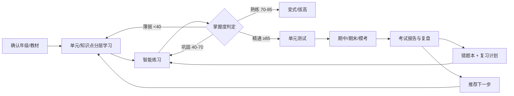
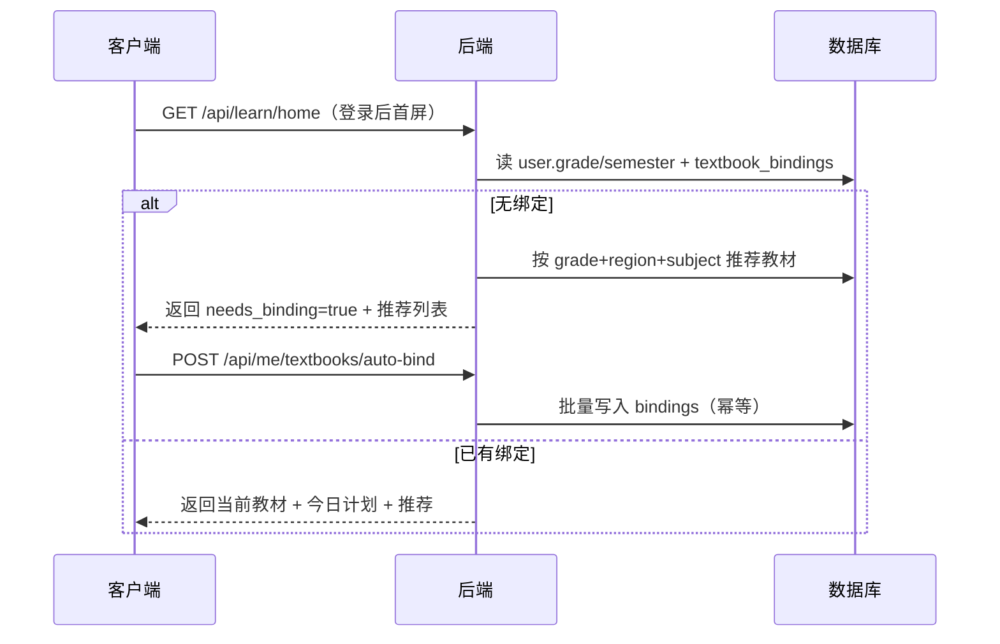
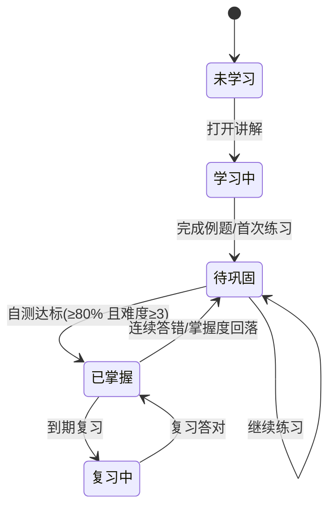
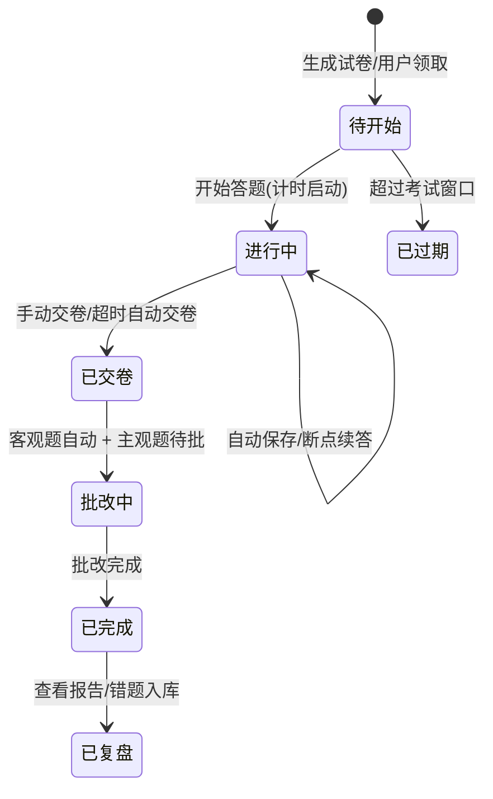
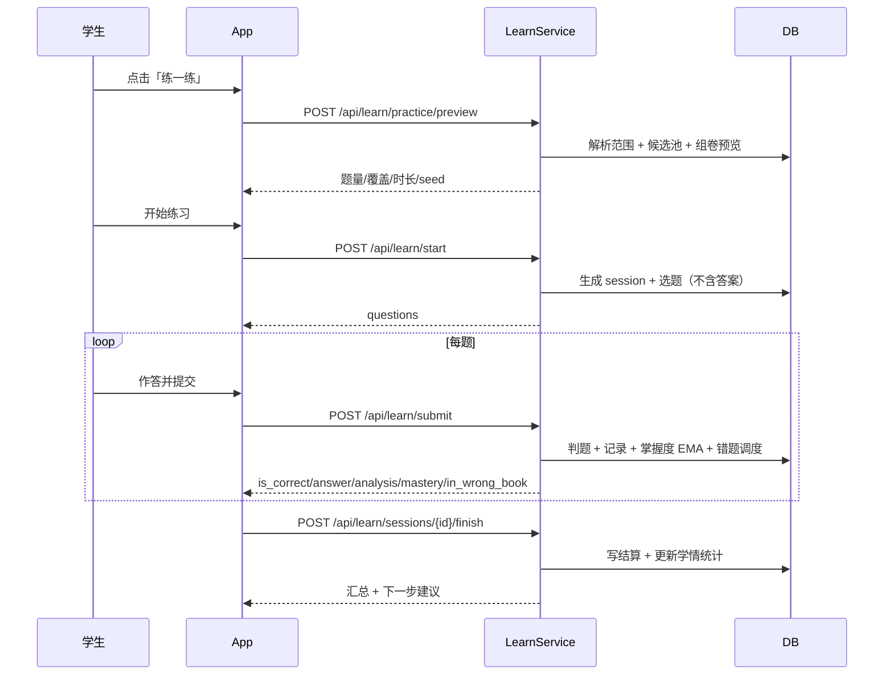
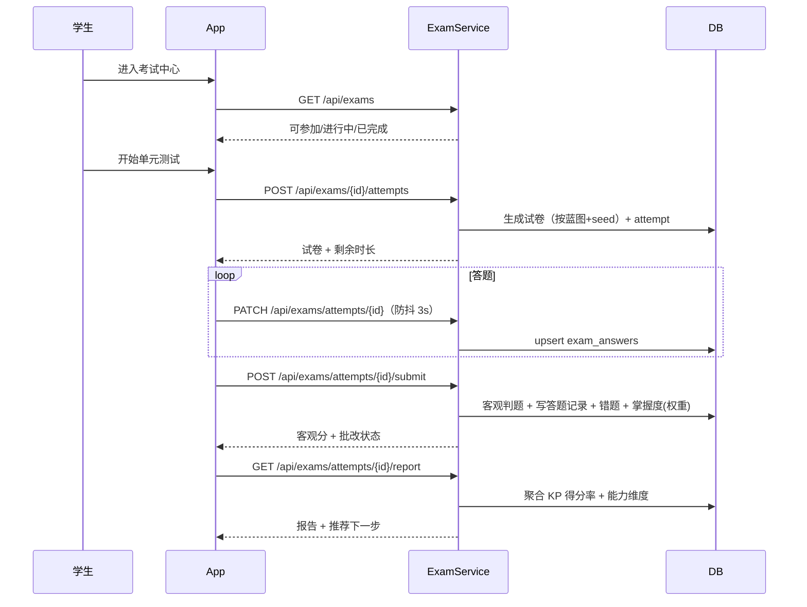

# 深爱学（AiLearning）学习页面功能设计方案

> **文档性质**：专项设计方案（学习主链路闭环蓝本）
> **版本**：v1.2
> **日期**：2026-11-06
> **最后更新**：2026-11-12（第二次修订：考试入口口径对齐、待办考试独立入口、考试入库/发布闭环，见 §8.7 / §12.4 / §14.2 L18~L20；对应主计划 CR-003 / EX-01~EX-03。第一次修订为练习模式与前置知识点，CR-002 / UX-04~UX-06）
> **关联文档**：[user-role-permission-design.md](./user-role-permission-design.md)、[k12-learning-app-design.md](./k12-learning-app-design.md)、[subject-tutoring-and-m2-design.md](./subject-tutoring-and-m2-design.md)
> **目标**：把当前"教材清单 + 章节列表"升级为"教材绑定 → 分层学习 → 智能练习 → 综合考试 → 复盘推荐"的完整闭环

---

## 目录

1. [现状盘点与问题定义](#一现状盘点与问题定义)
2. [设计目标与闭环模型](#二设计目标与闭环模型)
3. [信息架构与页面地图](#三信息架构与页面地图)
4. [用户与教材的关联绑定机制](#四用户与教材的关联绑定机制)
5. [教材选择入口设计](#五教材选择入口设计)
6. [知识点分层展示与深入学习路径](#六知识点分层展示与深入学习路径)
7. [智能辅助练习模块](#七智能辅助练习模块)
8. [综合考试体系设计](#八综合考试体系设计)
9. [交互逻辑与数据流转](#九交互逻辑与数据流转)
10. [用户操作流程](#十用户操作流程)
11. [数据模型设计](#十一数据模型设计)
12. [API 设计清单](#十二api-设计清单)
13. [异常与边界处理](#十三异常与边界处理)
14. [实施计划与验收标准](#十四实施计划与验收标准)
15. [附录：题型编码与组卷参数](#十五附录题型编码与组卷参数)

---

## 一、现状盘点与问题定义

### 1.1 现状（代码事实）

| 模块 | 现状 | 问题 |
|---|---|---|
| 学习页 `app/lib/features/learn/learn_page.dart` | 顶部欢迎卡 + "我的教材" ChoiceChip + 章节 ListTile | 教材以清单形式平铺，无"当前教材"概念；页面无学习任务、无推荐、无考试入口 |
| 教材数据 `Textbook(subject, grade, version, semester)` | 后端已登记 134 本教材，前端按 `grade` 拉取全部 | 学生与教材无绑定关系，每次进入都需重新点选；上下册同屏、信息噪音大 |
| 章节 `Chapter(textbook_id, grade, name, order_index)` | 只有"章"一层 | 缺少"节/知识点"两级下钻，无法承载学习路径 |
| 知识点 `KnowledgePoint(subject, name, parent_id, prerequisites, explanation)` | 已有树形与前置关系字段 | 前端未使用 `parent_id/prerequisites`，仅以"每章挂 1 个 KP"平铺展示 |
| 练习 `POST /api/learn/start` | 支持 `chapter_id/knowledge_point_id/subject/count` 自适应组卷 + 到期错题 | 无练习模式、无题型配比、无范围预览；入口只有一个"练一练" |
| 考试 `Exam/ExamSubmission` | 有 `questions JSON`、`total_score`、`time_limit_min` | 无试卷蓝图、无单元测/期中/期末分类、无答题过程、无报告与错题回流 |
| 学情 `MasteryScore/StudentQuestionRecord` | 掌握度 EMA、错题 SM-2 已就绪 | 考试数据未回流掌握度；无"下一步学什么"的推荐 |

### 1.2 问题定义

1. **教材未绑定**：学生身份（年级）与教材之间缺少持久关联，教材选择是"临时筛选"而不是"学习身份"。
2. **层次太浅**：教材 → 章节 → 题目，缺少"单元 → 节 → 知识点"的认知层级，无法表达先修关系与学习路径。
3. **练习单一**：只有"练一练"，没有同步巩固/专项突破/错题重练/考前速练等场景化模式。
4. **没有考试闭环**：单元测、期中、期末等高频刚需缺失，练习与考试数据割裂。
5. **页面无"下一步"**：进入学习页后需要用户自己找入口，缺少今日任务、继续学习、薄弱点推荐。

### 1.3 设计边界

- 覆盖小学 1-6、初中 7-9、高中 10-12 的同步学习与校內考试场景。
- 一期不做直播、不做教师实时互动课堂；教师布置作业作为 P2 扩展。
- 主观题（作文、解答题）一期采用"参考解析 + 自评/待批"混合方案，不做全自动语义评分。
- 离线能力：答题草稿本地暂存，联网后同步；不做整卷离线下载（P2）。

---

## 二、设计目标与闭环模型

### 2.1 目标

| 目标 | 衡量方式 |
|---|---|
| 学习身份明确 | 首次使用 3 步内完成年级 + 教材确认；进入学习页即展示"当前教材" |
| 路径可下钻 | 教材 → 单元 → 节 → 知识点，四层可逐级进入，任意层可发起练习 |
| 练习有针对性 | 每次练习知识点覆盖率 ≥ 80%，难度按掌握度分布，到期错题优先 |
| 考试成体系 | 单元测/期中/期末可自动组卷，客观题自动批改，报告含知识点得分率 |
| 数据全回流 | 练习与考试的错题 100% 进入错题本并生成复习计划；掌握度同步更新 |
| 下一步有推荐 | 学习页始终给出 1 个"继续学习"+ 1 个"推荐练习"+ 1 个"待办考试" |

### 2.2 闭环模型



核心原则：**学（讲解）—练（自适应）—测（单元/综合）—评（报告）—复（错题复习）** 五环相扣，任何一环产生的数据都回流到掌握度与推荐。

---

## 三、信息架构与页面地图

### 3.1 页面结构

```
学习 Tab
├── 学习首页 /learn
│   ├── 当前教材卡（学科切换、学期切换、换教材）
│   ├── 今日学习计划（继续学习 / 到期复习 / 待办测验）
│   ├── 学科入口（语文/数学/英语/…，按年级开课科目）
│   ├── 推荐练习（薄弱知识点 Top3）
│   └── 考试中心入口
├── 教材详情 /textbook/:id
│   ├── 单元列表（按 order_index）
│   └── 单元详情 /textbook/:id/unit/:chapterId
│       ├── 节列表
│       ├── 知识点列表（掌握度环 + 状态）
│       └── 单元测试入口
├── 知识点详情 /kp/:id
│   ├── 讲解（概念/公式/例题）
│   ├── 前置知识（按教材顺序，点击进入独立讲解页）
│   ├── 掌握度与作答历史
│   └── 开始练习（基础/变式/拔高）
├── 知识点独立讲解 /kp/:id/explain（v1.1 新增）
│   ├── 第一屏即讲解 + 例题，不重复前置/掌握度等详情
│   └── 底部「完整详情 / 练一练」按需下钻
├── 练习配置 /practice/config
│   └── 模式策略卡 + 各模式默认题量/题型/范围 + 组卷预览 → 开始
├── 答题 /practice/session
│   └── 逐题作答、反馈、结算
├── 学习首页「待办考试」卡（v1.2 新增）
│   └── pending_exams 按 entry 直达 /exam/:id 或 /past-papers
├── 考试中心 /exams
│   ├── 可参加（单元测/期中/期末/模考）
│   ├── 进行中（断点续答）
│   └── 已完成（报告）
├── 真题库 /past-papers（v1.2 提升为首页入口）
├── 考试管理与发布 /exams/manage（v1.2 新增，content:exam:write）
│   ├── 按蓝图组卷入库 POST /api/exams/generate
│   └── 派发班级同卷模考 POST /api/exams/mock
├── 考试详情 /exams/:id
├── 考试答题 /exams/:id/attempt
└── 考试报告 /exams/attempts/:id/report
```

### 3.2 学习首页布局（替换现有清单式页面）

```
┌────────────────────────────────────────────┐
│ 你好，小明   三年级 · 深圳   [切换年级]      │
├────────────────────────────────────────────┤
│ 当前教材                                    │
│ [数学 三上 北师大] [语文 三上 部编] [英语 3A 牛津深圳] │
│ 今日：第 3 单元 · 分数的初步认识            │
│ ▶ 继续学习：认识几分之一（上次学到 60%）     │
├────────────────────────────────────────────┤
│ 今日计划                                    │
│ · 到期复习 5 题           [去复习]           │
│ · 薄弱点：两位数乘法      [专项练习]         │
│ · 单元测试：第 3 单元     [去测一测]         │
├────────────────────────────────────────────┤
│ 学科                                   全部 >│
│ [语文] [数学] [英语] [科学] …                │
├────────────────────────────────────────────────┤
│ 考试中心                                    │
│ 单元测试 · 期中 · 期末 · 深圳模考           > │
└────────────────────────────────────────────┘
```

**设计要点**：

- 首屏只保留一个"当前教材"，其余学科以横向卡片呈现，避免上下册 + 多版本堆叠。
- "继续学习"由服务端聚合接口返回，不需要前端多次请求。
- 所有入口都带**预期收益**（到期 5 题 / 薄弱点 / 单元测），降低选择成本。

---

## 四、用户与教材的关联绑定机制

### 4.1 为什么需要绑定

当前实现是"按年级查询全部教材 → 用户点选"，属于**会话级筛选**。绑定后升级为**学习身份**，带来：

1. 进入学习页零选择成本，直接呈现当前教材与进度。
2. 练习、考试、错题的范围可自动限定，避免跨教材混题。
3. 学期切换、年级升级时系统可自动迁移。
4. 家长/教师看到的是"孩子实际在学的教材"，而不是一堆候选。

### 4.2 绑定模型

```
User(grade, region, semester)
        │ 自动派生（可覆盖）
        ▼
TextbookBinding(user_id, subject, textbook_id, source, is_primary, semester, status)
        │
        ▼
Chapter → Section → KnowledgePoint → Question
```

规则：

| 规则 | 说明 |
|---|---|
| 一学科一主教材 | 同一 `(user_id, subject, semester)` 仅 1 条 `is_primary=true AND status=active` |
| 自动绑定 | 依据 `grade + region + subject + semester` 匹配推荐版本（见 4.3） |
| 手动覆盖 | 用户可指定其他版本；`source=manual`，优先于自动规则，不随学期任务重置 |
| 学期归档 | 学期切换时旧绑定置 `archived`，新绑定按新学期生成；历史学情保留 |
| 年级升级 | 升级后自动重绑新年级教材；跨学段（6→7、9→10）需用户确认学科列表 |
| 冲突检测 | `textbook.grade != user.grade` → 标记 `mismatch`，首页提示"教材与年级不一致" |
| 解绑 | 允许解绑单个学科；解绑后该学科学习入口隐藏，历史数据保留 |
| 权限 | 仅本人可绑定；家长不可代替孩子改教材（避免误操作），校管可修正 |

### 4.3 深圳本地化推荐规则

| 学科 | 默认版本 | 说明 |
|---|---|---|
| 语文 | 部编版（人教版） | 全国统一 |
| 数学 | 北师大版 | 深圳主用；部分学校用人教版，允许手动切换 |
| 英语 | 牛津深圳版 | 小学起点；版本按年级 1A/1B… |
| 物理 / 化学 / 生物 | 人教版 | 初中起点（物理 8 年级、化学 9 年级、生物 7 年级） |
| 历史 / 道德与法治 | 部编版 | — |
| 地理 | 湘教版 | 部分学校用人教，允许切换 |
| 高中 | 人教版（新教材） | 按 3+1+2 选科组合推荐 |

推荐算法（服务端）：

```python
VERSION_PRIORITY = {
    "chinese": ["部编版", "人教版"],
    "math": ["北师大版", "人教版"],
    "english": ["牛津深圳版", "人教版"],
    "physics": ["人教版"], "chemistry": ["人教版"], "biology": ["人教版"],
    "history": ["部编版"], "politics": ["部编版"], "geography": ["湘教版", "人教版"],
}

def auto_bind(db, user):
    for subject in subjects_for_grade(user.grade):           # 按年级开课科目
        candidates = db.scalars(select(Textbook).where(
            Textbook.subject == subject,
            Textbook.grade == user.grade,
            Textbook.semester == user.semester,
            Textbook.is_active.is_(True),
        ))
        priority = VERSION_PRIORITY.get(subject, [])
        chosen = min(candidates, key=lambda t: priority.index(t.version)
                     if t.version in priority else len(priority))
        upsert_binding(user.id, subject, chosen.id, source="auto", is_primary=True)
```

### 4.4 绑定数据流



### 4.5 学期与升级

| 事件 | 时间 | 动作 |
|---|---|---|
| 学期切换 | 每年 2 月、9 月 | `users.semester` 更新；`bindings` 归档旧学期；按新学期自动绑定 |
| 年级升级 | 每年 9 月 1 日 | `grade+1`；教材重绑；跨学段要求确认学科；写 `grade_histories` |
| 教材改版 | 运营发布新版本 | 旧绑定保持 `active` 直到用户确认或学期结束；首页提示"有新版本" |
| 转学/换版本 | 用户手动 | 手动绑定覆盖自动规则，`source=manual` |

---

## 五、教材选择入口设计

### 5.1 入口分布

| 入口 | 位置 | 场景 | 交互 |
|---|---|---|---|
| 首次引导 | 注册/首次登录后 | 新生首次使用 | 全屏 3 步：选年级 → 确认学科 → 确认教材（默认推荐可改） |
| 当前教材卡 | 学习首页顶部 | 日常切换学科 | 学科 Chip 横滑；点击"换教材"进入教材管理 |
| 教材管理页 | 我的 → 教材管理 | 换版本/换学期 | 按学科列出已绑定教材，支持切换版本、解绑、查看教材目录 |
| 学期切换 | 学习首页顶部 | 寒暑假后 | 顶部提示"切换为下学期"，一键更新绑定 |
| 教师指定 | （P2）班级作业 | 教师布置统一教材 | 以班级教材为准，学生端只读展示 |

### 5.2 教材选择页设计

```
┌────────────────────────────────────────────┐
│ 选择教材                                    │
│ 学科   [语文] [数学] [英语]                  │
│ 年级   三年级 ▾    学期  [上册] [下册]       │
│ 版本                                    │
│ ○ 北师大版（推荐）  深圳主用                 │
│ ○ 人教版           部分学校使用              │
│ 预览：第 1 单元 混合运算 …                   │
│                    [取消]  [确认使用]        │
└────────────────────────────────────────────┘
```

交互规则：

| 规则 | 说明 |
|---|---|
| 推荐置顶 | 按 4.3 规则标记"推荐"，默认选中 |
| 只展示可用 | `is_active=true` 且有章节的教材才可选 |
| 冲突提示 | 选择 `grade != user.grade` 的教材需二次确认（用于补课/预习场景） |
| 即时生效 | 确认后刷新首页、练习范围、考试范围；已生成的练习不受影响 |
| 幂等 | 重复提交同一教材不产生重复绑定 |
| 空态 | 该学科该学期暂无教材 → 展示"敬请期待"+ 可切换其他版本/学期 |

### 5.3 展示规则

- 教材名称统一格式：`学科 + 年级 + 学期 + 版本`，如"数学 三年级上册 北师大版"。
- 上下册不同时平铺：通过学期切换器控制，避免 6 个 Chip 并列。
- 当前教材高亮 + 学习进度（"已学 3/8 单元"）。

---

## 六、知识点分层展示与深入学习路径

### 6.1 四层结构

| 层级 | 实体 | 现有字段 | 说明 |
|---|---|---|---|
| L0 教材 | `Textbook` | subject/grade/version/semester | 学习身份 |
| L1 单元 | `Chapter` | textbook_id/order_index/summary | 教材单元（章） |
| L2 节 | `KnowledgePoint(node_type='section', parent_id=NULL)` | name/grade | 单元下的节（新增节点类型，复用现有表） |
| L3 知识点 | `KnowledgePoint(node_type='point', parent_id=节id)` | explanation/prerequisites | 最小学习与测评单位 |

> 兼容策略：现有数据 `parent_id` 为空且 `node_type` 缺省 → 视为 L3 知识点并自动补一节（"默认节"），不破坏已有种子数据。

### 6.2 三种视图

| 视图 | 用途 | 交互 |
|---|---|---|
| **目录视图**（默认） | 按教材顺序学习 | 单元折叠列表 → 节 → 知识点，显示掌握度环与状态 |
| **图谱视图** | 看知识关联与前置 | 以 `prerequisites` 连线；点击节点进入详情；薄弱节点红色高亮 |
| **掌握度热力** | 快速定位薄弱单元 | 单元卡片按平均掌握度着色（红/橙/蓝/绿） |

### 6.3 知识点卡片信息

```
┌──────────────────────────────────────────┐
│ ◯ 62   认识几分之一            [巩固中]   │
│ 讲解：把一个整体平均分成若干份…           │
│ 前置：平均分（掌握 78）                   │
│ 3 题 · 上次学习 2 天前                    │
│                      [去学习]  [练一练]   │
└──────────────────────────────────────────┘
```

- 环颜色：`<40` 红、`40-70` 橙、`70-85` 蓝、`≥85` 绿（与现有 `mastery_band` 一致）。
- 状态：`未学习 / 学习中 / 待巩固 / 已掌握 / 复习中`。

### 6.4 深入学习路径（五步法）

| 步骤 | 内容 | 完成条件 | 数据写入 |
|---|---|---|---|
| ① 导学 | 学习目标、前置知识检查 | 阅读完成 | `KpStudyState.started_at` |
| ② 讲解 | 概念/公式/例题（图文，预留 AI 讲解） | 阅读完成 | `read_at` |
| ③ 例题 | 1-2 道示范题，带完整解析 | 答对或查看解析 | 答题记录（不计入掌握度或低权重） |
| ④ 变式 | 3-5 道同类变式 | 正确率 ≥ 60% | 掌握度 EMA 更新 |
| ⑤ 自测 | 5-8 道混合题（含 1 道拔高） | 正确率 ≥ 80% 且难度达标 | 掌握度更新，达标可标记"已掌握" |

**门禁规则**（避免无效刷题）：

```
掌握度 < 40  → 必须先完成「讲解」，否则练习只出基础题并提示先学
40 ≤ 掌握度 < 70 → 允许练习，默认基础 + 变式
70 ≤ 掌握度 < 85 → 默认变式 + 拔高
掌握度 ≥ 85 → 建议挑战题 / 进入下一知识点或单元测
前置知识掌握度 < 40 → 提示"建议先补齐前置：X"，提供一键跳转
```

### 6.5 状态机



### 6.6 推荐"下一步"规则

优先级从高到低：

1. 今日到期复习题 > 0 → "去复习"。
2. 当前单元存在 `掌握度 < 40` 的知识点 → "先学讲解"。
3. 存在 `40-70` 的知识点 → "专项练习"。
4. 当前单元全部 ≥ 70 且未做过单元测 → "单元测试"。
5. 学期进度落后（已学单元 < 当前周应学单元）→ "继续学习下一节"。
6. 无以上 → "每日一练"（保持手感）。

### 6.7 前置知识点排序与独立讲解页（v1.1 新增）

| 项 | 规则 |
|---|---|
| 排序 | `GET /api/learn/kp/{id}` 的前置按 `section.order_index → kp.order_index → prerequisites 声明顺序` 输出，附带 `order_index/section_order/section_name/has_explanation`；不再依赖无 `ORDER BY` 的 `IN` 查询与 dict 顺序 |
| 离线一致 | 离线整册包 `_ordered_prerequisites()` 只取当前知识点自己声明的前置并按同一规则排序；旧实现把整册前置塞给每个详情，已修 |
| 详情页展示 | 前置区改为紧凑编号列表（序号 / 名称 / 节名 / 掌握度圆点 / chevron），标题标注「N 个 · 按教材顺序」；前端 `sortedPrerequisites()` 对旧离线包缺字段按 id 稳定兜底 |
| 点击去向 | 前置项 → `/kp/:id/explain` 独立讲解页，第一屏即讲解卡 + 例题；掌握度、前置依赖、状态等留在 `/kp/:id` 完整详情，底部提供「完整详情 / 练一练」 |
| 路由约束 | GoRouter 中 `/kp/:kpId/explain` 必须注册在 `/kp/:kpId` 之前 |

---

## 七、智能辅助练习模块

### 7.1 练习模式

| 模式 | 入口 | 范围 | 题量 | 反馈 | 目的 |
|---|---|---|---|---|---|
| 同步巩固 | 知识点"练一练" | 单知识点 | 6-15 | 即时 | 当天所学及时巩固 |
| 专项突破 | 薄弱点推荐 / 知识点详情 | 单知识点或同类 KP 集合 | 10-20 | 即时 | 集中攻克薄弱 |
| 错题重练 | 错题本 / 首页今日计划 | 到期错题 | 到期数量 | 即时 | SM-2 复习闭环 |
| 单元综合 | 单元详情 | 整章 | 15-25 | 即时/延后 | 单元内知识串联 |
| 考前速练 | 考试中心 | 多单元/整册高频考点 | 20-30 | 延后 | 考前查漏 |
| 每日一练 | 首页 | 当前教材近期知识点 | 5-10 | 即时 | 保持学习习惯 |

#### 7.1.1 三种模式组卷策略落地（v1.1）

> 旧实现三个分段只改 `mode` 字符串，`build_plan` 不消费它，同 seed 下出同一套题。以下为落地后的真实策略。

| mode | 默认题量 | 默认范围 | 近 7 天答题排重 | 到期错题配额 | 选题/排序 | 知识点覆盖 |
|---|---|---|---|---|---|---|
| `special` 专项突破 | 10 | 整册教材 | 排除 | 25% | 掌握度 < 60 的薄弱 KP 优先 | 常规覆盖 |
| `sync` 同步巩固 | 15 | 本单元 | 排除 | 15% | 教材章节 → 知识点 → 难度由易到难 | 均衡覆盖 |
| `pre_exam` 考前速练 | 20 | 整册教材 | 不排重 | 0 | 考试题型配比、难度递进 | 要求全覆盖 |
| `unit` 单元测 | 沿用原蓝图 | 单元 | 沿用 | 沿用 | 蓝图 | 蓝图 |

- 后端 `services/practice.py` 的 `ModePolicy` / `MODE_POLICIES` 统一消费 `exclude_recent / due_quota_ratio / weak_first / cover_all_kps / textbook_order / difficulty_order`；`select_questions` 支持薄弱 KP 桶前移与全覆盖目标。
- 前端 `core/models/practice_mode.dart` 的 `PracticeModeSpec` 定义三模式默认题量、题型与优先范围；切换模式重置 seed、套用默认值并展示策略卡；学习首页新增三个独立入口，把 `mode` 传入 `/practice/config`。
- 预览与 `/learn/start` 消费同一策略，返回 `mode / mode_label / strategy`；`mode` 白名单 `special|sync|pre_exam|unit`，未知值 422。离线组卷按 `sync`/`pre_exam` 的排序规则兜底。

### 7.2 题型体系（按学科 × 学段）

| 学科 | 小学 | 初中 | 高中 |
|---|---|---|---|
| 语文 | 字词、古诗默写、句子、阅读理解、看图写话 | 基础积累、文言文、现代文阅读、作文 | 论述类/文学类阅读、文言文、默写、作文 |
| 数学 | 口算、选择、填空、判断、解决问题 | 选择、填空、计算、证明、应用题 | 单选、多选、填空、解答 |
| 英语 | 字母/单词、单选、判断、听写、句型 | 听力、单选、完形、阅读、写作 | 听力、阅读、七选五、完形、语法填空、写作 |
| 物理 | —（3-6 科学） | 选择、填空、实验探究、计算 | 单选、多选、实验、计算 |
| 化学 | — | 选择、填空、实验、计算 | 单选、多选、工艺流程、实验探究 |
| 生物 | — | 选择、填空、识图、实验 | 单选、多选、实验设计、遗传计算 |
| 历史 | — | 选择、材料分析、简答 | 单选、材料分析、论述 |
| 地理 | — | 选择、读图、填图、简答 | 单选、综合题 |
| 道德与法治 | — | 选择、辨析、材料分析 | 单选、材料分析、论述 |

> 题型编码见[附录 15.1](#151-题型编码)。

### 7.3 组卷算法（在现有 `choose_questions` 上扩展）

现有能力：到期错题优先（quota ≈ count/4，上限 3）+ 按掌握度映射难度 + 就近降级补齐。
新增约束：

```python
def build_practice(db, user, scope, count, mode):
    # 1) 范围解析
    kp_ids = resolve_kp_ids(scope)             # 知识点/章节/单元/教材
    if not kp_ids: raise EmptyScope

    # 2) 配额
    quota_wrong = min(max(count // 4, 1), 5) if mode != "exam" else 0
    quota_new   = count - quota_wrong

    # 3) 知识点覆盖：每个 KP 至少 1 题，最多 ceil(count/len(kp_ids)) 题
    per_kp = distribute(count=quota_new, kps=kp_ids, min_each=1, max_each=max(2, count//3))

    # 4) 题型配比（按学科/学段模板，见 15.2）
    type_ratio = TYPE_RATIO[subject][stage]

    # 5) 难度分布：按 KP 掌握度取 DIFFICULTY_MIX，再做整卷 6:3:1 校准
    # 6) 去重：排除最近 7 天已做题（同 KP 同题干哈希）
    # 7) 时长预算：Σ 预估用时 ≤ 用户单次上限；超时按低难度优先裁剪
    # 8) 兜底：不足题量时降级放宽（先同章、再同学科、最后跨年级预警）
    return assemble(per_kp, type_ratio, difficulty_mix, exclude_recent=True)
```

**关键指标**（可测）：

- 知识点覆盖率 = 覆盖 KP 数 / 范围 KP 数 ≥ 80%（范围 KP ≤ 3 时要求 100%）。
- 题型偏差 ≤ 10%（实际题数 vs 蓝图比例）。
- 到期错题占比 ≤ 25%，避免"全是错题"打击信心。
- 同题重复率 = 0（7 天内）。

### 7.4 练习配置页

```
┌────────────────────────────────────────────┐
│ 专项练习 · 两位数乘法                       │
│ 范围   ● 当前知识点   ○ 本单元   ○ 整册     │
│ 题量   [10] [15] [20]                       │
│ 题型   ☑选择 ☑填空 ☑判断 ☐解答              │
│ 反馈   ● 每题即时   ○ 做完统一看解析         │
│ 预计   8 分钟 · 15 题 · 覆盖 3 个知识点      │
│                    [开始练习]                │
└────────────────────────────────────────────┘
```

规则：

- 题量受年级默认上限约束（见权限文档 4.2）。
- 至少选择 1 种题型；题型不可用（无题）时置灰并提示。
- "预计时长/题量/覆盖知识点"由 `POST /api/learn/practice/preview` 返回，避免开始后才发现题不够。
- 预览与开始使用同一随机种子（`seed` 随请求返回并回传），保证所见即所得。

### 7.5 答题与反馈

| 题型 | 作答控件 | 判题 | 反馈内容 |
|---|---|---|---|
| 单选 | 选项列表 | 自动 | 正误、正确答案、解析、掌握度 |
| 多选 | 多选列表 | 自动（排序管道符比较） | 同上 + 漏选/多选提示 |
| 判断 | 正确/错误 | 自动 | 同上 |
| 填空 | 文本框 | 自动（容错：空格、全角、等价答案） | 同上 |
| 解答/作文 | 文本/图片（P2） | 自评 / 教师批改 | 参考答案、评分点、自评量表 |

交互细节：

- 提交后按钮变为"下一题"，最后一题变"完成练习"。
- 答错自动入错题本（现有 `in_wrong_book` 字段），并提示"明天可在错题本复习"。
- 连续答错 2 题时插入"看讲解"快捷入口（避免挫败）。
- 中途退出弹窗确认，草稿本地保存（`PracticeSession` 状态），可续答。

### 7.6 结算页

| 内容 | 说明 |
|---|---|
| 得分概览 | 答对/总数、正确率、用时 |
| 知识点表现 | 每个 KP 的本次正确率与掌握度变化（+Δ） |
| 错题清单 | 题目、正确答案、错因快捷标注 |
| 下一步 | "再练一次 / 专项突破 / 去错题本 / 返回学习页" |
| 数据回流 | 掌握度 EMA 已更新；错题已调度；学情统计已刷新 |

---

## 八、综合考试体系设计

### 8.1 考试类型

| 类型 | 编码 | 范围 | 时长 | 满分 | 触发 |
|---|---|---|---|---|---|
| 单元测试 | `unit` | 单个 `Chapter` | 30-45 min | 100 | 单元学完 / 手动 |
| 期中考试 | `midterm` | 前半册章节集合 | 60-90 min | 100 | 学期中 / 手动 |
| 期末考试 | `final` | 整册章节集合 | 90-120 min | 100 | 学期末 / 手动 |
| 模考 | `mock` | 深圳一模/二模/真题 | 按真实 | 按真实 | 考试中心 |
| 自定义测验 | `custom` | 教师指定范围（P2） | 可配 | 可配 | 教师布置 |

### 8.2 试卷蓝图（Blueprint）

试卷不再用"题目 JSON 硬编码"，改为**蓝图 + 实例**：

```json
{
  "code": "math_primary_grade3_final",
  "subject": "math",
  "grade": 3,
  "exam_type": "final",
  "total_score": 100,
  "time_limit_min": 80,
  "sections": [
    {"name": "一、计算", "q_type": "fill",  "count": 10, "score_each": 3, "difficulty": [1,2]},
    {"name": "二、填空", "q_type": "fill",  "count": 8,  "score_each": 2, "difficulty": [1,3]},
    {"name": "三、选择", "q_type": "choice","count": 8,  "score_each": 3, "difficulty": [2,3]},
    {"name": "四、解决问题", "q_type": "solve", "count": 6, "score_each": 5, "difficulty": [2,4]}
  ],
  "kp_coverage_min": 0.8,
  "difficulty_mix": {"easy": 0.6, "medium": 0.3, "hard": 0.1}
}
```

典型模板（节选）：

| 学段学科 | 结构示例 |
|---|---|
| 小学语文三上期末 | 积累与运用 40（字词 12/古诗 8/句子 10/口语交际 10）+ 阅读 30 + 习作 30；90 min |
| 小学数学三上期末 | 计算 30 + 填空 20 + 选择 20 + 解决问题 30；80 min |
| 小学英语 3A 期末 | 听力 30 + 选择 20 + 阅读 20 + 书写 20 + 口语 10（选做）；60 min |
| 初中数学九上期末 | 选择 30 + 填空 18 + 解答 52；120 min |
| 初中物理八上期末 | 选择 30 + 填空 20 + 实验探究 30 + 计算 20；90 min |
| 高中语文高一期末 | 现代文阅读 35 + 文言文 20 + 默写 10 + 语言运用 15 + 作文 40（或 150 分制）；150 min |

### 8.3 组卷规则

1. **范围**：按 `chapter_ids` / `knowledge_point_ids` 解析候选题池。
2. **题型配比**：严格按蓝图 `sections.count`，不足时允许 ±1 并按分值补偿。
3. **知识点覆盖**：≥ 80% 的 KP 至少 1 题；核心 KP（权重高/课时多）至少 2 题。
4. **难度分布**：整卷 6:3:1（易:中:难）；单元测可 7:2:1。
5. **去重**：同一试卷内题干哈希唯一；14 天内已考过的题不重复（可选）。
6. **稳定性**：同一用户同一蓝图在同一考试窗口内生成**同一套卷**（按 `user_id + blueprint_id + exam_window` 播种），避免刷新换卷。
7. **公平性**：选项顺序可乱序（按 seed）；同一班级使用同一套卷（P2）。
8. **兜底**：题量不足时按"先同单元 → 再同学科 → 再降难度"补齐，并在试卷上标注"题量不足"。

### 8.4 考试生命周期



关键规则：

| 环节 | 规则 |
|---|---|
| 开始 | 校验年级/教材范围；展示须知（时长、题量、分值、可否中途退出） |
| 计时 | 服务端记录 `started_at` 与剩余时长；客户端仅展示，防篡改 |
| 自动保存 | 每题作答后 3 秒防抖 `PATCH`；断网写本地队列，恢复后重放 |
| 交卷 | 二次确认；超时服务端强制交卷（以服务端时间戳为准） |
| 重复提交 | `attempt_id + submit_token` 幂等；重复提交返回已生成结果 |
| 客观题 | 交卷即判，写 `StudentQuestionRecord`（`source=exam`） |
| 主观题 | 一期：展示参考答案 + 学生自评量表；P2：教师批改 |
| 错题回流 | 错题 100% 入错题本；`wrong_reason` 默认 `other`，可后标注 |
| 掌握度 | 考试题目按权重更新：单元测 0.8、期中 0.6、期末 0.5（判断题/主观题权重更低） |
| 报告 | 交卷后即时生成客观部分，主观批改后刷新 |

### 8.5 考试报告

| 区块 | 内容 |
|---|---|
| 总分概览 | 得分/满分、班级平均（有班级时）、用时、正确率 |
| 题型得分 | 各题型得分率（计算/填空/选择/解答） |
| 知识点得分率 | 按 KP 聚合，红黄绿三色，定位薄弱 |
| 能力维度 | 理解/计算/应用/分析（按学科配置）雷达图 |
| 错题清单 | 逐题：你的答案、正确答案、解析、错因标注入口 |
| 下一步 | "薄弱点专项练习""错题重练""再考一次（换卷）" |

报告与学习页联动：报告中的薄弱 KP 直接写入推荐池，次日出现在首页"推荐练习"。

### 8.6 防作弊与体验平衡（轻量）

- 服务端计时 + 交卷时间戳校验；客户端时间仅展示。
- 切屏/后台记录次数（仅记录，不强制交卷），报告可见。
- 选项乱序按 seed，同一用户稳定；不承诺强防作弊（非高利害考试）。

### 8.7 考试入口与考试入库闭环（v1.2 新增）

> 来源：2026-11-12 PM 反馈「App 端考试入口功能依然未完成」。
> **实测根因**：`build_pending_exams()` 把 `is_past_paper` 真题、`source='assignment'` 作业卷、非本班班级卷都算进首页待办；`GET /api/exams` 对学生恰好排除这些卷。EBG 真机出现「首页 2 场考试待完成 → 考试中心 0 场」的**入口虚标**。

#### 8.7.1 口径契约（先修数据，再修入口）

| 来源 | 计入条件 | 排除 |
|---|---|---|
| `GET /api/learn/home.pending_exams` | `status=published`、年级匹配、未交卷、窗口未关闭、非真题/非作业卷、班级卷限本班 | `is_past_paper=true`、`source='assignment'`、`class_id` 不在本班、已交卷、`closed` |
| `GET /api/exams`（学生） | 同上 | 同上 |
| 真题 | 仅 `GET /api/exams/past-papers` 与首页「真题库」 | 通用考试列表 |

- 两处共用同一可见性过滤（避免再次漂移）；`pending_exams` 每条带 `entry`（`exam` / `past_paper`）、`subject`、`window_state`，供前端直达。
- 已完成但缺 `attempt` 的列表卡片必须给明确提示，禁止静默无响应。

#### 8.7.2 首页入口

- 落地 §2.1 / §3.2 要求的「待办考试」独立卡：最多 3 条，展示标题、类型与窗口状态；`entry=exam` 直达 `/exam/:id`，`entry=past_paper` 直达 `/past-papers`；`scheduled`/`closed` 给 SnackBar；无待办显示空态卡。
- 「考试入口」区由 2 张扩为 3 张：**考试中心 / 真题库 / 班级作业**；考试中心副标题与列表同口径，不再虚标。
- 首页「我的」按 `content:exam:write` 显示「考试管理与发布」入口。

#### 8.7.3 考试入库（生成/派发）

| 动作 | 入口 | 接口 | 权限 |
|---|---|---|---|
| 可选蓝图 | 「我的 → 考试管理与发布」 | `GET /api/exams/blueprints`（v1.2 新增） | `content:exam:write` |
| 按蓝图组卷并发布（入库） | 同上 | `POST /api/exams/generate` | `content:exam:write` |
| 派发班级同卷模考 | 同上 | `POST /api/exams/mock` | `learn:assignment:create` |

`/exams/manage` 提交后展示 `exam_id` / 题量 / 总分 / KP 覆盖 / 难度分布 / 兜底数，并允许把新卷直接派发到班级；生成结果立即进入学生可见考试列表，形成「入库 → 入口 → 作答」闭环。

---

## 九、交互逻辑与数据流转

### 9.1 页面 × 动作 × 数据

| 页面 | 主操作 | 调用 API | 写入数据 | 反馈 |
|---|---|---|---|---|
| 学习首页 | 加载 | `GET /api/learn/home` | — | 当前教材、今日计划、推荐、待办考试 |
| 学习首页 | 切换学科/学期 | `POST /api/me/textbooks/bind` | `textbook_bindings` | 首页刷新、进度重算 |
| 教材详情 | 加载单元 | `GET /api/learn/textbook/{id}/units` | — | 单元列表 + 掌握度热力 |
| 单元详情 | 加载节/知识点 | `GET /api/learn/unit/{chapterId}` | — | 节与 KP、状态、前置 |
| 知识点详情 | 加载讲解 | `GET /api/learn/kp/{id}` | `KpStudyState.read_at` | 讲解、例题、前置、历史 |
| 练习配置 | 预览 | `POST /api/learn/practice/preview` | — | 题量、覆盖、时长、seed |
| 练习答题 | 开始 | `POST /api/learn/start` | `practice_sessions` | 题目列表（不含答案） |
| 练习答题 | 提交单题 | `POST /api/learn/submit` | `student_question_records`、`mastery_scores`、`wrong_questions` | 正误、解析、掌握度、错题提示 |
| 练习结算 | 完成 | `POST /api/learn/sessions/{id}/finish` | `practice_sessions.finished_at` | 汇总、下一步 |
| 考试中心 | 加载 | `GET /api/exams?type=&status=` | — | 可参加/进行中/已完成 |
| 考试详情 | 开始 | `POST /api/exams/{id}/attempts` | `exam_attempts` | 试卷、剩余时长、须知 |
| 考试答题 | 自动保存 | `PATCH /api/exams/attempts/{id}` | `exam_answers` | 保存时间戳 |
| 考试答题 | 交卷 | `POST /api/exams/attempts/{id}/submit` | `exam_attempts.submitted_at`、答题记录、错题 | 客观分、批改状态 |
| 考试报告 | 查看 | `GET /api/exams/attempts/{id}/report` | — | 得分、KP 得分率、错题、建议 |
| 错题本 | 复习 | `GET /api/learn/review/today` → 练习答题 | 同练习 | 复习闭环 |

### 9.2 单次练习数据流



### 9.3 考试数据流



### 9.4 数据一致性规则

| 场景 | 规则 |
|---|---|
| 掌握度更新 | 单事务：判题 + 记录 + EMA + 错题调度；失败整体回滚 |
| 重复提交 | `submit_token` 幂等，返回首次结果 |
| 考试交卷 | 以服务端时间 + 已保存答案为准；未保存的作答按空处理 |
| 错题入库 | 练习与考试共用 `upsert_wrong_question`，同一题只一行 |
| 学情统计 | 实时查询（现有实现）→ P1 增加缓存，练习/考试后失效 |
| 教材切换 | 只影响后续练习/考试范围；历史记录保留原 `textbook_id` 快照 |

---

## 十、用户操作流程

### 10.1 首次使用（3 步完成身份确认）

```
登录成功
 → [1] 选择年级（必选）
 → [2] 确认开课学科（默认按年级）
 → [3] 确认教材（默认推荐，可展开修改）
 → 自动绑定教材 → 进入学习首页（展示今日计划）
```

### 10.2 日常学习（10-20 分钟）

```
学习首页
 → 看到「继续学习：认识几分之一」
 → 知识点详情：讲解（2 分钟）
 → 例题（1 题）
 → 变式练习（5 题，即时反馈）
 → 结算：掌握度 35 → 62
 → 首页推荐更新为「专项突破：分数比较」
```

### 10.3 考前复习

```
考试中心 → 期末考试（可参加）
 → 查看范围与时长
 → 开始答题（断点续答）
 → 交卷 → 客观分即时 → 报告
 → 「薄弱点：分数加减」→ 一键专项练习
 → 错题自动进入错题本，次日复习
```

### 10.4 错题复习（每日 5-10 分钟）

```
首页「到期复习 5 题」→ 复习答题
 → 答对：streak+1，间隔 1→3→7 天
 → 连续答对 3 次且难度≥3：标记已消灭
 → 答错：重置间隔、ease 下调，继续留在错题本
```

---

## 十一、数据模型设计

### 11.1 新增表

```sql
-- 1) 教材绑定
CREATE TABLE textbook_bindings (
  id BIGINT PRIMARY KEY,
  user_id BIGINT NOT NULL,
  subject VARCHAR(20) NOT NULL,
  textbook_id BIGINT NOT NULL,
  semester VARCHAR(10) NOT NULL,
  source VARCHAR(20) DEFAULT 'auto',        -- auto|manual|teacher
  is_primary BOOLEAN DEFAULT TRUE,
  status VARCHAR(20) DEFAULT 'active',      -- active|archived
  bound_at DATETIME DEFAULT CURRENT_TIMESTAMP,
  UNIQUE (user_id, subject, semester, textbook_id)
);
CREATE INDEX ix_binding_user_subject ON textbook_bindings(user_id, subject, status);

-- 2) 知识点学习状态
CREATE TABLE kp_study_states (
  id BIGINT PRIMARY KEY,
  user_id BIGINT NOT NULL,
  knowledge_point_id BIGINT NOT NULL,
  state VARCHAR(20) DEFAULT 'not_started',  -- not_started|learning|to_consolidate|mastered|reviewing
  read_at DATETIME NULL,
  example_done_at DATETIME NULL,
  self_test_passed_at DATETIME NULL,
  last_study_at DATETIME NULL,
  UNIQUE (user_id, knowledge_point_id)
);

-- 3) 练习会话（支撑续答与结算）
CREATE TABLE practice_sessions (
  id BIGINT PRIMARY KEY,
  user_id BIGINT NOT NULL,
  mode VARCHAR(20) NOT NULL,               -- sync|special|wrong|unit|pre_exam|daily
  scope_type VARCHAR(20) NOT NULL,         -- kp|chapter|textbook|wrong
  scope_ids JSON NULL,
  question_ids JSON NOT NULL,
  total_count INT NOT NULL,
  answered_count INT DEFAULT 0,
  correct_count INT DEFAULT 0,
  seed BIGINT NOT NULL,
  started_at DATETIME DEFAULT CURRENT_TIMESTAMP,
  finished_at DATETIME NULL
);

-- 4) 试卷蓝图
CREATE TABLE exam_blueprints (
  id BIGINT PRIMARY KEY,
  code VARCHAR(60) UNIQUE NOT NULL,
  subject VARCHAR(20) NOT NULL,
  grade INT NOT NULL,
  exam_type VARCHAR(20) NOT NULL,          -- unit|midterm|final|mock|custom
  total_score INT NOT NULL,
  time_limit_min INT NOT NULL,
  sections JSON NOT NULL,
  kp_coverage_min FLOAT DEFAULT 0.8,
  difficulty_mix JSON NULL,
  is_active BOOLEAN DEFAULT TRUE
);

-- 5) 考试作答（现有 Exam 扩展）
ALTER TABLE exams ADD COLUMN blueprint_id BIGINT NULL;
ALTER TABLE exams ADD COLUMN exam_type VARCHAR(20) DEFAULT 'mock';
ALTER TABLE exams ADD COLUMN chapter_ids JSON NULL;
ALTER TABLE exams ADD COLUMN status VARCHAR(20) DEFAULT 'published';

CREATE TABLE exam_attempts (
  id BIGINT PRIMARY KEY,
  user_id BIGINT NOT NULL,
  exam_id BIGINT NOT NULL,
  seed BIGINT NOT NULL,
  status VARCHAR(20) DEFAULT 'in_progress', -- in_progress|submitted|grading|graded|expired
  started_at DATETIME DEFAULT CURRENT_TIMESTAMP,
  submitted_at DATETIME NULL,
  duration_ms INT DEFAULT 0,
  objective_score FLOAT DEFAULT 0,
  subjective_score FLOAT NULL,
  total_score FLOAT NULL,
  submit_token VARCHAR(64) NULL,
  UNIQUE (user_id, exam_id, seed)
);

CREATE TABLE exam_answers (
  id BIGINT PRIMARY KEY,
  attempt_id BIGINT NOT NULL,
  question_id BIGINT NOT NULL,
  user_answer JSON NULL,
  is_correct BOOLEAN NULL,
  score FLOAT NULL,
  self_score FLOAT NULL,
  updated_at DATETIME DEFAULT CURRENT_TIMESTAMP,
  UNIQUE (attempt_id, question_id)
);
```

### 11.2 现有表扩展

| 表 | 变更 | 目的 |
|---|---|---|
| `knowledge_points` | 增加 `node_type`（`section`/`point`）、`order_index`、`weight` | 支撑"节 → 知识点"两级 |
| `questions` | 增加 `q_type` 扩展值（`solve`/`essay`/`experiment`/`reading`）、`score` | 支撑综合题与主观题 |
| `student_question_records` | 增加 `source`（`practice`/`exam`/`review`）、`session_id`/`attempt_id`、`kp_weight` | 区分数据来源与权重 |
| `mastery_scores` | 增加 `source_breakdown` JSON（练习/考试分别正确率） | 报告与解释性 |
| `exams` | 见 11.1 | 从"题目 JSON"升级为"蓝图生成" |

### 11.3 数据留存与合规

- 答题记录永久保留（用于学情曲线），用户注销后 30 天内匿名化。
- 考试作答原文属于未成年人学习数据，仅本人、绑定家长（可配置）、本校教师可见。
- 图片类作答（P2）单独对象存储，数据库只存 URL 与哈希。

---

## 十二、API 设计清单

### 12.1 学习首页与教材

| 方法 | 路径 | 说明 | 状态 |
|---|---|---|---|
| GET | `/api/learn/home` | 聚合首页：当前教材、今日计划、继续学习、推荐、待办考试 | 新增 |
| GET | `/api/me/textbooks` | 已绑定教材（按学科/学期） | 新增 |
| POST | `/api/me/textbooks/auto-bind` | 按年级自动绑定（幂等） | 新增 |
| POST | `/api/me/textbooks/bind` | 手动绑定/切换版本 | 新增 |
| DELETE | `/api/me/textbooks/{id}` | 解绑（历史保留） | 新增 |
| GET | `/api/me/textbooks/recommend` | 推荐版本（含理由） | 新增 |

### 12.2 分层内容

| 方法 | 路径 | 说明 | 状态 |
|---|---|---|---|
| GET | `/api/public/textbooks?grade=&subject=` | 教材列表 | 已有 |
| GET | `/api/public/chapters?textbook_id=` | 章（单元）列表 | 已有 |
| GET | `/api/learn/textbook/{id}/units` | 单元 + 进度 + 掌握度热力 | 新增（可复用 knowledge-tree 扩展） |
| GET | `/api/learn/unit/{chapterId}` | 节 + 知识点 + 状态 | 新增（扩展 knowledge-tree） |
| GET | `/api/learn/kp/{id}` | 知识点详情：讲解、例题、前置、历史 | 新增；v1.1 扩展 |
| GET | `/api/learn/knowledge-tree?textbook_id=` | 现有章→KP 树（兼容） | 已有，扩展 |

> v1.1：`KpBriefOut` 增 `order_index / section_order / section_name / has_explanation`，`prerequisites` 按 §6.7 的教材顺序输出；离线整册包同口径，且只返回本知识点声明的前置。前端新增页面路由 `/kp/:kpId/explain`（纯客户端路由，无新后端接口）。

### 12.3 练习

| 方法 | 路径 | 说明 | 状态 |
|---|---|---|---|
| POST | `/api/learn/practice/preview` | 组卷预览（题量/覆盖/时长/seed/模式策略） | 新增；v1.1 扩展 |
| POST | `/api/learn/start` | 生成练习（兼容旧参数） | 已有，扩展 mode/seed |

> v1.1：两者均按 §7.1.1 的 `ModePolicy` 组卷；`LearnStartIn.mode` / `PracticePreviewIn.mode` 白名单 `special|sync|pre_exam|unit`（未知值 422），`PracticePreviewOut` 与 `PracticePlan` 增加 `mode / mode_label / strategy`，与实际出题顺序一致。
| POST | `/api/learn/submit` | 单题提交 | 已有 |
| POST | `/api/learn/sessions/{id}/finish` | 结算 | 新增 |
| GET | `/api/learn/sessions/{id}` | 续答（含已答状态） | 新增 |
| GET | `/api/learn/wrong-questions` | 错题列表 | 已有 |
| POST | `/api/learn/wrong-questions/{id}/reason` | 错因标注 | 已有 |
| GET | `/api/learn/review/today` | 今日复习 | 已有 |
| GET | `/api/learn/stats` | 学情统计 | 已有 |

### 12.4 考试

| 方法 | 路径 | 说明 | 状态 |
|---|---|---|---|
| GET | `/api/exams?type=&status=` | 考试列表（可参加/进行中/已完成） | 扩展；v1.2 与 `pending_exams` 同口径 |
| GET | `/api/exams/{id}` | 试卷详情（不含答案） | 扩展 |
| GET | `/api/exams/blueprints` | 可选组卷蓝图（code/name/subject/grade/exam_type/total_score/time_limit_min） | v1.2 新增，需 `content:exam:write`，须注册在 `/{exam_id}` 之前 |
| GET | `/api/exams/past-papers` | 真题库 | 已有（P2-07）；v1.2 提升为首页入口 |
| POST | `/api/exams/{id}/attempts` | 开始/续答 | 新增 |
| PATCH | `/api/exams/attempts/{id}` | 自动保存答案 | 新增 |
| POST | `/api/exams/attempts/{id}/submit` | 交卷（幂等） | 新增 |
| GET | `/api/exams/attempts/{id}/report` | 报告 | 新增 |
| POST | `/api/exams/attempts/{id}/self-grade` | 主观题自评 | 新增（P1） |
| POST | `/api/exams/generate` | 按蓝图生成试卷并发布（入库） | 新增；v1.2 接入 App `/exams/manage` |
| POST | `/api/exams/mock` | 派发班级同卷模考 | 已有（P2-07）；v1.2 接入 App，需 `learn:assignment:create` |
| GET | `/api/learn/home` | `pending_exams` 增 `entry` / `subject` | v1.2 扩展，与 `/api/exams` 同可见性口径（§8.7.1） |

### 12.5 响应示例：学习首页聚合

```json
{
  "user": {"grade": 3, "semester": "first", "stage": "primary"},
  "current_textbooks": [
    {"subject": "math", "textbook_id": 1, "name": "数学 三年级上册 北师大版",
     "progress": {"units_done": 3, "units_total": 8, "avg_mastery": 61}},
    {"subject": "chinese", "textbook_id": 2, "name": "语文 三年级上册 部编版", "progress": {"units_done": 2, "units_total": 8}}
  ],
  "today_plan": {
    "due_review": 5,
    "recommended_kp": [
      {"id": 12, "name": "两位数乘法", "mastery": 38, "band": "weak", "action": "study_first"}
    ]
  },
  "continue_learning": {
    "kp_id": 9, "name": "认识几分之一", "mastery": 60, "last_study_at": "2026-11-04"
  },
  "pending_exams": [
    {"exam_id": 101, "title": "第 3 单元测试", "exam_type": "unit",
     "window_state": "open", "window_start": null, "window_end": null,
     "entry": "exam", "subject": "math"}
  ]
}
```

> v1.2：顶层 `pending_exams[]` 由 `student_visible_exam_clauses()` 过滤，与 `GET /api/exams` 同口径；真题（`is_past_paper`）、作业卷（`source='assignment'`）、非本班班级卷、草稿/已交卷/窗口关闭卷均不出现（§8.7.1、§12.4）。

---

## 十三、异常与边界处理

| 场景 | 处理 |
|---|---|
| 未完成年级确认 | 首页返回 `needs_grade=true`，客户端跳年级选择；学习内容接口返回 409 `GRADE_REQUIRED` |
| 未绑定教材 | 首页返回 `needs_binding` + 推荐列表；允许浏览公开目录但不可练习 |
| 教材与年级不一致 | 标记 `mismatch`，首页顶部提示；练习前二次确认 |
| 题量不足 | 预览返回 `insufficient=true` + 实际可出题数；用户可减少题量或扩大范围 |
| 练习中断 | 服务端保存 `practice_sessions`；本地草稿 24h 有效；续答从上次题号开始 |
| 断网 | 作答写本地队列；恢复后按 `client_seq` 重放；冲突以服务端为准 |
| 考试超时 | 服务端强制交卷，未保存答案按空；报告标注"超时交卷" |
| 重复交卷 | 幂等返回首次结果，不重复写错题/掌握度 |
| 主观题未批改 | 报告先展示客观分与"批改中"；不阻塞错题入库 |
| 内容下架 | 已生成的练习/试卷仍可完成；新请求返回"内容已更新" |
| 年级升级后旧教材 | 历史记录保留；首页提示切换新教材；未切换前练习限定旧教材范围并告警 |

---

## 十四、实施计划与验收标准

### 14.1 分期

| 阶段 | 范围 | 交付物 |
|---|---|---|
| **P0（1-2 迭代）** | 教材绑定（auto/manual）、学习首页聚合、单元/知识点两级下钻、练习配置与预览、会话续答、单元测试（客观题） | 新首页、教材管理页、知识点详情、练习配置页、单元测与报告（客观） |
| **P1** | 期中/期末蓝图与组卷、主观题自评、报告能力维度、推荐下一步、错题与考试联动优化 | 考试中心完整链路、报告页、推荐服务 |
| **P2** | 教师布置作业/班级统一卷、图谱视图、图片作答、离线整卷、AI 讲解 | 教师端、图谱、离线能力 |

### 14.2 验收标准（可测）

| 编号 | 验收项 | 判定 |
|---|---|---|
| L1 | 首次登录完成年级+教材确认 | ≤ 3 步；完成后首页展示"当前教材" |
| L2 | 教材绑定幂等 | 重复 auto-bind 不产生重复行 |
| L3 | 上下册不混排 | 首页仅展示当前学期教材；切换学期后自动更新 |
| L4 | 四层下钻 | 教材→单元→节→知识点均可进入，返回不丢状态 |
| L5 | 知识点状态与掌握度 | 状态机流转正确；环颜色与 `mastery_band` 一致 |
| L6 | 练习覆盖率 | 知识点覆盖率 ≥ 80%（KP≤3 时 100%） |
| L7 | 到期错题优先 | 错题占比 ≤ 25%，且到期错题优先出现 |
| L8 | 预览=实际 | 预览题量/覆盖/seed 与开始后一致 |
| L9 | 考试组卷 | 题型/分值/难度符合蓝图，偏差 ≤ 10% |
| L10 | 交卷幂等 | 重复提交不重复计分、不重复入库 |
| L11 | 报告正确性 | 客观分 = 逐题得分之和；KP 得分率可复算 |
| L12 | 数据回流 | 练习/考试错题 100% 入错题本；掌握度按权重更新 |
| L13 | 断点续答 | 杀进程后重进可恢复未交卷考试与未完成练习 |
| L14 | 性能 | 首页聚合接口 P95 < 300ms（本地库）；首屏渲染 < 800ms |
| L15 | 权限 | 家长/教师视角只能读取授权范围（见权限文档 A3-A5） |
| L16 | 三练习模式组卷策略互不相同 | 同 seed 下 `special/sync/pre_exam` 的默认题量、题型配比、排序、排重、错题配额与预览 `strategy` 均不同；§7.1.1 |
| L17 | 前置知识点按教材顺序且点击直达讲解 | `/kp/{id}` 前置按 `section_order → order_index` 排序并带节名；点击进 `/kp/{id}/explain` 首屏即讲解；§6.7 |
| L18 | 首页待办考试口径一致 | `pending_exams` 与 `GET /api/exams` 同过滤，真题/作业卷/非本班卷/已交卷/关闭窗口不虚标；§8.7.1 |
| L19 | 待办考试可直达 | 首页待办卡按 `entry` 直达 `/exam/:id` 或 `/past-papers`，窗口状态有提示、无待办有空态；已完成无 attempt 不静默；§8.7.2 |
| L20 | 考试入库闭环 | `content:exam:write` 可在 App 按蓝图生成并发布试卷，`learn:assignment:create` 可派发班级模考；新卷立即出现在学生可见列表；§8.7.3 |

### 14.3 风险与对策

| 风险 | 对策 |
|---|---|
| 内容不足导致组卷失败 | 预览前置校验 + 兜底降级 + 运营补齐题库（按 KP 题量下限 8 题） |
| 掌握度被考试"带偏" | 考试权重低于练习；单次考试最多影响 ±15 分 |
| 学生依赖即时反馈 | 高年级/考前模式默认延后反馈，报告统一解析 |
| 页面信息过载 | 首屏只保留"当前教材 + 今日计划 + 推荐"，其余折叠 |
| 教材版本碎片化 | 绑定以"推荐 + 手动覆盖"收敛；运营监控各版本使用占比 |

---

## 十五、附录：题型编码与组卷参数

### 15.1 题型编码

| 编码 | 名称 | 判题方式 | 适用 |
|---|---|---|---|
| `choice` | 单选 | 自动 | 全学科 |
| `multiple` | 多选 | 自动（排序后比较） | 初中/高中 |
| `judge` | 判断 | 自动 | 小学/初中 |
| `fill` | 填空 | 自动（容错匹配） | 全学科 |
| `calc` | 计算 | 自动（数值/表达式等价，P1） | 数学/物理/化学 |
| `solve` | 解答 | 自评/教师批改 | 数学/物理 |
| `reading` | 阅读理解 | 客观小题 + 主观问答 | 语文/英语 |
| `cloze` | 完形填空 | 自动 | 英语 |
| `experiment` | 实验探究 | 自评/教师批改 | 物理/化学/生物 |
| `material` | 材料分析 | 自评/教师批改 | 历史/政治/地理 |
| `essay` | 写作 | 自评/教师批改 | 语文/英语 |

### 15.2 题型配比默认值（可按蓝图覆盖）

| 场景 | choice | multiple | judge | fill | 主观/解答 |
|---|---|---|---|---|---|
| 小学同步练习 | 40% | 0% | 20% | 25% | 15% |
| 小学单元测 | 35% | 0% | 15% | 25% | 25% |
| 初中同步练习 | 40% | 10% | 5% | 20% | 25% |
| 初中单元测 | 35% | 10% | 5% | 20% | 30% |
| 高中同步练习 | 35% | 15% | 0% | 15% | 35% |
| 高中综合卷 | 30% | 15% | 0% | 15% | 40% |

### 15.3 难度映射

| 掌握度 | 难度权重（易:中:难） | 说明 |
|---|---|---|
| `< 40` 薄弱 | 7:2:1 | 以基础题建立信心 |
| `40-70` 巩固 | 5:4:1 | 基础 + 变式 |
| `70-85` 熟练 | 2:5:3 | 变式 + 拔高 |
| `≥ 85` 精通 | 1:4:5 | 拔高 + 综合 |

### 15.4 与现有实现的映射

| 现有能力 | 复用方式 |
|---|---|
| `learning.pick_difficulties` | 保留，按 KP 掌握度输出难度序列 |
| `learning.choose_questions` | 扩展题型配比、KP 覆盖、去重、时长预算 |
| `learning.grade_answer` | 练习与考试客观题共用判题 |
| `learning.update_mastery` | 练习权重 1.0；考试按 `exam_type` 权重 |
| `learning.upsert_wrong_question` | 练习/考试/复习统一错题入口 |
| `MasteryScore/StudentQuestionRecord` | 增加来源字段，不改变现有语义 |

---

> **落地建议**：P0 优先做"教材绑定 + 学习首页聚合 + 知识点下钻 + 练习预览/续答 + 单元测客观链路"。这五项即可消除"清单化页面"和"练习单一"两个核心问题；期中/期末与主观题批改在 P1 基于同一蓝图机制扩展，数据模型无需重构。
