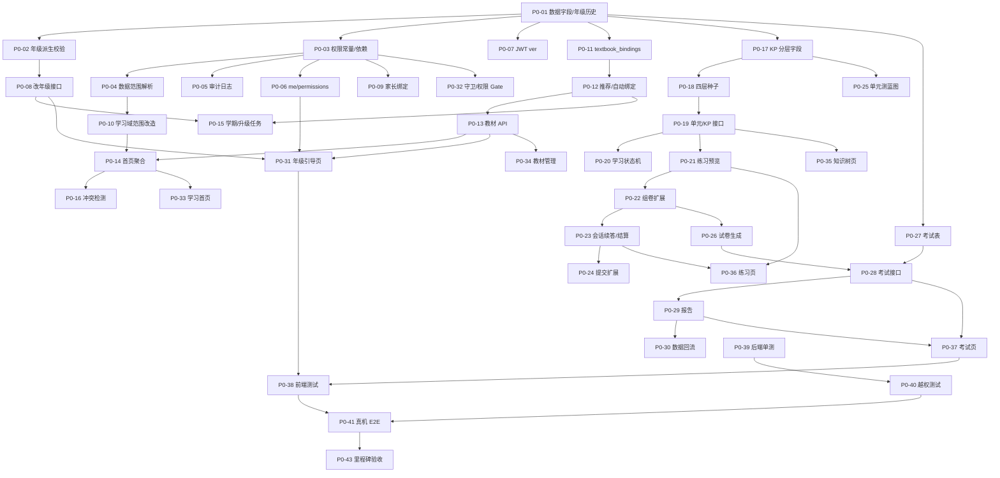
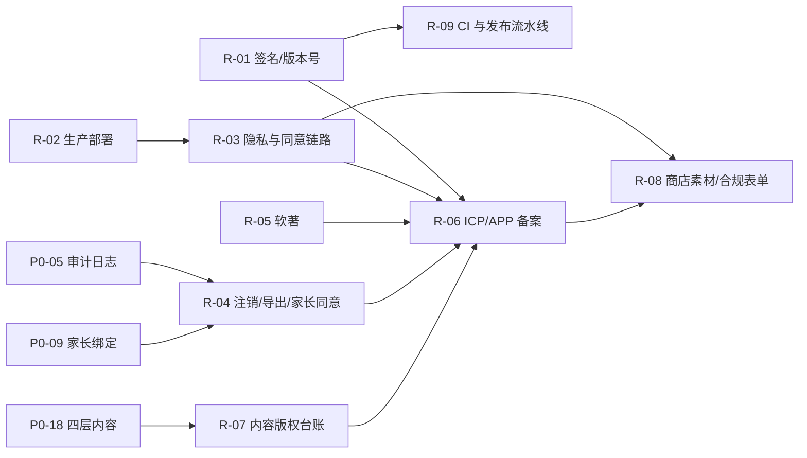

# 深爱学（AiLearning）项目实施任务计划与进度跟踪

> **文档性质**：项目主计划 / 进度跟踪 / 过程追溯（全程伴随开发周期）
> **版本**：v1.95
> **创建日期**：2026-11-06
> **最后更新**：2026-11-10（TT-03~TT-07 与 UX-03 全部完成：开源 TTS 全量生成 653 题音频、音频接口按需缓存、低年级自动读题、句级高亮与单词点读、读音抽检脚本与环境诊断页；TT-07 人工试听待 QA，见 §4.3 B-001）
> **参考设计文档**：见[§1.1 参考设计文档清单](#11-参考设计文档清单)（共 8 份，含 4 份设计方案、4 份支撑文档）
> **需求追踪**：见[§1.2 需求—设计—任务追踪矩阵](#12-需求设计任务追踪矩阵)
> **维护人**：项目负责人（PM）
> **更新频率**：每次开发会话结束必更；每日一次进度快照；里程碑专项评审

---

## 一、文档使用说明

### 1.1 参考设计文档清单

> 本计划的所有任务、验收标准均来源于下列文档。**需求变更必须先更新对应设计文档或登记 CR（§4.2），再调整本计划任务**，禁止"只改代码不改文档"。

| 编号 | 文档 | 版本 | 类型 | 覆盖范围 | 对应计划任务 | 维护人 | 状态 | 最后核对 |
|---|---|---|---|---|---|---|---|---|
| **D-01** | [k12-learning-app-design.md](./k12-learning-app-design.md) | v0.6 | 总体产品设计 | 产品定位、用户画像、信息架构、里程碑、技术栈、读题（TTS）方案（§3.9，含 §3.9.12 阶段 1 拆解、§3.9.13 阶段 2~4 落地） | 基线 B-01~B-05；P0 总体范围；TT-01~TT-07 | PM/AR | 已生效（M1/M2 基线；§3.9 评审通过，TT-01~TT-07 全部 `DONE`） | 2026-11-10 |
| **D-02** | [subject-tutoring-and-m2-design.md](./subject-tutoring-and-m2-design.md) | v1.0 | 学科辅导专项设计 | 五大学法支柱、九学科分学段辅导方案、深圳教材适配、M2 数据模型与算法 | B-03/B-04；P0-17~P0-24；P1-07 | CT/AR | 已生效（M2 已交付） | 2026-11-06 |
| **D-03** | [user-role-permission-design.md](./user-role-permission-design.md) | v1.0 | 角色权限专项设计 | 多级角色体系、年级维度、权限矩阵、数据范围、权限校验、数据模型与 API | P0-01~P0-10；P1-01~P1-06；P2-01/P2-02/P2-08/P2-09 | AR/PM | 已生效（P0/P1/P2 范围已交付） | 2026-11-07 |
| **D-04** | [learning-page-design.md](./learning-page-design.md) | v1.0 | 学习页专项设计 | 教材绑定、学习首页、知识点分层、智能练习、综合考试、数据流与 API | P0-11~P0-38；P1-07~P1-11；P2-03~P2-07 | FE/AR | 已生效（P0~P2 范围已交付） | 2026-11-07 |
| **D-05** | [privacy.md](./privacy.md) | v1.0（2026.11.06） | 合规支撑 | 隐私政策、未成年人数据、家长同意与数据留存 | P0-05/P0-09；P1-05；P2-08 | PM | 已生效（P2-08 脱敏导出与用途登记已落地；R-03 公网发布与首启同意链路已上线；R-04 注销/导出/青少年模式时长已生效） | 2026-11-07 |
| **D-06** | [skills.md](./skills.md) | 现行 | 工程支撑 | 开发规范、技能与接口使用说明 | 全部任务（开发约定） | AR | 已生效 | 2026-11-06 |
| **D-07** | [skill_github_repo_access.md](./skill_github_repo_access.md) | 现行 | 内部支撑 | 仓库访问与凭据说明（不进入版本库） | 发布/提交相关任务 | AR | 内部参考 | 2026-11-06 |
| **D-08** | [release-plan.md](./release-plan.md) | v1.0 | 发布支撑 | 上架缺口、渠道矩阵、备案/软著、合规红线、素材与时间线 | 发布任务 R-01~R-09；P0-05/P0-09、P1-05、P2-08 | PM/AR | 已生效（R-01 签名、R-02 生产化部署、R-03 法务同意链路、R-04 商店合规功能、R-05 软著材料、R-06 备案接口与关于页、R-07 内容合规、R-08 商店素材与合规表单、R-09 发布流水线与监控已完成） | 2026-11-07 |

**文档优先级**：需求冲突时，`D-01`（总体）> 专项设计（`D-02/D-03/D-04`）> 支撑文档（`D-05`~`D-08`）。专项之间冲突由 PM 裁决并登记 CR。发布相关的合规与上架要求以 `D-08` 为准。

**文档状态说明**：

| 状态 | 含义 |
|---|---|
| 草稿 | 编写中，不可作为开发依据 |
| 待实施（设计已评审） | 设计完成且通过评审，任务可启动 |
| 已生效 | 已落地并有代码/测试证据 |
| 待更新 | 实现与设计出现偏差，需同步修订或登记 CR |
| 废止 | 不再使用，需注明替代文档 |

### 1.2 需求—设计—任务追踪矩阵

> 用于回答三个问题：**这个需求出自哪份文档哪一章？由哪些任务实现？当前到哪一步？**

| 需求域 | 需求来源（文档 §） | 设计方案（文档 §） | 实现任务 | 验收编号 | 当前状态 |
|---|---|---|---|---|---|
| 多级角色体系与权限矩阵 | D-03 §3/§5 | D-03 §3/§5 | P0-03、P1-01、P1-04、P2-01、P2-02 | A8 | `DONE`（RBAC 表、双写/对账与可视化配置后台均已落地） |
| 学生年级细分与必填 | D-03 §4/§7.1 | D-03 §4/§7.1、D-04 §4.5 | P0-01、P0-02、P0-08、P0-15、P0-31、P0-42 | A1/A2/A9/L1 | `DONE`（年级校验/引导/改年级确认与迁移回归、seed 幂等均已通过） |
| 数据访问范围控制 | D-03 §6 | D-03 §6 | P0-04、P0-10、P0-40 | A3/A4/A5/A6 | `DONE`（范围解析、学习域改造与越权专项测试已通过） |
| 权限校验与审计 | D-03 §8 | D-03 §8 | P0-05、P0-07、P0-32、P0-39 | A7/A8/A10 | `DONE`（审计/`/me`/Token 失效/前端路由守卫/权限矩阵用例已通过） |
| 家长绑定与未成年人合规 | D-03 §7.2、D-05 | D-03 §7.2/§10.2 | P0-09、P1-05 | A4 | `DONE`（绑定/同意校验与家长端页面（切换孩子、孩子学情、每日时长、青少年模式）已完成） |
| 学校/教师组织能力 | D-03 §7.3/§7.4/§10.3 | D-03 §7.3/§7.4/§10.3 | P1-01~P1-06 | A5/A6 | `DONE`（组织模型/API/角色变更/班级聚合/教师端页面已完成） |
| 教材绑定与选择入口 | D-04 §4/§5 | D-04 §4/§5 | P0-11、P0-12、P0-13、P0-34、P0-16 | L1/L2/L3 | `DONE`（服务端推荐/绑定/冲突检测与前端教材管理页已完成） |
| 学习首页与"下一步"入口 | D-04 §3/§6.6 | D-04 §3/§6.6 | P0-14、P0-33、P1-11、P1-13 | L1/L14 | `DONE`（首页聚合接口、前端学习首页、六优先级推荐与缓存/失效策略已完成） |
| 知识点分层与学习路径 | D-02 学科方案、D-04 §6 | D-04 §6 | P0-17~P0-20、P0-35 | L4/L5 | `DONE`（四层结构、状态机与前端单元/知识点详情已完成） |
| 智能辅助练习 | D-02 学法、D-04 §7 | D-04 §7 | P0-21~P0-24、P0-36 | L6/L7/L8/L13 | `DONE`（服务端预览/组卷/会话/来源拆分 + 前端配置/预览/续答/结算已完成） |
| 单元测试 | D-04 §8.1~§8.5 | D-04 §8 | P0-25~P0-30、P0-37 | L9/L10/L11/L12 | `DONE`（服务端组卷/交卷/报告/回流 + 前端考试中心/限时答题/报告页已完成） |
| 期中/期末/模考 | D-04 §8.1~§8.5 | D-04 §8、D-03 §5.2 | P1-07~P1-10、P2-07 | L9~L12 | `DONE`（P1-07 蓝图组卷、P1-08 考试窗口与过期处理、P1-09 主观题自评、P1-10 报告增强、P2-07 真题库与班级同卷模考已完成） |
| 主观题与报告增强 | D-04 §7.5/§8.5 | D-04 §7.5/§8.5 | P1-09、P1-10 | L11 | `DONE`（主观题自评与能力维度/班级平均/趋势对比已完成） |
| 推荐与学习闭环 | D-04 §2.2/§6.6 | D-04 §2.2/§6.6 | P1-11、P1-12、P1-14 | 闭环验收 | `DONE`（六优先级推荐、考试错题默认错因/复习优先级、活服务端到端回归均已通过） |
| 平台化与增强（RBAC/图谱/离线/AI/真题库/合规导出/内容复核） | D-03 §9.2、D-04 §14 | D-03 §9.2、D-04 §14 | P2-01~P2-10 | M4 | `DONE`（P2-01~P2-10 全部完成并通过技术验收，M4 待 PM 签署） |
| 读题（TTS）辅助 | D-01 §3.9（2026-11-10 评审通过） | D-01 §3.9、§3.9.12、§3.9.13 | TT-01~TT-07 | T1~T6 | `DONE`（TT-01~TT-07 全部 `DONE`；T6 人工试听待 QA，见 §4.3 B-001） |
| 上架合规与发布 | D-08 §3/§7 | D-08 §3/§6 | R-01~R-09、P0-05、P0-09、P1-05、P2-08 | 发布验收 | `DOING`（R-01 签名、R-02 生产化部署、R-03 法务同意链路、R-04 商店合规功能、R-05 软著材料、R-06 备案信息、R-07 内容合规、R-08 商店素材与合规表单、R-09 发布流水线与监控已完成） |

**矩阵维护规则**：

1. 新增需求：先在对应设计文档补章节并升版本 → 在本矩阵新增一行 → 在 §3 台账新增任务（含依赖与验收映射）。
2. 需求变更：走 §4.2 CR 流程，更新"需求来源/设计方案"两列与任务状态。
3. 任务完成：同步更新"当前状态"列，并与 §5.1 快照、§6 里程碑保持一致。
4. 每次会话结束：核对本矩阵状态与台账是否一致；设计文档有改动时更新 §1.1 的"版本/最后核对"。

### 1.3 本文件的作用

1. **唯一任务台账**：所有开发任务在此登记，禁止口头/聊天记录替代。
2. **进度事实来源**：状态、实际工时、产出证据均以此为准。
3. **过程追溯依据**：需求变更、技术难点、阻塞与解决方案全部留痕。
4. **验收对照表**：每个任务对应设计文档的验收编号，便于逐项签署。
5. **需求—设计映射**：通过 §1.1 与 §1.2 可反查"需求出自哪、由谁实现、进展如何"。

### 1.4 角色与负责人代码

| 代码 | 角色 | 说明 |
|---|---|---|
| `PM` | 项目负责人 | 需求确认、优先级裁决、里程碑验收 |
| `AR` | 架构/后端 | 数据模型、API、算法、迁移 |
| `FE` | 前端 | Flutter 页面、交互、状态管理 |
| `QA` | 测试 | 接口/权限/真机/E2E/性能 |
| `CT` | 内容运营 | 教材、知识点、题库、试卷蓝图 |
| `ALL` | 协同 | 多人共同负责 |

> 当前执行模式：`AR`/`FE`/`QA` 由 Trae Agent 承担，`PM` 由用户承担（需求与验收），`CT` 由 Agent 生成 + `PM` 抽检。

### 1.5 状态定义与流转规则

| 状态 | 定义 | 进入条件 | 退出条件 |
|---|---|---|---|
| **待启动** `TODO` | 已登记，未开始 | 计划评审通过 | 开发人员领取并开始 |
| **进行中** `DOING` | 正在开发/测试 | 依赖任务全部 `DONE`；已建分支或已改代码 | 达成 DoD 并附证据 |
|  **已完成** `DONE` | 交付并通过验证 | DoD 全满足（代码 + 测试 + 证据） | 验收后一般不可回退；返工需走变更记录 |
| **阻塞中** `BLOCKED` | 无法继续推进 | 依赖未满足 / 环境故障 / 需求不明确 / 缺陷阻塞 | 阻塞解除后回到 `DOING` |

**流转约束**：

```
TODO ──领取──► DOING ──达成DoD──► DONE
                 │  ▲
              阻塞▼  │解除
                BLOCKED
DONE ──返工（需CR）──► DOING
```

- 禁止 `TODO → DONE` 跳步。
- 进入 `BLOCKED` 必须同时在[第四章问题记录](#四问题记录与解决方案)登记，注明影响与预计解除条件。
- 每日更新时必须同步：主台账、状态看板、变更记录、问题记录四处一致。

### 1.6 优先级定义

| 级别 | 含义 | 排期原则 |
|---|---|---|
| `P0` | 阻断主链路/合规风险 | 当前迭代必须完成 |
| `P1` | 核心体验与体系完整性 | P0 完成后进入 |
| `P2` | 增强与效率 | 按资源插入 |
| `P3` | 可选/长期 | 不占当前迭代 |

### 1.7 完成定义（DoD）

一个任务只有同时满足以下条件才可标记 `DONE`：

1. 代码已合入（或已写入工作区并通过检查）。
2. 相关单测/接口测试通过（后端 `pytest`，前端 `flutter test`）。
3. 静态检查通过（`ruff`/`dart analyze` 0 issue）。
4. 关键路径有可复现证据（接口响应、真机截图、日志片段）。
5. 对应设计文档验收项已勾选（见每任务 `验收映射`）。
6. 若涉及数据库：迁移脚本可在空库与存量库升级，且 `seed` 幂等。

---

## 二、基线：已完成能力（不计入本次新增工作）

| 编号 | 内容 | 状态 | 证据 |
|---|---|---|---|
| B-01 | M1 账号体系（注册/登录/JWT） | `DONE` | 现有 `/api/auth/*`，pytest 通过 |
| B-02 | 教材/章节/知识点/题目内容模型与种子（134 教材/112 章/170 KP/564 题） | `DONE` | `scripts/seed.py` 幂等运行 |
| B-03 | 掌握度 EMA、错题本 SM-2、自适应组卷、四题型判题 | `DONE` | `app/services/learning.py` + `tests/test_learn.py` |
| B-04 | 学习/错题本/我的 三 Tab 与答题闭环 | `DONE` | 真机冒烟记录（v0.3） |
| B-05 | Alembic 迁移与 SQLite 兼容 | `DONE` | `b3f1a2c77d8e` 迁移 |

> 基线已冻结。本次开发不重复实现上述能力，只在其上扩展。

---

## 三、任务台账

> **状态字段实时更新**；`实际(h)` 在任务完成时填写；`证据` 填 commit / 测试结果 / 截图路径。
> **总任务数**：90（开发 81：P0 43 + P1 15 + P2 10 + UX 3 + CT 3 + TT 7；发布 9：R-01~R-09）；**基线已完成**：5；**进行中**：0；**阻塞中**：0（B-001 为人工试听待办，不阻塞代码交付）；**待启动**：0；**总预估工时**：754 h（开发 635 + 发布 119）。

### 3.1 阶段 P0：身份与学习主链路

#### 3.1.1 数据与权限底座

| ID | 任务 | 负责人 | 预估(h) | 优先级 | 依赖 | 状态 | 实际(h) | 验收映射 | 证据 |
|---|---|---|---|---|---|---|---|---|---|
| P0-01 | 扩展 `users` 字段：`grade_group/semester/enrollment_year/region/token_version/grade_updated_at/graduated_at/teacher_subjects/grade_start/grade_end`；新增 `grade_histories` 表；迁移脚本（SQLite `batch_alter_table`） | AR | 6 | P0 | 无 | `DONE` | 3 | A2/A9 | `d7a9c3e5b210` 迁移；空库/存量库 upgrade→downgrade→upgrade 通过；存量回填 stage/grade_group；`tests/test_user_grade.py` 唯一约束+默认值用例通过 |
| P0-02 | 实现 `derive_stage/derive_grade_group` 与注册/资料更新校验（年级必填、学段一致性、选科限 10-12） | AR | 5 | P0 | P0-01 | `DONE` | 2 | A1/A2 | `app/core/grade.py`；注册返回 422 `GRADE_REQUIRED`/`STAGE_MISMATCH`/`ELECTIVE_ONLY_SENIOR`；pytest 29 passed |
| P0-03 | 权限常量表 `ROLE_PERMISSIONS`、`PERMISSION_SCOPE`；`require_permission`/`require_student_access` 依赖；`require_admin` 兼容改造 | AR | 8 | P0 | P0-01 | `DONE` | 5 | A8 | `app/core/permissions.py`（35 权限点+10 角色+范围映射）；`deps.py` 的 `require_permission`/`require_student_access`/`require_admin` 兼容；pytest 44 passed |
| P0-04 | 数据范围解析 `resolve_student_ids`（SELF/CHILD/CLASS/SCHOOL/ALL）与聚合脱敏工具 | AR | 6 | P0 | P0-03 | `DONE` | 4 | A3/A4/A5/A6 | `app/core/scope.py`（SELF/CHILD/SCHOOL/ALL 完整、CLASS 待 P1-01 返回空集安全默认）；`users.school_id` 迁移 `e1b2c3d4f5a6`；`mask_phone`；`tests/test_scope.py` 9 例；空库/存量库迁移通过 |
| P0-05 | 审计日志接入：登录失败、改角色、改年级、跨用户读取、导出（含 before/after） | AR | 4 | P0 | P0-03 | `DONE` | 2 | A10 | `app/services/audit.py`（detail JSON 含 before/after，1000 字截断）；登录失败/停用写 `auth.login_failed`/`auth.login_blocked`；`require_student_access` 跨用户读取写 `data.cross_user_read`；改角色/改年级/导出钩子随 P1-04/P0-08/P0-40 接入；`tests/test_audit.py` |
| P0-06 | `GET /api/auth/me` 扩展（`stage/grade_group/permissions`）与 `GET /api/auth/permissions` | AR | 3 | P0 | P0-03 | `DONE` | 2 | A8 | `MeOut`/`PermissionsOut`；`/auth/me` 返回 `stage/grade_group/permissions/scope`；`/auth/permissions` 独立查询；admin 兼容返回 `["*"]`/`ALL`；pytest 50 passed |
| P0-07 | JWT 增加 `ver`，角色/年级变更自增 `token_version`，旧 Token 失效 | AR | 3 | P0 | P0-01/P0-03 | `DONE` | 2 | A7 | `create_access_token` 写入 `ver`（旧 Token 无 `ver` 视为 0，兼容存量会话）；`get_current_user` 比对 `user.token_version`；`bump_token_version` 供角色/年级变更调用；`tests/test_token_version.py` 5 例 |
| P0-08 | 年级修改接口 `PUT /api/users/me/grade`（每学期限 1 次、二次确认令牌、影响提示） | AR | 5 | P0 | P0-02/P0-07 | `DONE` | 3 | A1/A9 | `api/routes/users.py`：428 `CONFIRM_REQUIRED` 返回影响提示与 10 分钟确认令牌，确认后写 `grade_histories(source=self)`、`user.grade.change` 审计并 `bump_token_version`（旧 Token 401 `TOKEN_REVOKED`）；每学期限 1 次（409 `GRADE_CHANGE_LIMIT`）；`tests/test_grade_change.py` 7 例 |
| P0-09 | 家长绑定：`ParentChildBinding` 状态机（pending/active/revoked）、确认/解除、儿童账号同意校验 | AR | 8 | P0 | P0-03 | `DONE` | 3 | A4 | `api/routes/family.py`（发起/确认/解除/我的孩子）；`services/family.py` `has_active_guardian`；`/auth/me` 增加 `guardian_consent`；`tests/test_family.py` 6 例 |
| P0-10 | 学习域接口范围改造：`stats`/`wrong-questions` 支持 `student_id`，越权返回 `SCOPE_DENIED` | AR | 6 | P0 | P0-04 | `DONE` | 3 | A3/A4 | `require_student_access` 支持多候选权限点并按角色范围择优；`stats` 支持 `learn:stats:self/child/class`，`wrong-questions` 支持家长查看已同意孩子；家长未选孩子返回 422 `STUDENT_ID_REQUIRED`；`tests/test_learn_scope.py` 7 例 |

#### 3.1.2 教材绑定与学习首页

| ID | 任务 | 负责人 | 预估(h) | 优先级 | 依赖 | 状态 | 实际(h) | 验收映射 | 证据 |
|---|---|---|---|---|---|---|---|---|---|
| P0-11 | 新增 `textbook_bindings` 表与迁移（唯一键、状态、学期归档） | AR | 4 | P0 | P0-01 | `DONE` | 1 | L2/L3 | `models/textbook.py`；迁移 `f2b3c4d5e6a7`（唯一键 `user+subject+semester+textbook`、索引 `user+subject+status`）；空库与 dev 库 upgrade/downgrade/upgrade 通过 |
| P0-12 | 教材推荐与自动绑定服务（深圳版本优先级、开课科目、幂等 upsert） | AR | 6 | P0 | P0-11 | `DONE` | 2 | L2/L3 | `services/textbook.py`：学段开课科目清单、版本名含"深圳"优先、`auto_bind` 幂等 upsert 并归档同学科旧版本；`manual_bind` 校验教材存在与学科匹配 |
| P0-13 | 教材 API：`GET /me/textbooks`、`POST /me/textbooks/auto-bind`、`POST /me/textbooks/bind`、`DELETE /me/textbooks/{id}`、`GET /me/textbooks/recommend` | AR | 6 | P0 | P0-12 | `DONE` | 2 | L2/L3 | `api/routes/textbooks.py`：五个接口全部可用，家长返回 403 `NOT_STUDENT`；`tests/test_textbook.py` 7 例 |
| P0-14 | 学习首页聚合接口 `GET /api/learn/home`（当前教材、今日计划、继续学习、推荐、待办考试） | AR | 8 | P0 | P0-13/P0-10 | `DONE` | 2 | L1/L14 | `api/routes/learn.py`：`/learn/home` 返回年级/学段/学期/区县、已绑定教材或推荐教材、`today_plan`（按学段练习量与时长）、`continue_learning`（最近答题回溯章节/知识点）、`recommendation`（复习→薄弱<40→40-70→继续→每日一练）、`pending_exams`；非学生 403 `NOT_STUDENT`；`tests/test_home.py` 6 例（无绑定推荐、绑定后展示、复习优先、薄弱/中等掌握度、家长拦截） |
| P0-15 | 学期切换与年级升级定时任务（2 月/9 月、幂等 `grade_histories`、跨学段确认） | AR | 8 | P0 | P0-08/P0-12 | `DONE` | 2 | A9/L3 | `services/promotion.py`：`switch_semester` 切换学期并归档旧学期教材、按新学期重绑；`promote_grades` 仅 9 月执行、按学年幂等（同生同学年只升级一次）、12 年级写 `graduated_at`、跨学段归档教材并要求重新确认、升级写历史与审计并失效旧 Token；`scripts/semester_jobs.py` 提供 cron/任务计划入口；`tests/test_promotion.py` 5 例 |
| P0-16 | 教材与年级冲突检测（`mismatch` 标记、接口告警、练习前拦截） | AR | 4 | P0 | P0-14 | `DONE` | 1 | L3/异常表 | 教材绑定返回 `mismatch`、首页返回 `mismatch_subjects` 与单本教材 `mismatch`；`/learn/start` 命中冲突返回 428 `TEXTBOOK_MISMATCH`，`confirm_mismatch=true` 后放行；`tests/test_mismatch.py` 3 例 |

#### 3.1.3 四点：知识点分层与练习

| ID | 任务 | 负责人 | 预估(h) | 优先级 | 依赖 | 状态 | 实际(h) | 验收映射 | 证据 |
|---|---|---|---|---|---|---|---|---|---|
| P0-17 | `knowledge_points` 增加 `node_type/order_index/weight`，存量数据兼容（空 `parent_id` 视为 point 并补"默认节"） | AR | 4 | P0 | P0-01 | `DONE` | 1 | L4 | `models/content.py` 新增三字段；迁移 `c3d4e5f6a7b8`（batch 加列 + 索引 + 存量补"默认节"并挂接，downgrade 可逆）；dev 库 upgrade/downgrade/upgrade 验证：237 行中 67 节 + 170 知识点，无孤儿、无自引用；`tests/test_kp_layers.py` 2 例 |
| P0-18 | 内容种子改造：生成"单元→节→知识点"四层结构（小学 1-3 完整，4-12 样章），保持幂等 | CT/AR | 12 | P0 | P0-17 | `DONE` | 2 | L4 | `scripts/seed.py`：每单元生成节节点并挂接知识点（`_put_section`/`_put_kp`）；修复节与知识点同名误匹配（限定 `node_type='point'`）；`_prune_default_sections` 清理迁移遗留空"默认节"；全新库 alembic+seed 连跑两次结果稳定（170 知识点 + 112 节，无自引用/孤儿/空节）；`tests/test_seed_layers.py` 3 例 |
| P0-19 | 单元/节/知识点接口：`GET /learn/textbook/{id}/units`、`GET /learn/unit/{chapterId}`、`GET /learn/kp/{id}`（含前置、状态、历史） | AR | 8 | P0 | P0-17/P0-18 | `DONE` | 2 | L4/L5 | `api/routes/learn.py`：单元列表（节数/知识点数/题量/平均掌握度/已学进度）、单元详情（节聚合 + 知识点节点状态）、知识点详情（前置掌握度、所属节、最近学习时间）；`services/learning.derive_study_state` 状态推导（未学习/待巩固/已掌握/复习中）；`tests/test_unit_tree.py` 4 例 |
| P0-20 | `kp_study_states` 表与状态机（未学习/学习中/待巩固/已掌握/复习中），讲解阅读与自测达标写入 | AR | 6 | P0 | P0-19 | `DONE` | 2 | L5 | `models/practice.KpStudyState` + 迁移 `d4e5f6a7b8c9`；`services/study_state.py` 状态迁移（read→学习中、practice→待巩固、selftest≥80→已掌握、revision→复习中）与幂等 upsert；接口 `POST /learn/kp/{id}/read`、`POST /learn/kp/{id}/selftest`；`/learn/submit` 自动写入；知识树/单元/知识点详情优先展示持久化状态、复习到期覆盖为"复习中"；`tests/test_study_state.py` 3 例 |
| P0-21 | 练习预览 `POST /learn/practice/preview`：题量、KP 覆盖、时长、seed，题量不足提示 | AR | 6 | P0 | P0-19 | `DONE` | 2 | L6/L8 | `services/practice.py`（`resolve_pool` 支持 kp/chapter/textbook/wrong 四范围、`select_questions` 确定性选题 + 到期错题配额 25% + 按知识点分桶轮转、`PracticePlan` 覆盖率/时长统计）；`POST /learn/practice/preview` 返回可用题量/是否不足/覆盖率/预估时长/题型分布/到期错题数/seed；`tests/test_practice_preview.py` 5 例（不足提示、章节/教材范围、题型过滤+同 seed 幂等、错题范围到期计数、非法范围 422）；修复分桶轮转在空桶时不推进游标导致的死循环 |
| P0-22 | 组卷算法扩展：题型配比、KP 覆盖≥80%、去重、时长预算、到期错题≤25% | AR | 10 | P0 | P0-21 | `DONE` | 3 | L6/L7 | `services/practice.py`：题型配比按学段（小学 40/20/25/15，初中/高中另设）与 `unit`/`pre_exam` 蓝图；覆盖目标 KP≤3 全覆、否则 ≥80%；7 天内已作答去重（过滤后为空回退全量）；到期错题 floor(25%) 且上限 5、只走配额；时长预算超限裁剪低难度非到期题；`/learn/start` 支持 `scope_type/scope_ids/q_types/mode/seed/duration_limit_min` 与预览同 seed 同题，旧参数兼容；`tests/test_practice_plan.py` 6 例 |
| P0-23 | `practice_sessions` 表与续答/结算：`POST /learn/sessions/{id}/finish`、`GET /learn/sessions/{id}` | AR | 7 | P0 | P0-22 | `DONE` | 3 | L13 | `models/practice.PracticeSession` + 迁移 `e5f6a7b8c9d0`（question_ids/scope JSON、计数、seed、起止时间）；`/learn/start` 新范围方式创建会话并返回 `session_id`；`GET /learn/sessions/{id}` 返回题目+已答状态+`next_index`（断点续答）；`POST .../finish` 汇总正确率/用时/知识点表现/错题数，重复调用幂等（保留首次 `finished_at`）；会话仅本人可见；`tests/test_practice_session.py` 5 例 |
| P0-24 | 练习提交兼容扩展：`session_id/source` 写入、掌握度来源拆分 | AR | 4 | P0 | P0-23 | `DONE` | 3 | L12 | `student_question_records` 增加 `source`（practice/review/exam）、`session_id`、`kp_weight` + 迁移 `f6a7b8c9d0e1`；`mastery_scores` 增加 `source_breakdown` JSON；`/learn/submit` 接受 `session_id`（归属校验 + 会话内题目校验）与 `source`，旧请求不变；`update_mastery` 支持来源与权重并累计来源明细；会话续答/结算优先按 `session_id` 归属（兼容无 session_id 的时间窗记录）；`tests/test_submit_session.py` 4 例 |

#### 3.1.4 单元测试闭环

| ID | 任务 | 负责人 | 预估(h) | 优先级 | 依赖 | 状态 | 实际(h) | 验收映射 | 证据 |
|---|---|---|---|---|---|---|---|---|---|
| P0-25 | `exam_blueprints` 表与单元测蓝图种子（小学数学/语文/英语各 1 套） | CT/AR | 8 | P0 | P0-17 | `DONE` | 3 | L9 | `models/exam.ExamBlueprint`（code/subject/grade/exam_type/total_score/time_limit_min/sections/kp_coverage_min/difficulty_mix/is_active）+ 迁移 `g7b8c9d0e1f2`；`scripts/seed.py` 新增 `_put_blueprint`（按 code 幂等）与 `EXAM_BLUEPRINT_SEEDS`（数学 计算30+填空20+选择20+解决问题30；语文 字词20+句子20+阅读30+习作30；英语 听力30+选择40+书写30，均为 60 min、覆盖率 0.8、难度 7:2:1）；`tests/test_exam_blueprint.py` 3 例（种子幂等、分值合计=100、更新不新增） |
| P0-26 | 试卷生成服务（蓝图 + seed 稳定、题型/难度/覆盖约束、题量兜底） | AR | 10 | P0 | P0-25/P0-22 | `DONE` | 3 | L9 | `services/exam_paper.py`（`generate_paper` 分节按题型+难度优先选题、知识点覆盖优先、跨节去重、题型不足时按任意剩余题兜底并记录 `fallback_count`、`ExamPaper` 输出题目/分值/覆盖率/难度分布/题量不足标记）；同 seed 完全确定；`tests/test_exam_paper.py` 5 例（蓝图一致性 36 题/100 分、seed 可复现、难度优先、兜底 26 题、题量不足） |
| P0-27 | `exams` 扩展 + `exam_attempts`/`exam_answers` 表与迁移 | AR | 6 | P0 | P0-01 | `DONE` | 3 | L10 | `Exam`（模型）扩展 `blueprint_id/exam_type/chapter_ids/status`；新增 `ExamAttempt`（user/exam/seed 唯一、status、起止时间、客观/主观/总分、submit_token）与 `ExamAnswer`（attempt+question 唯一、user_answer/is_correct/score/self_score）；迁移 `h8c9d0e1f2g3`；`tests/test_exam_schema.py` 4 例（默认值、作答往返、两级唯一约束） |
| P0-28 | 考试接口：开始/续答、3 秒防抖保存、交卷幂等、客观自动判 | AR | 10 | P0 | P0-26/P0-27 | `DONE` | 4 | L10/L11 | `app/schemas/exam.py` + `app/api/routes/exams.py`（列表按用户年级与作答状态分类、详情不含答案、`POST /exams/{id}/attempts` 复用进行中作答/超时强制交卷、`PATCH /exams/attempts/{id}` 幂等 upsert、`POST .../submit` 按 `submit_token` 幂等且客观题自动判/主观题转 `grading`、`POST /exams/generate` 按蓝图组卷）；`main.py` 注册路由；`tests/test_exam_api.py` 8 例；全量 pytest 148 passed |
| P0-29 | 考试报告：总分、题型得分、KP 得分率、错题清单、下一步入口 | AR | 8 | P0 | P0-28 | `DONE` | 3 | L11/L12 | `GET /api/exams/attempts/{id}/report`（未交卷 409 `EXAM_NOT_SUBMITTED`；输出总分/满分、客观/主观得分、正确率、题型得分率、知识点得分率、错题清单与正确解析、`weak_practice`/`wrong_review`/`retake` 下一步）；`tests/test_exam_report.py` 4 例；全量 pytest 152 passed |
| P0-30 | 考试数据回流：错题入库、掌握度按考试权重更新（单元测 0.8） | AR | 4 | P0 | P0-29 | `DONE` | 3 | L12 | `student_question_records.attempt_id`（迁移 `i9d0e1f2g3h4`）；交卷 `_finalize` 对客观题写入 `source=exam` 答题记录（含 `kp_weight`）、`WrongQuestion`（默认 `wrong_reason=other`）与掌握度 EMA（单元测 0.8 / 期中 0.6 / 期末 0.5），主观题不回流；幂等交卷不重复入库；`tests/test_exam_backflow.py` 3 例；全量 pytest 155 passed |

#### 3.1.5 前端 P0

| ID | 任务 | 负责人 | 预估(h) | 优先级 | 依赖 | 状态 | 实际(h) | 验收映射 | 证据 |
|---|---|---|---|---|---|---|---|---|---|
| P0-31 | 登录后年级引导页（3 步：学段→年级→教材确认），未完成强制拦截 | FE | 10 | P0 | P0-06/P0-08/P0-13 | `DONE` | 4 | L1 | 新增 `core/models/textbook_binding.dart`、`textbook_service.dart`（绑定/推荐/自动绑定）、`user_service.dart`（年级变更 428 二次确认）；`api_client` 增加 `putJson` 与结构化 `payload`；`features/onboarding/entry_gate_page.dart`（按绑定状态放行/拦截）+ `onboarding_page.dart`（学段→年级→教材推荐三步）；`app.dart` 路由守卫 + 登录后进入 `/gate`；`dart analyze lib test` 0 issues、`flutter test` 8 passed |
| P0-32 | 路由守卫 + `PermissionGate` + 403 错误统一处理（按业务码给引导） | FE | 6 | P0 | P0-03/P0-06 | `DONE` | 3 | A8 | 新增 `core/errors/api_error_guide.dart`（`TOKEN_REVOKED`→重登、`PERMISSION_DENIED`/`SCOPE_DENIED`→无权限文案、`GRADE_REQUIRED`/`GRADE_MISSING`→引导页、401/403 兜底）；`features/common/permission_gate.dart`（`anyOf` 任一命中放行、超管 `*` 直通、`ForbiddenPage` 返回/回首页）；`app.dart` 未登录统一跳 `/login`，`/shell`/`/home` 需 `learn:content:read`、`/knowledge/*` 需 `learn:kp:study`、`/session`/`/practice/*` 需 `learn:practice:start`；各页错误统一走 `ApiErrorGuide`/`handleApiError`；`dart analyze lib test` 0 issues、`flutter test` 8 passed |
| P0-33 | 学习首页重构：当前教材卡、今日计划、继续学习、学科入口、考试入口 | FE | 12 | P0 | P0-14 | `DONE` | 4 | L1/L15 | `core/models/learn.dart` 新增 `HomeData/HomeTextbook/HomeTodayPlan/HomeContinue/HomeRecommendation`（`textbookOf`/`stageEnum`/学期与学科标签）；`learn_service.home()` 接入 `GET /api/learn/home`；`features/learn/learn_page.dart` 重构为学生首页聚合（推荐下一步卡、今日计划三项可点、继续学习、学科入口教材卡含年级冲突标识、考试入口占位）与家长非学生教材章节浏览降级；未绑定教材展示推荐与 `/gate` 绑定入口；`learn_model_test.dart` 新增 HomeData 2 例；`dart analyze lib test` 0 issues、`flutter test` 10 passed |
| P0-34 | 教材管理页：学科/学期切换、版本选择、推荐标识、冲突二次确认、解绑 | FE | 8 | P0 | P0-13 | `DONE` | 4 | L2/L3 | 新增 `features/textbook/textbook_manage_page.dart`（学科 Chip、上册/下册切换、推荐标识、使用中高亮、年级不一致二次确认、解绑确认与空态）；`textbook_service` 增加 `bind/unbind`，`api_client` 增加 `deleteJson`，`/textbooks` 路由 + 学习首页/我的页入口；后端 `manual_bind` 绑定学期改为以教材为准并跨学期归档同学科旧绑定（`tests/test_textbook.py` 新增 1 例）；`dart analyze lib test` 0 issues、`flutter test` 10 passed、`pytest` 156 passed |
| P0-35 | 单元/节/知识点树与详情页（掌握度环、状态、前置跳转、讲解/例题） | FE | 12 | P0 | P0-19/P0-20 | `DONE` | 6 | L4/L5 | `knowledge_page` 改为单元目录（掌握度环/进度/节·知识点·题量），新增 `unit_page`（节分组、知识点状态与练一练、单元综合练习）、`kp_detail_page`（讲解/前置跳转/状态/掌握置信度/例题带答案解析/我已理解）、`mastery_ring` 通用组件；`learn_service` 增加 units/unitDetail/kpDetail/kpExamples/markKpRead，模型增加 UnitSummary/UnitSection/UnitDetail/KpBrief/KpDetail/KpExample；后端新增 `GET /learn/kp/{id}/examples`（最多 2 道，带答案解析，`tests/test_unit_tree.py` 新增 1 例）；路由 `/unit/:id`、`/kp/:id`；`dart analyze` 0 issues、`flutter test` 10 passed、`pytest` 157 passed |
| P0-36 | 练习配置页 + 预览 + 答题页扩展（模式、续答、结算、下一步） | FE | 12 | P0 | P0-21/P0-23 | `DONE` | 8 | L8/L13 | 新增 `practice/config` 配置页（专项/同步/考前模式、知识点/单元/整册范围、题量、题型、组卷预览与不足提示）；`session_page` 扩展范围组卷（同 seed 预览=实际）、428 教材年级冲突二次确认、断点续答（`/session?session=id`）、提交带 `session_id/source`、结算页（正确率/用时/错题/知识点表现/下一步）；首页增加「继续上次练习」入口（本地草稿 `practice_last_session`）；模型新增 PracticePreview/PracticeStartResult/PracticeSessionData/PracticeFinish；`dart analyze` 0 issues、`flutter test` 10 passed、`pytest` 157 passed |
| P0-37 | 考试中心列表、考试详情/答题（计时、自动保存、交卷确认）、报告页 | FE | 16 | P0 | P0-28/P0-29 | `DONE` | 10 | L10/L11 | 新增 `core/models/exam.dart`（ExamSummary/ExamAttempt/ExamReport/题型与知识点统计/错题与下一步）、`exam_service.dart`（列表/开始续答/防抖保存/交卷/报告）、`api_client` 增加 `patchJson`；新增 `features/exam/exam_list_page.dart`（待考/进行中/已完成分类、开始/继续/查看报告）、`exam_page.dart`（倒计时、答题卡、3 秒防抖自动保存、交卷确认、超时自动交卷、退出保留计时）、`exam_report_page.dart`（总分/正确率/用时、题型得分率、知识点得分率与跳转、错题清单与解析、薄弱点专项/错题重练/再考一次下一步）；路由 `/exams`、`/exam/:examId`（`learn:exam:take`）、`/exam/report/:attemptId`（`learn:exam:report:self`），学习首页考试入口改为跳转考试中心；`exam_model_test.dart` 3 例；`dart analyze` 0 issues、`flutter test` 13 passed、`pytest` 157 passed |
| P0-38 | 前端单测/组件测试补充（模型解析、状态机、守卫） | FE/QA | 8 | P0 | P0-31~P0-37 | `DONE` | 4 | L15 | 新增 `permission_gate_test.dart`（命中任一权限放行、无权限 403、超管 `*` 直通、未登录 fallback、`anyOf` 为空不限制 + `AppUser` 权限判定 5 例组件测试）；`api_error_guide_test.dart` 5 例（`TOKEN_REVOKED`/`PERMISSION_DENIED`/`GRADE_REQUIRED`/401/403 兜底/普通文案）；`practice_session_model_test.dart` 4 例（预览、开始、会话续答、结算知识点表现）；`textbook_binding_model_test.dart` 4 例（绑定/推荐/学段映射）；累计前端测试 32 例全部通过、`dart analyze` 0 issues |

#### 3.1.6 测试与验收 P0

| ID | 任务 | 负责人 | 预估(h) | 优先级 | 依赖 | 状态 | 实际(h) | 验收映射 | 证据 |
|---|---|---|---|---|---|---|---|---|---|
| P0-39 | 后端单测：年级派生、权限矩阵、范围解析、组卷约束、考试幂等 | QA/AR | 12 | P0 | P0-01~P0-30 | `DONE` | 6 | A1~A10/L6~L12 | 新增 `test_exam_guards.py` 9 例（跨年级 403/未发布隐藏、列表分类与类型过滤、超时自动结算后新建、过期保存自动交卷、交卷后 PATCH 只读、seed 冲突、报告需交卷且仅本人、报告题型/知识点统计、作答归属）；扩充 `test_grade_rules.py` 5 例（1~12 年级全矩阵、越界错误码、学段校验、选科限制、学年/学期边界）；扩充 `test_permissions.py` 4 组（9 角色权限矩阵、超管全量、权限目录一致性、权限→范围矩阵）；扩充 `test_scope.py` 5 例（CLASS 安全空集、未知范围、无绑定、ALL、跨权限拒绝）；后端测试 203 passed |
| P0-40 | 越权专项测试：跨学生、跨班级、跨学校、pending 绑定、旧 Token | QA | 6 | P0 | P0-39 | `DONE` | 4 | A3~A7 | 新增 `test_access_control.py` 7 例（跨学生统计/错题 403、教师跨班级 SCOPE_DENIED 且不可参加考试、跨学校范围解析与接口拒绝、pending 绑定错题 403、家长不可参加考试/不可读未绑定孩子、家长不可读已绑定孩子考试报告、旧 Token 在 `/auth/me` `/learn/home` `/exams` 均 `TOKEN_REVOKED`）；后端测试 210 passed |
| P0-41 | 真机 E2E：年级引导→首页→四层下钻→练习→单元测→报告→错题复习 | QA | 8 | P0 | P0-31~P0-38 | `DONE` | 6 | L1~L15 | 新增 `app/integration_test/learning_e2e_test.dart`（真机 integration_test：注册/登录→三步年级引导→首页→数学教材→单元→知识点→练一练→练习配置（取消填空题）→答题与结算→错题本→管理员生成单元测→考试中心→限时答题→交卷→报告→返回考试中心校验「查看报告/得分」）；`app/android/app/build.gradle.kts` 增加 `configurations.all { resolutionStrategy { force(...) } }` 将 espresso/test 依赖升到 3.5.1/1.5.x，解决 AGP 8 下 `androidx.test.espresso` namespace 冲突；设备 `66B0219C18003002`（OXF AN10 / Android 12）执行 `flutter test --no-pub integration_test/learning_e2e_test.dart -d <device>` 全部通过（All tests passed）；`dart analyze lib test integration_test` 0 issues |
| P0-42 | 迁移/种子回归：空库升级、存量库升级、seed 二次幂等 | QA/AR | 4 | P0 | P0-18/P0-25 | `DONE` | 2 | A9/基线约束 | 新增 `backend/tests/test_migrations.py` 3 例：①空库 `upgrade head → downgrade base → upgrade head`（head `i9d0e1f2g3h4`、19 张核心表齐全、降级后仅剩 `alembic_version`）；②存量库（`b3f1a2c77d8e` + 学生数据 `grade=4`）升级 head 后数据保留，回填 `stage=primary`/`grade_group=primary_mid`/`token_version=0`/默认 `region=shenzhen`/`semester=first` 并生成 `grade_histories`；③`scripts.seed` 连跑两次行数完全一致（users 9 / textbooks 134 / chapters 112 / knowledge_points 282 / questions 564 / exam_blueprints 3）且无重复账号；另在 `ailearning_dev.db` 副本上执行 `alembic upgrade head` + 双跑 seed 复核一致；`ruff check tests/test_migrations.py` 通过，`pytest` 213 passed |
| P0-43 | P0 里程碑验收与文档同步（更新本计划、设计文档差异） | PM | 3 | P0 | P0-39~P0-42 | `DONE` | 3 | M2.5 | 汇总复核 P0-01~P0-42 台账；`pytest` 213 passed、`ruff check` 0 issue、`flutter analyze --no-pub` 0 issues、`flutter test --no-pub` 32 passed；§6.1 A10 调整为部分完成（改角色审计随 P1-04、导出审计随 P2-08）、L6/L7 转 `DONE`；§4.1 I-001/I-002 转 `RESOLVED`；§1.1 D-03/D-04 状态更新为「部分生效（P0 已落地）」；新增 §6.2 M2.5 验收记录；M2.5 技术验收通过待 PM 签署 |

> **P0 小计**：43 项，预估 **310 h**（AR 173、FE 84、CT 20、QA 30、PM 3；CT/AR 协同任务按主责计一次）。

### 3.2 阶段 P1：角色扩展与综合考试

| ID | 任务 | 负责人 | 预估(h) | 优先级 | 依赖 | 状态 | 实际(h) | 验收映射 | 证据 |
|---|---|---|---|---|---|---|---|---|---|
| P1-01 | 教师/班主任/校管角色与 `schools/classes/class_members/teacher_class_assignments` 表 | AR | 10 | P1 | P0-03 | `DONE` | 3 | A5/A6 | 新增 `app/models/org.py`（`School`/`SchoolClass`/`ClassMember`/`TeacherClassAssignment`，班级唯一键 `school_id+grade+name`、授课唯一键 `teacher_id+class_id+subject`）；迁移 `j0e1f2g3h4i5`（4 表 + 索引，空库与 `ailearning_dev.db` 副本升级通过）；`scope.py` 的 CLASS 范围接入：班主任 `head_teacher_id`/`role_in_class` 全学科可见，科任教师按 `subject` 收窄，跨校与未绑定学校安全返回空集；`tests/test_org.py` 4 例（学科收窄、班主任全科、跨校/未绑定拒绝、复合唯一约束）；`pytest` 217 passed |
| P1-02 | 班级与授课分配 API、教师年级/学科范围校验 | AR | 8 | P1 | P1-01 | `DONE` | 2 | A5 | `api/routes/org.py`：`GET/POST /org/schools`（超管）、`GET/POST /org/classes`（校管按本校、教师按授课班）、`GET/POST /org/classes/{id}/members`（批量入班，校验学生角色/同校/年级一致、重复入班幂等）、`GET/POST /org/assignments`（校验教师角色、同学段、`teacher_subjects`、`grade_start/grade_end`，班主任冲突/重复分配 409）；`schemas/org.py`；`deps.require_any_permission`；审计 `org.school.create/class.create/member.add/teacher.assign`；`tests/test_org_api.py` 3 例（班级/成员/教师可见性、跨校与角色拒绝、分配规则与冲突）；`pytest` 220 passed |
| P1-03 | 班级学情聚合接口（仅聚合值，不泄露逐题原文） | AR | 8 | P1 | P1-02/P0-04 | `DONE` | 2 | A5/6.5 | `GET /api/org/classes/{id}/stats`：返回学生数/近 7 日活跃数与提交率、答题数与正确率、平均掌握度、薄弱知识点 Top5（班级均值），支持 `subject` 收窄；教师按授课班+学科校验，校管限本校，越权 `SCOPE_DENIED`；响应不含任何学生标识与逐题原文；`tests/test_org_stats.py` 2 例（聚合口径与字段白名单、教师/校管/学生/跨校范围）；`pytest` 222 passed |
| P1-04 | 管理端用户列表与角色授予/回收（禁止自授超管、本校范围） | AR | 8 | P1 | P1-01 | `DONE` | 3 | A6/A8 | `api/routes/admin_users.py`：`GET /admin/users`（分页/角色/学校/年级/关键词筛选，校管强制本校，手机号脱敏）；`POST /admin/users/{id}/roles`（grant/revoke 单角色，`SELF_ROLE_DENIED` 禁自改与自授超管、校管仅可授予学生/教师/班主任且限本校、`ROLE_MISMATCH`/`ROLE_INVALID`/`ROLE_CONFLICT`）；角色变更 `bump_token_version` 旧 Token 401 `TOKEN_REVOKED`；审计 `admin.role.assign` 含 before/after；`tests/test_admin_users.py` 4 例；`pytest` 226 passed、`ruff` 0 issue |
| P1-05 | 家长端页面：切换孩子、孩子学情、时长与青少年模式 | FE | 12 | P1 | P0-09 | `DONE` | 3 | A4 | 后端：`users.teen_mode` 字段（迁移 `k1f2g3h4i5j6`）、`GET /family/children` 返回 `daily_limit_minutes/teen_mode`、`PUT /family/children/{id}/controls`（空字段 422 `CONTROLS_REQUIRED`、无 active 绑定 404、审计 `family.controls.update`），`tests/test_family_controls.py` 2 例；前端：`FamilyChild` 模型、`FamilyService`、`ParentChildrenPage`（ChoiceChip 切换孩子、按 `student_id` 拉取学情、时长滑块 0~240、青少年模式开关、保存提示）、`/family` 路由 + `PermissionGate`、个人中心家长入口，非学生账号不再请求个人统计；`family_model_test.dart` 2 例、`parent_children_page_test.dart` 4 例；`flutter analyze --no-pub` 0 issues、`flutter test --no-pub` 38 passed、`pytest` 228 passed、`ruff` 0 issue |
| P1-06 | 教师端页面：班级概览、班级报告（聚合） | FE | 12 | P1 | P1-03 | `DONE` | 3 | A5 | 前端：`ClassSummary`/`ClassStats`/`ClassWeakPoint` 模型、`OrgService`（`GET /org/classes`、`GET /org/classes/{id}/stats` 支持 `subject`）、`TeacherClassesPage`（班级卡片/空态/下拉刷新）、`ClassStatsPage`（学生数/近 7 日活跃/正确率/平均掌握度/提交率/薄弱 Top5，页面明示仅聚合数据）、`/teacher/classes` 与 `/teacher/classes/:classId/stats` 路由 + `PermissionGate`、个人中心教师入口；`org_model_test.dart` 3 例、`teacher_pages_test.dart` 3 例；`flutter analyze --no-pub` 0 issues、`flutter test --no-pub` 44 passed |
| P1-07 | 期中/期末蓝图与组卷（范围=章节集合、6:3:1 难度、KP 覆盖） | CT/AR | 10 | P1 | P0-26 | `DONE` | 3 | L9 | 蓝图：`scripts/seed.py` 新增 6 套期中/期末蓝图（语数英各 2 套，`exam_type=midterm/final`，`sections` 按 `band` 分带，得分 60/30/10，`kp_coverage_min=0.8`，时限 90 分钟）；组卷：`app/services/exam_paper.py` 支持 `band → difficulty` 映射（easy 1 / medium 2~3 / hard 4~5）；`tests/test_exam_comprehensive.py` 4 例（蓝图规格、两章范围组卷得分 60/30/10 且覆盖 6/6 KP、同 seed 幂等、`/api/exams/generate` 发布 midterm 试卷）；`tests/test_exam_blueprint.py` 同步 9 套蓝图断言；`pytest` 232 passed |
| P1-08 | 考试中心扩展：期中/期末/模考入口、考试窗口与过期处理 | AR/FE | 10 | P1 | P0-37/P1-07 | `DONE` | 3 | L10 | 后端：`exams.window_start/window_end`（迁移 `l2g3h4i5j6k7`）、`/api/exams/generate` 支持窗口配置、列表返回 `window_state`（open/scheduled/closed/unscheduled）、窗口外开考 403 `EXAM_WINDOW_NOT_OPEN/EXAM_WINDOW_CLOSED`、保存/交卷遇窗口关闭按已存答案自动交卷且不再接收新答案，`tests/test_exam_window.py` 3 例；前端：`ExamSummary` 窗口字段与 `windowLabel/windowRange`、考试列表新增类型筛选（单元测/期中/期末/模考）、窗口时间与状态展示、未开放时提示拦截，`exam_model_test.dart` +1 例、`exam_list_page_test.dart` 2 例；`pytest` 235 passed、`flutter analyze --no-pub` 0 issues、`flutter test --no-pub` 47 passed |
| P1-09 | 主观题自评：参考答案、评分点、自评量表、成绩回写 | AR/FE | 10 | P1 | P0-29 | `DONE` | 3 | L11 | 后端：报告新增 `pending_subjective`（题干/作答/参考答案/`scoring_points`/解析/原自评分）、`POST /exams/attempts/{id}/self-assess`（未交卷 409、重复题/非主观题/超满分 422、题目不在卷 404；首次自评按 60% 及格线写 `StudentQuestionRecord`、掌握度 EMA 与错题本，重评不重复回流；按试卷重算主观分与总分，`pending_count==0` 转 `completed`），`tests/test_exam_self_assess.py` 4 例；前端：`ExamSubjectiveQuestion` 模型与 `pending_subjective` 解析、`ExamService.selfAssess`、报告页新增「主观题自评」卡（参考答案/评分点/解析/0~满分滑块/提交后刷新），`exam_model_test.dart` +1 例、`exam_report_page_test.dart` 1 例；`pytest` 239 passed、`flutter analyze --no-pub` 0 issues、`flutter test --no-pub` 49 passed |
| P1-10 | 报告增强：能力维度雷达、班级平均（有班级时）、趋势对比 | AR/FE | 8 | P1 | P1-09/P1-03 | `DONE` | 3 | L11 | `GET /api/exams/attempts/{id}/report` 新增 `ability_stats`（理解/计算/应用/分析，题型默认映射+学科覆盖）、`class_average`（仅同班聚合值）、`trend`（同科同类近 5 次及 delta）；前端报告页新增能力雷达（`CustomPaint`）、班级平均对比、成绩趋势列表；`tests/test_exam_report_enhanced.py` 2 例、`exam_model_test.dart` +1 例、`exam_report_page_test.dart` 1 例；`pytest` 241 passed、`flutter analyze` 0 issues、`flutter test` 51 passed |
| P1-11 | 推荐服务：今日计划生成规则（复习→薄弱→单元测→进度→每日一练） | AR | 8 | P1 | P0-14/P0-20 | `DONE` | 3 | 6.6 | 新增 `app/services/recommendation.py`（六优先级规则、当前单元薄弱知识点、单元测检测、学期进度基准每两周 1 单元、待办考试）；`GET /api/learn/home` 推荐增加 `chapter_id/chapter_name/exam_id`，`pending_exams` 填充本年级未完成试卷；前端 `HomeRecommendation` 扩展并支持 `unit_test` 跳转与章节继续；`tests/test_home_recommendation.py` 4 例、`learn_model_test.dart` +1 例；`pytest` 245 passed、`flutter analyze` 0 issues、`flutter test` 52 passed |
| P1-12 | 错题与考试联动优化：考试错题错因默认分类、复习优先级 | AR | 4 | P1 | P0-30 | `DONE` | 2 | L12 | 新增 `app/services/wrong_reason.py`（按题型默认错因：选择/判断→概念、填空/计算→计算、多选→审题、主观→方法、未作答→粗心）与复习优先级（错误次数×2+遗忘次数+逾期天数，high≥6/medium≥3）；考试交卷与主观自评回流写入默认错因（已有标注不覆盖）；`GET /api/learn/wrong-questions` 返回 `review_priority/priority_score` 并按优先级排序；`tests/test_exam_wrong_reason.py` 3 例、`test_exam_backflow.py` 断言更新；`pytest` 248 passed |
| P1-13 | 性能优化：首页聚合缓存、学情统计缓存失效策略 | AR | 6 | P1 | P0-14 | `DONE` | 3 | L14 | 新增 `app/core/cache.py`（进程内 TTL 30s、按用户前缀失效、命中统计）；`/api/learn/home` 与 `/api/learn/stats` 接入缓存；练习提交（`/learn/submit`、`/practice/submit`）、会话提交、考试交卷/自评、教材绑定/解绑后失效；`tests/test_learn_cache.py` 3 例（含 P95 基准）与 conftest 缓存清理；`pytest` 251 passed；本地首页聚合缓存命中 P95=2.03ms（<300ms） |
| P1-14 | P1 测试与真机回归 | QA | 12 | P1 | P1-01~P1-13 | `DONE` | 3 | M3 回归 | `scripts/e2e_p1_smoke.py` 活服务端到端 67 项断言通过（学习/练习/错题优先级/考试窗口/交卷/报告增强/班级聚合/家长绑定）；`pytest` 251 passed；`flutter analyze` 0 issues、`flutter test` 52 passed；真机不可用原因见 §4.1 I-005 |
| P1-15 | P1 里程碑验收与计划同步 | PM | 3 | P1 | P1-14 | `DONE` | 3 | M3 | P1-01~P1-14 全量 `DONE`；`pytest` 251 passed、`flutter analyze` 0 issues、`flutter test` 52 passed、活服务 E2E 67 项断言；M3 技术验收通过（待 PM 签署）；§1.1 D-03/D-04 状态同步、§6.3 验收记录新增 |

> **P1 小计**：15 项，预估 **129 h**。

### 3.3 阶段 P2：平台化与增强（当前迭代）

| ID | 任务 | 负责人 | 预估(h) | 优先级 | 依赖 | 状态 | 实际(h) | 验收映射 | 证据 |
|---|---|---|---|---|---|---|---|---|---|
| P2-01 | RBAC 表上线（`roles/permissions/role_permissions/user_roles`）与双写/对账 | AR | 12 | P2 | P1-04 | `DONE` | 6 | 9.2 | 迁移 `m3n4o5p6q7r8`（空库/存量库升降级 + 存量 `admin→super_admin` 回填）；新增 `app/models/rbac.py`、`app/services/rbac.py`（catalog 同步、`sync_user_role` 双写、`effective_permissions` 优先读 `user_roles`）、`scripts/rbac_reconcile.py`（差异检查/`--fix`）；注册与角色变更双写；`tests/test_rbac_tables.py` 7 例；全量 `pytest` 258 passed |
| P2-02 | 权限配置后台（角色-权限可视化） | AR/FE | 12 | P2 | P2-01 | `DONE` | 6 | 9.1 | 后端 `GET /api/admin/rbac/roles`、`GET /permissions`、`PUT /roles/{code}/permissions`（`system:config:write` 鉴权、超管只读、未知权限 422、变更审计 `rbac.role.permissions`）；前端 `features/admin/rbac_config_page.dart`（角色切换、按域勾选、保存差异提示），路由 `/admin/rbac` 与"我的"入口；`tests/test_admin_rbac.py` 6 例 + `app/test/rbac_config_page_test.dart` 2 例；全量 `pytest` 264 passed、`flutter test` 54 passed |
| P2-03 | 教师布置作业/班级统一卷、批改主观题 | AR/FE | 16 | P2 | P1-09/P1-02 | `DONE` | 6 | 8.1/5.2 | 新增 `assignments` 表与迁移 `n4o5p6q7r8s9`（`exam_answers` 批改字段，空库/存量库升降级通过）；后端 `services/assignment.py` + `/api/assignments`（布置/列表/详情/批改清单/批量批改，班级越权、超分、客观题校验，作业卷隔离出通用考试列表与学生名单脱敏）；前端 `features/assignment/*`（列表/布置/详情/批改页 + 学习页与"我的"入口）；`tests/test_assignments.py` 2 例 + `app/test/assignment_list_page_test.dart` 2 例；全量 `pytest` 266 passed、`flutter analyze` 0 issues、`flutter test` 56 passed |
| P2-04 | 知识图谱视图（前置依赖可视化、薄弱高亮） | FE | 10 | P2 | P0-19 | `DONE` | 4 | 6.2 | 前端 `features/learn/knowledge_graph_page.dart`：聚合教材全部单元知识点、按前置依赖计算列深并绘制箭头连线（`CustomPainter`）、薄弱节点红色高亮/图例、单元筛选与点击下钻知识点详情；路由 `/knowledge/:textbookId/graph` 与目录页「知识图谱」入口；`app/test/knowledge_graph_page_test.dart` 2 例；`flutter analyze` 0 issues、`flutter test` 58 passed |
| P2-05 | 图片作答与离线整卷（本地队列、断网重放） | FE/AR | 16 | P2 | P0-23 | `DONE` | 8 | 13 章 | 后端主观题图片作答校验（PNG/JPEG/WEBP、单张 3 MB、合计 4 MB、最多 2 张、客观题拒绝）与 `tests/test_exam_image_answer.py`；前端 `OfflineExamStore`/`OfflineExamSync`（Hive 本地快照 + save/submit 队列按序重放、服务端冲突丢弃、12s 自动重试）、考试页离线横幅与交卷暂存、`SignatureAnswerPage` 手写导图、批改页展示手写图片；`app/test/offline_exam_sync_test.dart` 2 例；`pytest` 267 passed、`flutter analyze` 0 issues、`flutter test` 60 passed |
| P2-06 | AI 讲解与错题归因辅助（LLM 接入、Prompt 安全） | AR | 16 | P2 | P0-19 | `DONE` | 8 | 6.4 | 后端 `services/ai.py`（OpenAI 兼容 `chat/completions` 接入 + 规则兜底、失败自动回退、按用户小时额度 `AI_RATE_LIMITED`）、`services/ai_prompt.py`（控制字符/标签/注入特征行清洗、分隔素材块、系统指令与输出二次清洗截断）、`/api/ai/explain`（未作答 409 `AI_EXPLAIN_LOCKED` 防泄题、错题归属校验）与 `/api/ai/diagnose`（复用错因分类 + 错误次数置信度 + 改进建议）；前端 `core/services/ai_service.dart`、错题本「AI 归因」弹层与一键采纳错因、考试报告错题「AI 讲解」弹层；`tests/test_ai.py` 10 例、`app/test/ai_explain_test.dart` 3 例；`pytest` 277 passed、`flutter analyze` 0 issues、`flutter test` 63 passed |
| P2-07 | 模考与真题库、考试窗口与公平性（同班同卷） | CT/AR | 12 | P2 | P1-08 | `DONE` | 8 | 8.3 | 迁移 `o5p6q7r8s9t0` 增 `exams.region/is_past_paper/class_id`；`GET /api/exams/past-papers`（年级/学科/年份/地区筛选、窗口状态）、`POST /api/exams/mock`（教师按班派发同卷，`class_authorized` + 年级一致 + 窗口校验 + 审计 `exam.mock.assign`）；考试列表对班级卷仅本班可见、非本班进入 403 `EXAM_NOT_MEMBER`；`generate` 支持标记真题/地区；seed 内置 3 套演示真题（幂等）；前端真题库页（学科/年份筛选、窗口提示）、考试中心入口；`tests/test_mock_exams.py` 3 例、`app/test/past_paper_page_test.dart` 2 例；迁移空库 upgrade/downgrade/upgrade 通过、seed 两次幂等；`pytest` 280 passed、`flutter analyze` 0 issues、`flutter test` 65 passed |
| P2-08 | 数据导出与合规审计增强（脱敏导出、用途登记） | AR | 6 | P2 | P0-05 | `DONE` | 4 | A10 | 新增 `services/export.py`（五类用途登记、`SECTION_LIMIT=1000` 显式截断、手机号掩码）与 `api/routes/data.py`（`GET /api/data/export` 自助/家长/校管三档授权，`GET /api/data/export/purposes`）；导出写审计 `data.export`（含用途、目标用户、范围、各段条数，不落明文手机号）；`tests/test_export.py` 9 例（脱敏、用途必填/非法/身份不匹配、家长绑定越权、校管跨校 `SCOPE_DENIED`）；`pytest` 289 passed |
| P2-09 | 内容审核双人复核流程 | AR/FE | 8 | P2 | P0-05 | `DONE` | 6 | 5.3 | 新增 `content_reviews` 表 + `questions.status`（迁移 `p6q7r8s9t0u1`，存量题目回填 `published`）；`services/content_review.py` + `api/routes/content.py`（提交/复核/发布三态机，提交人自审 403 `REVIEW_SELF_DENIED`、复核人自发布 403 `PUBLISH_SELF_DENIED`、驳回必填原因、重复提交 409、未通过发布 409，全程审计 `content.review.submit`/`content.review.decide`/`content.publish`）；前端 `/content/reviews` 审核页与我的页入口（`content_review_page.dart`）；`tests/test_content_review.py` 11 例、`content_review_page_test.dart` 2 例；迁移空库/存量库升降级通过；`pytest` 300 passed、`flutter analyze` 0 issues、`flutter test` 67 passed |
| P2-10 | P2 回归与验收 | QA/PM | 10 | P2 | P2-01~P2-09 | `DONE` | 4 | M4 | 全量回归：`pytest` 300 passed；新增/修改文件 `ruff check --select E,F,I` 0 issue（全仓 E501 既有基线不纳入本任务）；`flutter analyze --no-pub` 0 issues；`flutter test --no-pub` 67 passed；空库 `alembic upgrade head` + `seed` 两次：首次创建 3 套真题、二次 0 套（幂等），教材 134/章节 112/知识点 282/题目 564/蓝图 9 稳定；回归期对 P2-08/P2-09 新文件做 `ruff format` 与导入排序对齐（commit `0082d67`）；验收记录见 §6.5 |

> **P2 小计**：10 项，预估 **118 h**。

### 3.4 发布与合规任务（R，来源 D-08）

> 本组任务来自 [release-plan.md](./release-plan.md) §3 的 8 项上架缺口，按"可执行项"拆分。**发布任务不重复开发任务**：凡与 P0/P1/P2 重叠的，以开发任务为实施主体，R 任务负责补齐商店与法规硬性要求并做发布验收。

| ID | 任务（可执行项） | 负责人 | 预估(h) | 优先级 | 依赖 | 状态 | 实际(h) | 缺口/验收 | 证据 |
|---|---|---|---|---|---|---|---|---|---|
| R-01 | 正式签名与构建纪律：生成 release keystore（`make-release-keystore.ps1`）+ 备份；`build.gradle.kts` release 缺 keystore 时 fail-fast（禁止回退 debug）；统一 Android/HarmonyOS `versionCode` 规则（`1.0.0+1 → 10001`）；导出签名 MD5/SHA-256；AGC 正式签名证书与 Profile | AR | 5 | P0 | 无 | `DONE` | 2 | 缺口1 / R-A1 | `make-release-keystore.ps1`（复用密码 + 自动备份 zip）、`build.gradle.kts`（缺签名 fail-fast、`releaseVersionCode`）、`sync-version.ps1`、`signature-info.ps1`；鸿蒙 `versionCode=10001`；release APK `CN=AiLearning`、MD5 `EB:51:94:8B:3D:DB:AA:41:05:01:0E:40:E2:CC:72:95`；缺 keystore 时 Gradle `BUILD FAILED`；AGC 证书待 PM 在开放平台生成归档 |
| R-02 | 后端生产化部署：云主机 + 域名 + HTTPS；切 PostgreSQL + `alembic upgrade head` + `seed.py`；密钥环境变量化；CORS 白名单、登录/注册限流、错误脱敏；每日备份与恢复演练；审计日志留存 ≥6 个月 | AR | 16 | P0 | 无 | `DONE` | 6 | 缺口3 / R-A2 | `deploy/`（Dockerfile/compose/Nginx TLS/.env 样例）；`validate_settings` 生产启动校验（默认密钥/debug/自动建表/CORS 通配直接拒绝，实测正反两例）；登录/注册限流 429 `RATE_LIMITED`（4 例）；未捕获异常 500 `INTERNAL_ERROR`+request_id（1 例）；`db_backup/db_restore` 备份恢复演练 users=9/questions=564/audit=7 且 `quick_check` 通过；`prune_audit` 留存 <6 月拒绝（3 例）；Android/鸿蒙 release 禁止明文 HTTP、release 构建强制 HTTPS（http 地址实测拒绝）；pytest 312 passed；云主机/域名/证书上线待 PM 提供资源后执行 |
| R-03 | 隐私政策公网发布 + App 内法务与同意链路：后端 `GET /legal/privacy`、`/legal/terms`（HTTPS、免登录）；「我的」页新增隐私政策/用户协议/联系我们；首启 ConsentGate（主动勾选、拒绝退出、无网络请求）；儿童注册监护人确认；政策版本升高重新同意并留痕 | AR/FE | 20 | P0 | R-02 | `DONE` | 20 | 缺口2 / R-A3 | `app/legal/` 隐私政策+用户协议（JSON/HTML 双形态、根路径与 `/api` 双挂载、`legal_public_base_url`）；`consent_records` 表 + 迁移 `q7r8s9t0u1v2`（空库/上一版库升级、降级再升级通过）；`POST /api/legal/consent` 409 版本校验 + 幂等留痕 + 审计 `legal.consent.accepted`；`/auth/me` 返回已同意版本与 `needs_reconsent`；儿童注册强制 `guardian_consent`；App 首启 `ConsentGate`、`/consent` 重新同意页、「我的」三项法务入口、内置 Markdown 离线回退；`pytest` 318 passed、`flutter analyze` 0 issues、`flutter test` 75 passed |
| R-04 | 商店硬性合规功能：账号注销（15 个工作日删除/匿名化）+ 数据导出（最小可用版）；家长绑定与 `consent_at` 生效；`daily_limit_minutes` 青少年模式生效；敏感操作审计（完整脱敏导出与用途登记仍由 P2-08 承接） | AR/FE | 20 | P0 | P0-05、P0-09 | `DONE` | 20 | 缺口8 / R-A4 | `DELETE /api/users/me`（立即停用+匿名化+解绑+Token 失效+审计 `account.deletion.requested`，15 个工作日 due_at）；`services/usage.py` 中国时区今日时长与 `GET /api/users/me/usage`，练习/考试开始 429 `DAILY_LIMIT_REACHED` + `Retry-After`；App「账号与安全」页（时长/导出/注销）；迁移 `r8s9t0u1v2w3` 空库与上一版库升降级通过；`pytest` 324 passed、`flutter test` 77 passed |
| R-05 | 软著申请：整理源码 60 页（`app/lib` + `backend/app`）+ 操作说明书 + CPCC 线上提交（加急）+ 登记号归档（名称建议"深爱学学习辅助软件"） | PM/CT | 12 | P1 | 无（第 1 天启动） | `DONE` | 12 | 缺口5 / R-A5 | `scripts/make-copyright-docs.py` 生成 `release/software-copyright/source-code.docx`（60 页：前 30 + 后 30，每页 50 行，页眉页脚完整，源程序约 29,847 行）、`user-manual.docx`（13 章操作说明书）、`metadata.json`（申请表字段）、`submission-checklist.md`、`registration.txt` 归档模板；CPCC 线上提交与登记号由 PM 完成 |
| R-06 | 备案：域名 ICP 备案 → 导出签名 MD5 → 华为/小米商店侧 APP 备案（包名、签名、隐私 URL、SDK"无"）→ 备案号回填后端并在关于页展示 → 固化包名/签名不可变更 | PM/AR | 8 | P1 | R-01、R-03、R-05 | `DONE` | 8 | 缺口4 / R-A6 | `GET /app/info`（根路径与 `/api` 双挂载，免登录返回应用名/版本/ICP/APP 备案号/软著号/法务 URL/客服邮箱）；配置新增 `APP_DISPLAY_NAME`/`APP_VERSION_LABEL`/`ICP_RECORD_NO`/`APP_RECORD_NO`/`SOFTWARE_COPYRIGHT_NO`/`SUPPORT_EMAIL`；App「我的 → 关于」页（版本 + 三项编号 + 法务入口，离线回退本地常量）；`release/record-filing/checklist.md`（包名/签名/流程/回填/固化纪律）；`deploy/.env.example` 增补变量；`pytest` 326 passed、`flutter analyze` 0 issues、`flutter test` 79 passed；ICP/APP 备案线上提交待 PM |
| R-07 | 内容版权与教育合规：建立《题源与授权台账》（来源/授权凭证/录入/审核）；商店与 App 内免责声明；删除"官方教材/名师/提分/押题"表述；举报入口与 24h 下架流程演练 | CT/AR/FE | 16 | P0 | P0-18 | `DONE` | 8 | 缺口6 / R-A7 | 新增 `content_reports` 表 + 迁移 `s9t0u1v2w3x4`（空库升降级通过）；`POST /api/content/reports`（学生举报，校验题目存在）、`GET/PATCH /api/content/reports`（需 `content:review:decide`，下架将题目置 `offline`）、审计 `content.report.created/takedown/dismissed`；用户协议新增 §6.4 内容来源与 24 小时下架声明（版本升至 `2026.11.07` 触发重新同意）；App「我的 → 内容举报」页 + 关于页免责声明；`release/content-compliance/license-ledger.md`（授权台账/免责声明/违规表述扫描 0 命中/24h 流程与演练）；`pytest` 330 passed、`flutter analyze` 0 issues、`flutter test` 79 passed |
| R-08 | 商店素材与合规表单：图标/特性图/截图（无教材封面与真实学生信息）、文案模板适配；Data Safety、目标受众与 Families、IARC 分级、华为隐私标签 | PM/QA | 12 | P1 | R-03 | `DONE` | 12 | 缺口7 / R-A8 | `scripts/make-store-assets.py` 生成 `release/store-assets/`：`icon-1024/512/216`、`feature-graphic-1024x500`、8 张 1080×1920 虚构示例截图（底部标注「示例数据」）与 `assets.json`（尺寸/字节/sha256）；补 `README.md`（规格与平台差异）、`listing.md`（名称/简短描述 33 字符/完整描述/更新说明/华为文案）、`data-safety.md`（6 类数据 + 安全实践 + 政策一致性核对）、`audience-rating.md`（目标受众/Families/IARC/华为 3+）、`huawei-privacy-label.md`；顺带修复 release 阻断项：Android main manifest 显式 `INTERNET`、`android:label="深爱学"`，同步 Launcher 图标 48~192 与鸿蒙 `app_name`/`app_icon`；`pytest` 330 passed、`flutter analyze` 0 issues、`flutter test` 79 passed |
| R-09 | 发布流水线与监控：`ci.ps1`（analyze/pytest/flutter test → build APK/AAB/HAP → `apksigner` 校验 → 产物归档 → git tag）；接入崩溃与错误监控；发布检查表自动化 | AR/QA | 10 | P2 | R-01 | `DONE` | 10 | 缺口8 / R-A9 | `scripts/ci.ps1`（`-SkipTests/-SkipBuild/-BuildAab/-WithHap/-Tag`，含版本校验/质量门禁/构建/签名校验/产物归档/检查表/Git Tag）；崩溃监控：`crash_reports` 表 + 迁移 `t0u1v2w3x4y5`、`POST /api/monitor/crash`（匿名+限流+隐私掩码）、`GET /api/monitor/crashes[/summary]`（超管）、`ErrorMaskingMiddleware` 后端异常落库；App `CrashReporter`（Flutter/平台异常钩子 + 10 条本地队列 + 启动重放）；`tests/test_monitor.py` 6 例、`app/test/crash_reporter_test.dart` 5 例；`pytest` 336 passed、`flutter analyze` 0 issues、`flutter test` 84 passed；检查表 PASS-WITH-WARNINGS（软著受理号/备案号待 PM 回填） |

> **R 小计**：9 项，预估 **119 h**（P0 5 项 77 h；P1 3 项 32 h；P2 1 项 10 h）。

#### 3.4.1 缺口 → 任务映射（发布验收口径）

| release-plan 缺口 | 对应 R 任务 | 关联开发任务 | 验收编号 |
|---|---|---|---|
| 缺口 1 正式签名与构建纪律 | R-01 | — | R-A1 |
| 缺口 2 隐私 URL + App 内同意链路 | R-03 | P0-05、P0-09（同意/审计底座） | R-A3 |
| 缺口 3 后端生产化部署 | R-02 | — | R-A2 |
| 缺口 4 APP 备案 | R-06 | — | R-A6 |
| 缺口 5 软件著作权 | R-05 | — | R-A5 |
| 缺口 6 内容版权与教育合规 | R-07 | P0-18（四层内容种子） | R-A7 |
| 缺口 7 商店素材与合规表单 | R-08 | — | R-A8 |
| 缺口 8 产品侧合规功能与发布工程 | R-04、R-09 | P0-05、P0-09、P1-05（完整增强另见 P2-08） | R-A4/R-A9 |

**发布验收编号（R-A1~R-A9）**

| 编号 | 判定标准 |
|---|---|
| R-A1 | 删除 `keystore.properties` 后 release 构建**失败**；有签名时 `apksigner` 证书 CN=AiLearning；Android 与 HarmonyOS `versionCode` 相同；MD5 已归档 |
| R-A2 | 公网 `https://<域名>/health` 返回 200；明文 HTTP 被客户端拒绝；备份可恢复演练通过；审计日志留存 ≥6 个月 |
| R-A3 | 隐私 URL 公网可直接打开且与 App 内一致；首启必须主动勾选才能进入；拒绝同意后无任何网络请求；政策版本升级触发重新同意且留痕 |
| R-A4 | 注销入口可用并在 15 个工作日内完成；数据导出可用；儿童账号无 `active` 绑定 + `consent_at` 时功能受限；时长上限生效；敏感操作全部审计留痕 |
| R-A5 | 取得软著受理号/证书，登记号归档 |
| R-A6 | APP 备案号下发并在 App 关于页展示；包名/签名与备案一致 |
| R-A7 | 题源台账覆盖首批内容；免责声明上线；举报入口可用；24h 下架流程演练通过 |
| R-A8 | 素材无版权/隐私瑕疵；Data Safety、Families、IARC、华为隐私标签均提交 |
| R-A9 | 一条命令完成 analyze/test/build/签名校验/tag；产物可追溯；崩溃监控有数据 |

### 3.5 依赖关系图（P0 与发布）





> **发布关键路径**：R-01 → R-02 → R-03 → R-06（备案）→ R-08 → 提审；R-05 软著为最长外部周期，须第 1 天启动。R-04 依赖 P0-05/P0-09 完成后方可验收。

### 3.6 体验优化任务（UX，M5 后追加）

> 来源：2026-11-07 产品建议——参考 RetroEmuPouch `feature_card.dart` 的淡彩功能卡片，提升视觉层次与学习兴趣。设计规范见 [k12-learning-app-design.md](./k12-learning-app-design.md) §3.6。

| ID | 任务 | 负责人 | 预估(h) | 优先级 | 依赖 | 状态 | 实际(h) | 验收映射 | 证据 |
|---|---|---|---|---|---|---|---|---|---|
| UX-01 | 视觉升级：品牌柔和彩功能卡片（accent token + `FeatureCard` + 学习首页 4 个入口分色；可访问性/暗色公式约束） | FE | 8 | P2 | R-09 | `DONE` | 8 | R-A10 | 设计规范 §3.6；`AppAccents`/`FeatureCard` + 首页 4 入口分色；`dart analyze` 0 issues、`flutter test` 88 passed；OXF-AN10 真机登录学生账号验证（§6.15） |
| UX-02 | 子页面返回链路修复：入口统一 `push`、考试提交 `pushReplacement`、自定义返回按 `canPop` 回退 | FE | 2 | P1 | UX-01 | `DONE` | 2 | R-A11 | 知识点/单元/知识点详情、教材管理、班级学情等子页均出现系统返回；真机三级下钻逐级返回首页（§6.16） |
| UX-03 | 服务地址运行时可配置：内置地址仅作兜底，「我的 → 环境诊断」展示当前地址/连通性并支持切换预置环境（内网/预发/生产），避免 PC 局域网 IP 变化后 App 只能读旧离线包 | FE | 4 | P2 | R-09 | `DONE` | 4 | I-007 回归（改地址后在线接口恢复、离线包仍可读） | 来源：2026-11-10 真机验证（I-007）；新增 `core/services/server_config.dart`（`server.baseUrl` 持久化 + 地址规范化）、`initialBaseUrlProvider` 启动覆盖、`ApiClient.setBaseUrl` 运行时切换；新增「我的 → 环境诊断」页 `/settings/diagnostics`（应用信息、`/health` 连通性与耗时、服务地址编辑、自动读题状态）；`test/server_config_test.dart` 2 例通过；**真机 EBG-AN00**：诊断页显示 `http://127.0.0.1:18080`、`健康检查 ok · AiLearning API · 12 ms`、登录态「小深（student）」、自动读题「已开启」；非法地址提示见单测 |

> **UX 小计**：3 项，预估 **14 h**。

### 3.7 内容建设任务（CT，M5 后追加）

> 来源：2026-11-07 反馈——各科题目与知识点数量偏少，需要可复制的题库/知识库模板与低门槛导入方式。

| ID | 任务 | 负责人 | 预估(h) | 优先级 | 依赖 | 状态 | 实际(h) | 验收映射 | 证据 |
|---|---|---|---|---|---|---|---|---|---|
| CT-01 | 题库/知识库作者模板与导入 CLI（9 学科 JSON 模板、字段规范、幂等导入、dry-run、单测） | BE+教研 | 6 | P2 | R-09 | `DONE` | 6 | R-A12 | `docs/content-templates/`（README + 9 学科模板）；`backend/app/services/content_import.py`、`backend/scripts/import_content.py`；`pytest tests/test_content_import.py` 3 例、9 模板 dry-run 全部通过 |
| CT-02 | 题库/知识库来源与版权登记（`source_type/source_name/source_ref/copyright_owner/license_note/adapted_from`、迁移、导入校验、模板示例、管理接口暴露） | BE+教研 | 4 | P2 | CT-01 | `DONE` | 4 | R-A13 | 迁移 `u1v2w3x4y5z6`；`pytest tests/test_content_import.py` 7 passed、`tests/test_migrations.py` 3 passed；9 模板 dry-run 全通过；来源非原创必填名称、授权必填说明、外部导入必须 `draft` |
| CT-03 | 知识点同名消歧与每日入库流水线（迁移 `y1z2a3b4c5d6`、seed/导入自动后缀、`build_kp_baseline`、`--pattern`/`--manifest`） | BE+教研 | 4 | P1 | CT-01 | `DONE` | 4 | R-A14 | 两库同名组 54→0；`pytest tests/test_content_import.py tests/test_seed_layers.py tests/test_migrations.py` 15 passed；基线重建歧义 0；清单二次运行全部跳过 |

> **CT 小计**：3 项，预估 **14 h**。

### 3.8 读题（TTS）任务（TT，全部完成）

> 来源：2026-11-10 需求讨论 + PM 评审——1–3 年级识字量不足，题干需代读。方案见 [k12-learning-app-design.md](./k12-learning-app-design.md) §3.9（v0.5 定稿：**C 开源 TTS 预生成（零 API 费用）+ A 系统 TTS 兜底**；**默认不随整册包下发**，按需下载缓存；首期仅 **1–3 年级语文/数学/英语**）。
> **状态约束**：评审已通过，TT-01~TT-07 全部 `DONE`（T1/T2 单测 + 真机通过；T3 全量合成 653 题、T4/T5/T6 接口与客户端完成；T6 人工试听清单已生成待 QA 执行）。

| ID | 任务 | 负责人 | 预估(h) | 优先级 | 依赖 | 状态 | 实际(h) | 验收映射 | 证据 |
|---|---|---|---|---|---|---|---|---|---|
| TT-01 | 读题基础能力：接入 `flutter_tts`，题干/选项喇叭按钮、播放/停止/重听、语速（0.85 默认，0.7/1.0 可选）与设置持久化；1–3 年级语数英生效 | FE | 8 | P1 | 无 | `DONE` | 6 | T1 | 设计 §3.9.3/§3.9.4/§3.9.12；新增 `core/speech/tts_service.dart`、`features/speech/speech_button.dart`、`features/profile/learning_settings_page.dart`，接入 session/practice 题干喇叭、`/settings/learning` 路由与「我的→学习设置」；`flutter analyze` 0 issue、`flutter test` 133 passed；真机 EBG-AN00 验证：点击播放（图标切停止）、再次点击停止、长按 1.3 s 停止、语速 1.00× 重启后保持；语义节点 `clickable=true`（修复 Tooltip 抢占长按）；补充点验：8 年级语文题干无喇叭（门禁），1 年级英语题喇叭点击后 `en-US` 合成（`adb logcat` 记 `lang=eng`/`EN_US`）并可停止 |
| TT-02 | 文本预处理与读法规则：分数/幂/运算符/单位/填空线/选项读法表，客户端与服务端合成脚本共用规则，单测 ≥15 条 | FE+CT | 6 | P1 | TT-01 | `DONE` | 3 | T2 | 设计 §3.9.5/§3.9.12；`core/speech/question_speech.dart`（`SpeechRules.version=1`，含分数/幂/上下标/单位/运算符/填空线/选项与空白归一化）；`test/question_speech_test.dart` 24 例全通过 |
| TT-03 | 开源 TTS 合成管线：接入 sherpa-onnx/Piper（MIT/Apache 模型）+ `ffmpeg` 转 Opus，`scripts/build_question_audio.py` 增量合成、并发/重试/失败清单，仅生成 1–3 年级语数英 | AR | 12 | P1 | TT-02 | `DONE` | 12 | T3/T6 | 设计 §3.9.2/§3.9.7；新增 `backend/app/services/question_speech.py`（规则 Python 版，`RULES_VERSION=1` 与 Dart 共用）、`backend/scripts/build_question_audio.py`（增量/`ThreadPoolExecutor`/重试/`manifest.json`/`failed_jobs.json`）、`backend/requirements-audio.txt`；模型 `.tools/tts-models/vits-piper-zh_CN-huayan-medium` 与 `vits-piper-en_US-lessac-medium`（sherpa-onnx 1.10），ffmpeg 9.0.1 转 Opus 24 kbps；全量 653 题全部生成、失败 0、17.5 MB；`pytest tests/test_question_speech.py tests/test_build_question_audio.py` 全通过 |
| TT-04 | 音频分发与按需缓存：`GET /api/learn/questions/{id}/audio`（ETag/304、404 `AUDIO_NOT_READY`、权限、60 次/分限流）；客户端首次播放下载落缓存，按教材 LRU 200 MB，随教材删除/更新清理；整册包默认不含音频 | FE+AR | 8 | P1 | TT-03 | `DONE` | 8 | T3/T4 | 设计 §3.9.6/§3.9.7；后端 `app/api/routes/learn.py` 音频路由 + `app/services/question_audio.py`（ETag=内容哈希、`Cache-Control: public, max-age=2592000`、304、`AUDIO_NOT_READY`、`learn:content:read`、60 次/分/用户限流、返工清单 404、仅 published 且 1–3 年级语数英）；客户端 `core/speech/question_audio.dart`（ETag 缓存、LRU 200 MB、`just_audio` 播放与变速）、`api_client.getBytes`；`pytest tests/test_question_audio.py` 8 例、`flutter test test/question_audio_test.dart` 5 例通过；**接口实测**：题 79/647/651/127 均 200 + `ETag` + `audio/ogg`，`If-None-Match` 返回 304，不存在题号返回 404；**真机 EBG-AN00**：进入 1 年级英语练习后 `MediaCodec`+`AudioTrack` 播放 476,808 帧（约 10.8 s），客户端落盘 `files/question_audio/q_1526.opus`（30 KB），移除 `adb reverse` 后仍从缓存播放（无网络、无 TTS） |
| TT-05 | 低年级自动读题与无障碍：1–3 年级默认自动读、学习设置开关、TalkBack 语义、真机断网验证 | FE+QA | 6 | P2 | TT-01/TT-04 | `DONE` | 6 | T5 | 设计 §3.9.4；`core/speech/question_reader.dart` 统一入口（音频优先、TTS 兜底）、`speech_settings.dart` 新增 `speech.autoRead`（1–3 年级默认开启）；`learning_settings_page.dart` 增加「自动读题」开关；session/practice 进入新题 `_maybeAutoRead`（同题去重、失败静默）；`SpeechButton` 保留 `Semantics(button,label,onTap)`；`flutter analyze` 0 issue；**真机 EBG-AN00**：1 年级账号进入英语练习未点喇叭即自动播放（`AudioTrack` 02:01:49 起播）且按钮语义为「停止朗读」；「我的→学习设置」显示「自动读题 / 当前年级默认开启」；移除 `adb reverse` 后（服务不可达）仍可从缓存自动朗读 |
| TT-06 | 句级高亮与英语单词点读：朗读进度高亮（字级时间戳）、单词点击发音（英语科目） | FE | 6 | P2 | TT-04 | `DONE` | 6 | T1/T5 | 设计 §3.9.4；`features/speech/readable_question_text.dart`：播放进度按「题干字符占比 × 音频进度」估算高亮当前句（**非字级时间戳，已在代码注释标注**），英语单词 `TapGestureRecognizer` 点读走系统 TTS；`core/speech/question_audio.dart` 播放器新增 `progress`；`test/readable_question_text_test.dart` 2 例通过；`flutter analyze` 0 issue；**真机 EBG-AN00**：播放中题干整句带高亮底色（截图 `.tmp/tt06_highlight.png`），点击单词 `letter` 后播放器先停（`PlayerBase stop()`），随后 TTS 合成 `text length: 6` / `EN_US` 并播放 |
| TT-07 | 读音质量抽检与返工：每单元抽检 ≥5 题试听（多音字/分数/单位/英文），合格率 ≥95%，不达标题目回退系统 TTS 并登记返工清单 | CT+QA | 4 | P1 | TT-03 | `DONE` | 4 | T6 | 设计 §3.9.10；`backend/scripts/check_question_audio.py`（按章节抽样、`ffprobe` 时长、中英文分别按字/词语速筛查、`--results` 人工结论、`--apply` 写 `rework.json`）；已产出 `build/question_audio/qa_audio_report.json`（27 单元 / 抽样 133 题）与 `qa_audio_checklist.md`；自动筛查 132/133 无异常（中英文分别按字/词语速判定，混排题按 3 字≈1 词折算），仅 q1063（16.8 s）语速偏慢待复核；`pytest tests/test_check_question_audio.py` 通过；**人工试听待 QA 执行**（见 §4.3 B-001） |

> **TT 小计**：7 项，预估 **50 h**（合成成本 0 元；全部音频约 1.4 GB，按需下载不随整册包下发）。建议排期：TT-01/TT-02 → TT-03/TT-07 → TT-04 → TT-05/TT-06。

---

## 四、问题记录与解决方案

> 记录开发过程中的**技术难点、需求变更、阻塞问题、缺陷**；每条必须填写处理时间与结论。
> 状态：`OPEN` 待处理 / `RESOLVED` 已解决 / `MITIGATED` 已规避 / `DEFERRED` 延后。

### 4.1 问题台账

| ID | 日期 | 类型 | 描述 | 影响任务 | 严重度 | 处理人 | 解决方案 | 处理用时 | 状态 |
|---|---|---|---|---|---|---|---|---|---|
| I-001 | 2026-11-06 | 风险（数据） | 存量学生账号大量 `grade` 为空，直接强制必填会阻断登录 | P0-02/P0-31 | 高 | AR/PM | 采用"登录后强制引导 + 未完成仅开放公开浏览"的灰度策略；迁移仅回填学段不猜测年级 | P0-31 已落地 | `RESOLVED` |
| I-002 | 2026-11-06 | 风险（内容） | 部分知识点题量不足（<8 题），组卷 KP 覆盖 ≥80% 可能无法满足 | P0-22/P0-26 | 中 | CT/AR | 预览接口前置返回 `insufficient`；组卷按"同章→同学科→降难度"兜底；`test_practice_plan` 覆盖 ≥80% 与错题占比 ≤25% 用例通过 | P0-39/P0-43 已验证 | `RESOLVED` |
| I-003 | 2026-11-06 | 技术 | SQLite 对已有表加外键/约束需 `batch_alter_table`，否则迁移失败 | P0-01/P0-27 | 中 | AR | 已有 v0.3 经验，统一使用 batch 模式；迁移在空库与存量库各跑一次 | 已预置 | `MITIGATED` |
| I-004 | 2026-11-06 | 技术 | 断言 `autoflush=False` 下新对象默认值不落库，导致掌握度/错题为空 | P0-24/P0-30 | 中 | AR | 写操作显式 `db.flush()`；新对象显式赋默认值；补单测 | 已修复（v0.3） | `MITIGATED` |
| I-005 | 2026-11-07 | 环境（设备） | 当前机器无 Android/HarmonyOS 真机接入（`adb devices` 为空、无模拟器），Windows 桌面缺 Visual Studio 无法构建，web 平台因 `dart:io` 未接入而不可用，`integration_test` 无法执行 | P1-14 | 中 | QA | 以「独立 E2E 库 + 活服务 HTTP 端到端」替代真机：`scripts/e2e_p1_smoke.py` 覆盖学生/教师/家长全链路 67 项断言；真机复测随 R-09 发布流水线在设备接入后补跑 | 已规避 | `MITIGATED` |
| I-006 | 2026-11-10 | 缺陷（数据） | 真机设备库仅导入按单元增量文件，整册 `*_20261109_book.json` 未入库，App 上 1/8 年级多数单元无节/知识点/题目；且已有内容的章节仍显示「教材目录骨架（章节占位，待补知识点与题目）」 | CT-03、真机离线验证 | 高 | AR/CT | 整册文件导入设备库；`content_import.py` 在正式内容导入时清空骨架摘要（骨架文件重导不写回）并补单测；两库回填 548 条残留摘要 | 已修复，真机复验通过（1 年级语数英、8 年级 8 科整册包均含全部单元） | `RESOLVED` |
| I-007 | 2026-11-10 | 环境（设备） | APK 内嵌后端地址为固定局域网 IP（`192.168.1.14:18080`），PC 更换网段后 App 无法联网，只能读旧离线包，表现为「只看到第一单元」 | UX-03、真机离线验证 | 中 | QA/FE | 以当前地址（`192.168.0.5:18080`）重构建并重装 debug 包（release 受 R-02 明文 HTTPS 约束），重下两个账号整册离线包；根治由 UX-03 提供运行时可配置地址 | 临时规避，真机复验通过 | `MITIGATED` |

### 4.2 需求变更记录（CR）

| CR ID | 日期 | 变更内容 | 提出人 | 影响范围 | 决策 | 决策人 | 关联任务 |
|---|---|---|---|---|---|---|---|
| CR-001 | 2026-11-10 | 读题方案定稿：预生成改为开源 TTS（Piper/sherpa-onnx，零 API 费用）+ 系统 TTS 兜底；音频默认不随整册包下发，改为按需下载缓存；首期范围收敛为 1–3 年级语文/数学/英语 | PM | D-01 §3.9、§3.8、§5.1 | 通过 | PM | TT-01~TT-07、UX-03 |

> 变更流程：提出 → 影响评估（任务/工时/验收） → PM 裁决 → 更新本表与任务台账 → 通知相关方。

### 4.3 阻塞记录

| 阻塞 ID | 日期 | 任务 | 阻塞原因 | 解除条件 | 责任人 | 预计解除 | 状态 |
|---|---|---|---|---|---|---|---|
| B-001 | 2026-11-10 | TT-07 | 读音合格率需人工试听判定（多音字/分数/单位/英文读法），Agent 只能完成自动筛查（时长/语速），无法代替听感结论 | 教研/QA 按 `backend/build/question_audio/qa_audio_checklist.md` 逐题试听，在 `qa_audio_results.json` 回填 `{"题目id":"ok|fail"}` 后执行 `python -m scripts.check_question_audio --results <file> --apply`，生成 `rework.json`（接口自动返回 404，客户端回退系统 TTS） | 教研+QA | 设备与人力排期后 | `OPEN` |

---

## 五、进度快照与同步机制

### 5.1 当前进度快照（2026-11-06 开发启动后）

| 指标 | 数值 |
|---|---|
| 任务总数（不含基线） | 90（开发 81：P0 43 + P1 15 + P2 10 + UX 3 + CT 3 + TT 7；发布 9：R-01~R-09） |
| `TODO` | 0 |
| `DOING` | 0 |
| `DONE` | 90（P0-01~P0-43、P1-01~P1-15、P2-01~P2-10、UX-01~UX-03、CT-01~CT-03、TT-01~TT-07、R-01~R-09；基线 5 项已冻结） |
| `BLOCKED` | 0 |
| 预估总工时 | 754 h（开发 635 = P0 310 + P1 129 + P2 118 + UX 14 + CT 14 + TT 50；发布 119） |
| 已投入工时 | 413 h（P0-01 3、P0-02 2、P0-03 5、P0-04 4、P0-05 2、P0-06 2、P0-07 2、P0-08 3、P0-09 3、P0-10 3、P0-11 1、P0-12 2、P0-13 2、P0-14 2、P0-15 2、P0-16 1、P0-17 1、P0-18 2、P0-19 2、P0-20 2、P0-21 2、P0-22 3、P0-23 3、P0-24 3、P0-25 3、P0-26 3、P0-27 3、P0-28 4、P0-29 3、P0-30 3、P0-31 4、P0-32 3、P0-33 4、P0-34 4、P0-35 6、P0-36 8、P0-37 10、P0-38 4、P0-39 6、P0-40 4、P0-41 6、P0-42 2、P0-43 3、P1-01 3、P1-02 2、P1-03 2、P1-04 3、P1-05 3、P1-06 3、P1-07 3、P1-08 3、P1-09 3、P1-10 3、P1-11 3、P1-12 2、P1-13 3、P1-14 3、P1-15 3、P2-01 6、P2-02 6、P2-03 6、P2-04 4、P2-05 8、P2-06 8、P2-07 8、P2-08 4、P2-09 6、P2-10 4、R-01 2、R-02 6、R-03 20、R-04 20、R-05 12、R-06 8、R-07 8、R-08 12、R-09 10、UX-01 8、UX-02 2、UX-03 4、CT-01 6、CT-02 4、CT-03 4、TT-01 6、TT-02 3、TT-03 12、TT-04 8、TT-05 6、TT-06 6、TT-07 4） |
| 当前迭代 | 读题全链路收口：TT-01~TT-07 全部 `DONE`（阶段 1 系统 TTS → 阶段 2 开源合成 653 题 → 阶段 3 按需下载缓存 → 阶段 4 自动读题/句级高亮）；UX-03 环境诊断完成，I-007 有根治手段。唯一待办：TT-07 人工试听（§4.3 B-001） |
| 迭代目标 | 读题方案（CR-001）全部落地并收口；后续按 PM 排期推进内容覆盖与真机回归（R-09 流水线补跑 TT-05 断网场景与音频播放） |
| 里程碑 | M2.5（P0 技术验收通过，待签署）→ M3（P1 技术验收通过，待签署）→ M4（P2 技术验收通过，待签署）→ M5（发布就绪，R-01~R-09 已完成，待 PM 签署）→ UX-01~UX-03（`DONE`）→ CT-01~CT-03（`DONE`）→ 读题方案评审（2026-11-10 通过）→ 读题实施（TT-01~TT-07 全部 `DONE`，T3 全量合成完成、T6 待人工试听） |
| 最新真机验证（2026-11-10） | device 库整册内容导入后，1 年级（语文/数学/英语）与 8 年级（语文/数学/英语/生物/历史/地理/物理/政治）整册离线包均含全部单元；断网冷启动、单元内容、离线判分与联网同步均通过；环境与数据问题见 I-006/I-007 |
| 已知观感项（已处理） | CT-03 去重后同名 section 与其「（要点）」point 双层并存（如 1 年级数学 `10以内加减法` + `10以内加减法（要点）`）。展示层已收敛：单元页按节聚合成可折叠节卡片，同主题「（要点）」节点折叠进所属节并显示为「本节要点」；知识图谱、知识点详情、前置知识点统一显示为「名称 · 要点」；**数据层未改动** |

### 5.2 同步节奏

| 频率 | 动作 | 责任人 | 产出 |
|---|---|---|---|
| 每次开发会话结束 | 更新任务状态、实际工时、证据；登记新问题 | 执行人（AR/FE/QA） | 本文件 §3/§4/§5.1 更新 |
| 每日 | 生成进度快照（完成数、阻塞数、偏差） | PM | §5.1 覆盖更新 + 会话汇报 |
| 每周 | 计划偏差评审：延期任务、优先级调整、风险复盘 | PM + 执行人 | §5.4 周报摘要 |
| 每个里程碑 | 验收签署、文档差异回写、基线冻结 | PM | 里程碑记录 + 设计文档更新 |

### 5.3 状态更新检查清单（每次会话结束自查）

- [ ] 所有 `DOING` 任务是否填写了实际工时与证据？
- [ ] 是否有任务满足 DoD 但未标记 `DONE`？
- [ ] `BLOCKED` 任务是否都在 §4.3 有记录且写了解除条件？
- [ ] 新发现的技术难点/需求变更是否进入 §4.1/§4.2？
- [ ] §5.1 快照数字是否与 §3 台账一致（总数、各状态数、工时）？
- [ ] 若完成里程碑，是否同步更新设计文档与验收记录？

### 5.4 周报摘要模板

```
周次：YYYY-Www
完成任务：P0-xx, P0-yy（附证据链接）
进行中：P0-zz（进度 xx%，剩余 xxh）
阻塞：I-xxx（原因 / 解除条件 / 责任人）
偏差：计划 xxh vs 实际 xxh（原因与纠偏）
风险：新增风险与应对
下周计划：任务清单
需 PM 决策：事项列表（若无写"无"）
```

### 5.5 更新记录（Changelog）

| 版本 | 日期 | 更新人 | 变更摘要 |
|---|---|---|---|
| v1.0 | 2026-11-06 | AR | 初始计划：拆分 P0/P1/P2 共 68 项任务；建立状态机制、问题台账、同步节奏；登记 4 条已知风险/经验 |
| v1.1 | 2026-11-06 | AR | 新增 §1.1 参考设计文档清单（D-01~D-07）与 §1.2 需求—设计—任务追踪矩阵，建立"需求→设计→任务→验收"双向追溯；补充文档优先级与状态规则；修正小节编号重复 |
| v1.2 | 2026-11-06 | AR | 文档清单新增 D-08 `release-plan.md`（发布方案，源稿）；同步更新文档数量（8 份）与优先级说明 |
| v1.3 | 2026-11-06 | AR | 新增 §3.4 发布与合规任务 R-01~R-09（119 h）与缺口→任务映射、发布验收 R-A1~R-A9、发布依赖图；新增 M5 发布就绪里程碑；总任务数 68→77，总工时 557→676 h |
| v1.4 | 2026-11-06 | AR | 开发启动：P0-01（users 年级维度 + grade_histories 迁移）、P0-02（年级派生与注册校验）标记 DONE 并补充证据；§5.1 快照同步（DONE 2 / 投入 5 h）；A1/A2 对应任务转 `DOING` |
| v1.5 | 2026-11-06 | AR | P0-03 权限底座落地（35 权限点 + 角色映射 + 范围映射 + `require_permission`/`require_admin`），标记 `DOING`（`require_student_access` 随 P0-04 完成）；§5.1 同步（DOING 1 / 投入 9 h） |
| v1.6 | 2026-11-06 | AR | P0-04 数据范围解析落地（SELF/CHILD/SCHOOL/ALL，CLASS 待 P1-01）、`users.school_id` 迁移 `e1b2c3d4f5a6`、`require_student_access` 完成，P0-03/P0-04 转 DONE；§5.1 同步（DONE 4 / 投入 14 h） |
| v1.7 | 2026-11-06 | AR | P0-05 审计服务落地（登录失败/停用/跨用户读取 + before/after）；P0-06 `/auth/me` 扩展与 `/auth/permissions` 上线；P0-05/P0-06 转 DONE；§5.1 同步（DONE 6 / 投入 18 h / pytest 50） |
| v1.8 | 2026-11-06 | AR | P0-07 JWT `ver` 与 `token_version` 校验落地（兼容旧 Token），`bump_token_version` 供角色/年级变更调用；A7 验收通过；§5.1 同步（DONE 7 / 投入 20 h / pytest 55） |
| v1.9 | 2026-11-06 | AR | P0-08 年级修改接口落地（428 二次确认令牌、每学期限 1 次、跨学段提示、历史与审计、Token 失效），旧 Token 401 统一返回 `TOKEN_REVOKED`；§5.1 同步（DONE 8 / 投入 23 h / pytest 62） |
| v1.10 | 2026-11-06 | AR | P0-09 家长绑定状态机落地（发起/确认/解除/我的孩子、`consent_at` 留痕、`/auth/me` 增加 `guardian_consent`）；§5.1 同步（DONE 9 / 投入 26 h / pytest 68） |
| v1.11 | 2026-11-06 | AR | P0-10 学习域范围改造落地（`stats`/`wrong-questions` 支持 `student_id`，多候选权限按角色范围择优，家长未选孩子 422）；§5.1 同步（DONE 10 / 投入 29 h / pytest 75） |
| v1.12 | 2026-11-06 | AR | P0-11 `textbook_bindings` 表与迁移 `f2b3c4d5e6a7` 落地；§5.1 同步（DONE 11 / 投入 30 h） |
| v1.13 | 2026-11-06 | AR | P0-12/P0-13 教材推荐、自动绑定与五个教材 API 落地（深圳版本优先、幂等 upsert、手动切换归档旧版本）；§5.1 同步（DONE 13 / 投入 34 h / pytest 82） |
| v1.14 | 2026-11-06 | AR | P0-14 学习首页聚合接口 `GET /api/learn/home` 落地（教材/今日计划/继续学习/推荐/待办考试，推荐优先级 复习→薄弱→专项→继续→每日一练），非学生 403；§1.2 学习首页转 `DOING`；§5.1 同步（DONE 14 / 投入 36 h / pytest 88） |
| v1.15 | 2026-11-06 | AR | P0-15 学期切换与学年升级任务落地（`switch_semester` 旧学期教材归档+新学期重绑；`promote_grades` 仅 9 月、按学年幂等、12 年级毕业、跨学段归档教材、历史+审计+Token 失效）；新增 cron 入口 `scripts/semester_jobs.py`；§6.1 A9 转 `DOING`；§5.1 同步（DONE 15 / 投入 38 h / pytest 93） |
| v1.16 | 2026-11-06 | AR | P0-16 教材与年级冲突检测落地（绑定/首页 `mismatch` 标记与 `mismatch_subjects` 告警、`/learn/start` 428 二次确认后放行）；§5.1 同步（DONE 16 / 投入 39 h / pytest 96） |
| v1.17 | 2026-11-06 | AR | P0-17 知识点四层结构落地（`node_type/order_index/weight` 三字段 + 迁移 `c3d4e5f6a7b8` 存量补"默认节"）；§1.2 知识点分层转 `DOING`；§5.1 同步（DONE 17 / 投入 40 h / pytest 98） |
| v1.18 | 2026-11-06 | AR | P0-18 内容种子四层改造（节/知识点挂接、同名误匹配修复、遗留"默认节"清理），全新库双跑种子稳定；§5.1 同步（DONE 18 / 投入 42 h / pytest 101） |
| v1.19 | 2026-11-06 | AR | P0-19 目录视图接口落地（教材单元列表、单元详情节聚合、知识点详情含前置与状态/最近学习时间）；§5.1 同步（DONE 19 / 投入 44 h / pytest 105） |
| v1.20 | 2026-11-06 | AR | P0-20 知识点学习状态机落地（`kp_study_states` 表 + 迁移、阅读/自测接口、提交自动写入、到期复习覆盖）；§5.1 同步（DONE 20 / 投入 46 h / pytest 108） |
| v1.21 | 2026-11-06 | AR | P0-21 练习组卷预览落地（四范围解析、确定性选题、到期错题配额、KP 覆盖率与时长统计，`POST /learn/practice/preview`）；修复分桶轮转在空桶时不推进游标导致的死循环；§1.2 智能辅助练习转 `DOING`；§6.1 L8 转 `DOING`；§5.1 同步（DONE 21 / 投入 48 h / pytest 113） |
| v1.22 | 2026-11-06 | AR | P0-22 组卷算法扩展落地（题型配比、KP 覆盖≥80%、7 天去重、时长预算、到期错题≤25%；`/learn/start` 与预览同 seed 同题并兼容旧参数）；§6.1 L6/L7、L8 转 `DOING`；§5.1 同步（DONE 22 / 投入 51 h / pytest 119） |
| v1.23 | 2026-11-06 | AR | P0-23 练习会话落地（`practice_sessions` 表 + 迁移 `e5f6a7b8c9d0`、`/start` 返回 `session_id`、断点续答 `GET /learn/sessions/{id}`、幂等结算 `POST .../finish` 含知识点表现与错题数）；§6.1 L13 转 `DOING`；§5.1 同步（DONE 23 / 投入 54 h / pytest 124） |
| v1.24 | 2026-11-06 | AR | P0-24 提交兼容扩展落地（答题记录 `source/session_id/kp_weight`、掌握度 `source_breakdown`、迁移 `f6a7b8c9d0e1`；`/learn/submit` 会话归属与来源校验；会话续答优先按 `session_id` 归属）；§6.1 L9~L12 转 `DOING`；§5.1 同步（DONE 24 / 投入 57 h / pytest 128） |
| v1.25 | 2026-11-06 | AR | P0-25 试卷蓝图落地（`exam_blueprints` 表 + 迁移 `g7b8c9d0e1f2`、小学语数英单元测种子、按 code 幂等写入）；§1.2 单元测试转 `DOING`；§5.1 同步（DONE 25 / 投入 60 h / pytest 131） |
| v1.26 | 2026-11-06 | AR | P0-26 试卷生成服务落地（蓝图分节 + 难度优先 + 知识点覆盖 + 跨节去重 + 题量兜底，seed 确定可复现）；§6.1 L9 推进；§5.1 同步（DONE 26 / 投入 63 h / pytest 136） |
| v1.27 | 2026-11-07 | AR | P0-27 考试表结构落地（`exams` 扩展 + `exam_attempts`/`exam_answers` + 迁移 `h8c9d0e1f2g3`，两级唯一约束与批改状态字段）；§6.1 L9~L12 推进；§5.1 同步（DONE 27 / 投入 66 h / pytest 140） |
| v1.28 | 2026-11-07 | AR | P0-28 考试接口落地（`GET /api/exams` 按年级/状态分类、详情不含答案、开始/续答（超时强制交卷后新建）、`PATCH` 幂等 upsert、`POST /submit` 按 `submit_token` 幂等且客观自动判/主观转 `grading`、`POST /generate` 按蓝图组卷）；§1.2 单元测试推进；§6.1 L9~L12 推进；§5.1 同步（DONE 28 / 投入 70 h / pytest 148） |
| v1.29 | 2026-11-07 | AR | P0-29 考试报告落地（`GET /api/exams/attempts/{id}/report`：未交卷 409、总分/正确率、题型得分率、知识点得分率、错题清单与解析、弱项/错题/再考下一步）；`tests/test_exam_report.py` 4 例；§6.1 L9~L12 推进；§5.1 同步（DONE 29 / 投入 73 h / pytest 152） |
| v1.30 | 2026-11-07 | AR | P0-30 考试数据回流落地（`student_question_records.attempt_id` + 迁移 `i9d0e1f2g3h4`；交卷客观题写答题记录/错题本/掌握度 EMA，权重单元测 0.8、期中 0.6、期末 0.5；主观题不回流；幂等不重复）；`tests/test_exam_backflow.py` 3 例；§6.1 L9~L12 推进；§5.1 同步（DONE 30 / 投入 76 h / pytest 155） |
| v1.31 | 2026-11-07 | AR | P0-31 年级引导页落地（教材绑定/推荐服务、年级变更 428 二次确认、`/gate` 判定与 `/onboarding` 三步引导、登录后进入 gate、路由守卫拦截）；§6.1 L1 转 `DONE`；§5.1 同步（DONE 31 / 投入 80 h / flutter test 8） |
| v1.32 | 2026-11-07 | AR | P0-32 路由守卫与权限错误引导落地（未登录统一跳 `/login`；`/shell`/`/home`/`/knowledge`/`/session`/`/practice` 由 `PermissionGate` 按权限点拦截；`ApiErrorGuide` 统一 401/403/业务码文案与重登/引导跳转；各页 catch 接入）；§6.1 A1/A2 转 `DONE`、A8 转 `DOING`；§5.1 同步（DONE 32 / 投入 83 h / flutter test 8） |
| v1.33 | 2026-11-07 | AR | P0-33 学习首页重构落地（`HomeData` 等首页聚合模型 + `learn_service.home()`；学生首页展示推荐下一步、今日计划、继续学习、学科入口教材卡与考试入口，儿童年级冲突标识；未绑定教材给推荐与 `/gate` 入口；非学生降级教材章节浏览）；`learn_model_test.dart` 新增 HomeData 2 例；§1.2 学习首页推进；§5.1 同步（DONE 33 / 投入 87 h / flutter test 10） |
| v1.34 | 2026-11-06 | AR | P0-34 教材管理页落地（学科 Chip + 上册/下册切换、版本选择与推荐标识、使用中高亮、年级不一致二次确认、解绑确认与空态；`textbook_service` 增加 `bind/unbind`、`api_client` 增加 `deleteJson`、新增 `/textbooks` 路由与首页/我的页入口）；后端 `manual_bind` 绑定学期以教材为准并跨学期归档同学科旧绑定；`tests/test_textbook.py` 新增 1 例；§1.2 教材绑定转 `DONE`、§6.1 L2/L3 转 `DONE`；§5.1 同步（DONE 34 / 投入 91 h / pytest 156 / flutter test 10） |
| v1.35 | 2026-11-06 | AR | P0-35 知识树与知识点详情落地（单元目录 → 节 → 知识点四层下钻；`unit_page` 展示节分组/状态/练一练/单元综合练习，`kp_detail_page` 展示讲解、前置跳转、掌握置信度、例题答案解析与「我已理解」；新增通用 `mastery_ring`；后端新增 `GET /learn/kp/{id}/examples` 带答案与解析）；§1.2 知识点分层转 `DONE`、§6.1 L4/L5 转 `DONE`；§5.1 同步（DONE 35 / 投入 97 h / pytest 157 / flutter test 10） |
| v1.36 | 2026-11-06 | AR | P0-36 智能练习前端落地（新增 `practice/config` 配置页：模式/范围/题量/题型 + 组卷预览；答题页扩展范围组卷、428 冲突二次确认、断点续答、提交带会话与来源、结算页含知识点表现与下一步；首页新增「继续上次练习」本地草稿入口）；§1.2 智能辅助练习转 `DONE`、§6.1 L8/L13 转 `DONE`；§5.1 同步（DONE 36 / 投入 105 h / pytest 157 / flutter test 10） |
| v1.37 | 2026-11-06 | AR | P0-37 考试前端闭环落地（新增考试中心列表、限时答题页（倒计时/答题卡/3 秒防抖自动保存/交卷确认/超时自动交卷）、报告页（总分/正确率、题型与知识点得分率、错题解析、薄弱点专项/错题重练/再考一次）；学习首页考试入口接通；`exam_model_test.dart` 3 例）；§1.2 单元测试转 `DONE`、§6.1 L9~L12 转 `DONE`；§5.1 同步（DONE 37 / 投入 115 h / pytest 157 / flutter test 13） |
| v1.38 | 2026-11-06 | AR | P0-38 前端单测补充（`PermissionGate` 权限守卫 5 例组件测试、`ApiErrorGuide` 错误映射 5 例、练习会话模型 4 例、教材绑定模型与学段映射 4 例）；§5.1 同步（DONE 38 / 投入 119 h / pytest 157 / flutter test 32） |
| v1.39 | 2026-11-06 | AR | P0-39 后端单测补充（年级派生全矩阵/越界码/选科/学年学期、9 角色权限矩阵与权限→范围映射、CLASS 安全空集与跨权限拒绝、考试守卫/超时结算/交卷只读/seed 冲突/报告权限与统计）；§5.1 同步（DONE 39 / 投入 125 h / pytest 203） |
| v1.40 | 2026-11-06 | AR | P0-40 越权专项测试（新增 `test_access_control.py`：跨学生统计/错题、教师跨班级、跨学校范围与接口拒绝、pending 绑定、家长越权、旧 Token 跨端点失效）；§6.1 L15 仍待 P0-41 端到端验收；§5.1 同步（DONE 40 / 投入 129 h / pytest 210） |
| v1.41 | 2026-11-06 | QA | P0-41 真机 E2E 通过（新增 `app/integration_test/learning_e2e_test.dart`，覆盖注册/登录→三步引导→首页→单元/知识点→练习配置与结算→错题本→考试中心→限时答题/交卷→报告→返回考试中心；`android/app/build.gradle.kts` 强制 espresso 3.5.1 修复 AGP 8 namespace 冲突；设备 `66B0219C18003002` 真机 E2E 全部通过）；§6.1 L15 转 `DONE`、A3~A6/A8 同步；§5.1 同步（DONE 41 / 投入 135 h） |
| v1.42 | 2026-11-06 | QA/AR | P0-42 迁移/种子回归（新增 `backend/tests/test_migrations.py`：空库 upgrade→downgrade→upgrade、存量库升级数据保留与回填、seed 双跑幂等；`ailearning_dev.db` 副本复核）；§6.1 A9 转 `DONE`；§5.1 同步（DONE 42 / 投入 137 h / pytest 213） |
| v1.43 | 2026-11-06 | PM | P0-43 P0 里程碑技术验收与文档同步（全量复核 `pytest` 213、`ruff` 0 issue、`flutter analyze` 0 issues、`flutter test` 32；§6.1 A10 转部分完成、L6/L7 转 `DONE`；§4.1 I-001/I-002 转 `RESOLVED`；§1.1 D-03/D-04 状态更新；新增 §6.2 验收记录；M2.5 技术验收通过待 PM 签署）；§5.1 同步（DONE 43 / 投入 140 h / TODO 34） |
| v1.44 | 2026-11-06 | AR | P1-01 学校/班级/成员/授课分配落地（`schools/classes/class_members/teacher_class_assignments` 四表与迁移 `j0e1f2g3h4i5`；CLASS 范围接入班主任全科可见与科任学科收窄、跨校/未绑定安全拒绝）；`tests/test_org.py` 4 例；§1.2 学校/教师组织能力转 `DOING`；§5.1 同步（DONE 44 / 投入 143 h / pytest 217） |
| v1.45 | 2026-11-07 | AR | P1-02 班级与授课分配 API 落地（`/org/schools`、`/org/classes`、`/org/classes/{id}/members`、`/org/assignments`；教师学科/年级范围与人班主任唯一性校验；批量入班幂等与跨校拒绝；审计四类操作；`tests/test_org_api.py` 3 例）；`require_any_permission` 依赖；§5.1 同步（DONE 45 / 投入 145 h / pytest 220） |
| v1.46 | 2026-11-07 | AR | P1-03 班级学情聚合接口（`GET /org/classes/{id}/stats` 仅返回聚合值：提交率/正确率/平均掌握度/薄弱 Top5；支持学科收窄，教师按授课班+学科、校管限本校；`tests/test_org_stats.py` 2 例）；§5.1 同步（DONE 46 / 投入 147 h / pytest 222） |
| v1.47 | 2026-11-07 | AR | P1-04 管理端用户列表与角色授予/回收（分页筛选+手机脱敏、校管限本校；自改/自授超管拒绝、Token 失效、审计 before/after；`tests/test_admin_users.py` 4 例）；§6.1 A10 更新（改角色审计已接入）；§5.1 同步（DONE 47 / 投入 150 h / pytest 226） |
| v1.48 | 2026-11-07 | AR | P1-05 家长端页面（后端 `teen_mode` 字段+迁移 `k1f2g3h4i5j6`、`PUT /family/children/{id}/controls` 含审计与边界校验、`tests/test_family_controls.py` 2 例；前端 `FamilyChild`/`FamilyService`/`ParentChildrenPage`（切换孩子、按 `student_id` 拉学情、每日时长、青少年模式）、`/family` 路由与个人中心入口、非学生隐藏个人统计；`flutter analyze` 0 issues、`flutter test` 38 passed、`pytest` 228 passed）；§1.2 家长绑定与未成年人合规转 `DONE`；§5.1 同步（DONE 48 / 投入 153 h / TODO 29） |
| v1.49 | 2026-11-07 | AR | P1-06 教师端页面（`ClassSummary`/`ClassStats` 模型与 `OrgService`、`TeacherClassesPage` 班级概览、`ClassStatsPage` 聚合报告与薄弱 Top5、`/teacher/classes` 路由与个人中心教师入口；`org_model_test.dart` 3 例、`teacher_pages_test.dart` 3 例；`flutter analyze` 0 issues、`flutter test` 44 passed）；§1.2 学校/教师组织能力转 `DONE`；§6.1 A3~A6 补充教师端；§5.1 同步（DONE 49 / 投入 156 h / TODO 28） |
| v1.50 | 2026-11-07 | AR | P1-07 期中/期末蓝图与组卷（6 套蓝图按 band 分带，得分 60/30/10、`kp_coverage_min=0.8`；`generate_paper` 支持 band→difficulty 映射；`tests/test_exam_comprehensive.py` 4 例验证两章范围组卷、难度得分配比、KP 覆盖、同 seed 幂等与 API 发布；`test_exam_blueprint.py` 同步 9 套断言；`pytest` 232 passed）；§1.2 期中/期末/模考转 `DOING`；§5.1 同步（DONE 50 / 投入 159 h / TODO 27） |
| v1.51 | 2026-11-07 | AR | P1-08 考试窗口与过期处理（`exams.window_start/window_end` + 迁移 `l2g3h4i5j6k7`；生成接口支持窗口、列表 `window_state`、窗口外开考 403、窗口关闭按已存答案自动交卷且拒收新答案，`tests/test_exam_window.py` 3 例；前端类型筛选与窗口展示/拦截，`exam_list_page_test.dart` 2 例；`pytest` 235 passed、`flutter test` 47 passed）；§5.1 同步（DONE 51 / 投入 162 h / TODO 26） |
| v1.52 | 2026-11-07 | AR | P1-09 主观题自评（报告 `pending_subjective` 含参考答案/评分点/解析、`POST /exams/attempts/{id}/self-assess` 成绩回写与首次回流、按卷重算主观/总分并转 completed，`tests/test_exam_self_assess.py` 4 例；前端自评卡与 `ExamService.selfAssess`，`exam_model_test.dart` +1 例、`exam_report_page_test.dart` 1 例；`pytest` 239 passed、`flutter analyze` 0 issues、`flutter test` 49 passed）；§1.2 主观题与报告增强转 `DOING`；§6.1 L9~L12 补充自评结算；§5.1 同步（DONE 52 / 投入 165 h / TODO 25） |
| v1.53 | 2026-11-07 | AR | P1-10 报告增强（`GET /api/exams/attempts/{id}/report` 新增 `ability_stats`（理解/计算/应用/分析，题型映射+学科覆盖）、`class_average`（仅同班聚合值）、`trend`（同科同类近 5 次与 delta），`tests/test_exam_report_enhanced.py` 2 例；前端能力雷达 `CustomPaint`、班级平均对比、成绩趋势，`exam_model_test.dart` +1 例、`exam_report_page_test.dart` 1 例；`pytest` 241 passed、`flutter analyze` 0 issues、`flutter test` 51 passed）；§1.2 主观题与报告增强转 `DONE`、期中/期末/模考更新；§6.1 L9~L12 补充报告增强；§5.1 同步（DONE 53 / 投入 168 h / TODO 24） |
| v1.54 | 2026-11-07 | AR | P1-11 推荐服务（新增 `app/services/recommendation.py` 六优先级规则（到期复习→当前单元 <40 讲解→40-70 练习→单元测→学期进度→每日一练）、待办考试聚合；`/api/learn/home` 推荐新增 `chapter_id/chapter_name/exam_id` 并填充 `pending_exams`；前端 `HomeRecommendation` 扩展、`unit_test` 跳转与按章节继续；`tests/test_home_recommendation.py` 4 例、`learn_model_test.dart` +1 例；`pytest` 245 passed、`flutter analyze` 0 issues、`flutter test` 52 passed）；§1.2 首页入口转 `DONE`、推荐闭环转 `DOING`；§5.1 同步（DONE 54 / 投入 171 h / TODO 23） |
| v1.55 | 2026-11-07 | AR | P1-12 考试错题错因默认分类与复习优先级（新增 `app/services/wrong_reason.py`：按题型默认错因与高/中/低优先级；交卷与主观自评回流写入默认错因且不覆盖已标注；`GET /api/learn/wrong-questions` 返回 `review_priority/priority_score` 并按优先级排序，`tests/test_exam_wrong_reason.py` 3 例、`test_exam_backflow.py` 断言更新；`pytest` 248 passed）；§1.2 推荐与学习闭环转 `DONE`；§6.1 L9~L12 补充错因与优先级；§5.1 同步（DONE 55 / 投入 173 h / TODO 22） |
| v1.56 | 2026-11-07 | AR | P1-13 缓存与性能优化（新增 `app/core/cache.py` 进程内 TTL 缓存与用户前缀失效；首页/学情统计接入缓存，练习提交、会话提交、考试交卷/自评、教材变更后失效；`tests/test_learn_cache.py` 3 例含 P95 基准、conftest 每例清缓存；`pytest` 251 passed；首页聚合缓存命中 P95=2.03ms）；L14 转 `DONE`；§5.1 同步（DONE 56 / 投入 176 h / TODO 21） |
| v1.57 | 2026-11-07 | QA | P1-14 P1 测试与回归（新增 `backend/scripts/e2e_p1_smoke.py`：独立 E2E 库 + 活服务 HTTP 全链路（注册/组织夹具→教材绑定→首页推荐→练习→错题优先级→考试窗口/暂存/交卷/报告增强→教师班级聚合→家长绑定与孩子学情），67 项断言全部通过；全量 `pytest` 251 passed、`flutter analyze` 0 issues、`flutter test` 52 passed；真机不可用原因登记 I-005（无 Android/HarmonyOS 设备、Windows 缺 VS、web 未接入 `dart:io`），真机复测随 R-09 补跑）；§1.2 推荐与学习闭环补充；§5.1 同步（DONE 57 / 投入 179 h / TODO 20） |
| v1.58 | 2026-11-07 | PM | P1-15 P1 里程碑验收与计划同步（P1-01~P1-15 全量 `DONE`；核对 `pytest` 251 passed、`flutter analyze` 0 issues、`flutter test` 52 passed、活服务 E2E 67 项断言；M3 转 `DONE`（待 PM 签署），新增 §6.3 M3 验收记录；§1.1 D-03/D-04 状态更新为"已生效（P0/P1 已落地，P2 待实施）"；§5.1 同步（DONE 58 / 投入 182 h / TODO 19）） |
| v1.59 | 2026-11-07 | AR | P2-01 RBAC 表与双写/对账（迁移 `m3n4o5p6q7r8` 建 `roles/permissions/role_permissions/user_roles` 并回填存量 `users.role`（`admin→super_admin`），空库升降级 + 存量库升级验证通过；新增 `app/models/rbac.py`、`app/services/rbac.py`（常量目录同步、`sync_user_role` 双写、权限读取优先 `user_roles` 回退 `users.role`）、`scripts/rbac_reconcile.py`（差异检查/`--fix`）；注册与角色变更双写；`tests/test_rbac_tables.py` 7 例；`pytest` 258 passed、`flutter analyze` 0 issues、`flutter test` 52 passed、两次 seed 幂等 + 对账通过）；§1.2 角色权限行补 P2-01；§6 新增 §6.4 P2 滚动验收；§5.1 同步（DONE 59 / 投入 188 h / TODO 18） |
| v1.60 | 2026-11-07 | AR/FE | P2-02 权限配置后台（后端 `GET /api/admin/rbac/roles`、`GET /permissions`、`PUT /roles/{code}/permissions`，`system:config:write` 鉴权 + 超管只读 + 未知权限 422 + `rbac.role.permissions` 审计；前端 `/admin/rbac` 角色权限勾选页与"我的"入口；`tests/test_admin_rbac.py` 6 例、`app/test/rbac_config_page_test.dart` 2 例；`pytest` 264 passed、`flutter analyze` 0 issues、`flutter test` 54 passed）；§1.2 角色权限行转 `DONE`；§6.4 补 9.1；§5.1 同步（DONE 60 / 投入 194 h / TODO 17） |
| v1.61 | 2026-11-07 | AR/FE | P2-03 班级作业与主观题批改（`assignments` 表 + 迁移 `n4o5p6q7r8s9`、`exam_answers` 批改字段；`/api/assignments` 布置/列表/详情/批改清单/批量批改 + 班级越权/超分/客观题校验 + 作业卷隔离与名单脱敏；前端列表/布置/详情/批改页与学习页、"我的"入口；`tests/test_assignments.py` 2 例、`app/test/assignment_list_page_test.dart` 2 例；`pytest` 266 passed、`flutter analyze` 0 issues、`flutter test` 56 passed）；§1.2 平台化行转 `DOING`；§6.4 补 8.1/5.2；§5.1 同步（DONE 61 / 投入 200 h / TODO 16） |
| v1.62 | 2026-11-07 | FE | P2-04 知识图谱视图（`knowledge_graph_page.dart` 聚合全教材知识点、按前置依赖计算列深 + `CustomPainter` 箭头连线、薄弱红框/图例、单元筛选、节点下钻；`/knowledge/:textbookId/graph` 路由与目录页入口；`app/test/knowledge_graph_page_test.dart` 2 例；`flutter analyze` 0 issues、`flutter test` 58 passed）；§6.4 补 6.2；§5.1 同步（DONE 62 / 投入 204 h / TODO 15） |
| v1.63 | 2026-11-07 | FE/AR | P2-05 图片作答与离线整卷（后端主观题图片校验 + `test_exam_image_answer.py`；前端 Hive 离线快照/队列 + `OfflineExamSync` 按序重放与冲突丢弃、考试页离线横幅/交卷暂存、手写画板导图、批改页展示图片；`app/test/offline_exam_sync_test.dart` 2 例；`pytest` 267 passed、`flutter analyze` 0 issues、`flutter test` 60 passed）；§6.4 补 13 章；§5.1 同步（DONE 63 / 投入 212 h / TODO 14） |
| v1.64 | 2026-11-07 | AR | P2-06 AI 讲解与错题归因（`services/ai.py` OpenAI 兼容接入 + 规则兜底 + 小时额度、`services/ai_prompt.py` 注入清洗与输出截断、`/api/ai/explain` 防泄题与 `/api/ai/diagnose`；前端错题本 AI 归因/报告 AI 讲解弹层；`tests/test_ai.py` 10 例、`ai_explain_test.dart` 3 例；`pytest` 277 passed、`flutter analyze` 0 issues、`flutter test` 63 passed）；§6.4 补 6.4；§5.1 同步（DONE 64 / 投入 220 h / TODO 13） |
| v1.65 | 2026-11-07 | CT/AR | P2-07 模考与真题库、班级同卷（迁移 `o5p6q7r8s9t0` 增 `region/is_past_paper/class_id`；`GET /api/exams/past-papers`、`POST /api/exams/mock`、班级卷可见性与 `EXAM_NOT_MEMBER`、`generate` 支持真题标记；前端真题库页与考试中心入口；seed 3 套真题幂等；`test_mock_exams.py` 3 例、`past_paper_page_test.dart` 2 例；迁移升降级与 seed 双跑验证；`pytest` 280 passed、`flutter analyze` 0 issues、`flutter test` 65 passed）；§6.4 补 8.3 行；§5.1 同步（DONE 65 / 投入 228 h / TODO 12） |
| v1.66 | 2026-11-07 | AR | P2-08 数据导出与合规审计增强（新增 `services/export.py`（五类用途、`SECTION_LIMIT=1000` 截断、手机号掩码）与 `api/routes/data.py`（`GET /api/data/export` 自助/家长/校管三档授权、`GET /api/data/export/purposes`）；导出写审计 `data.export`（用途/目标/范围/条数，不落明文手机号）；`tests/test_export.py` 9 例；`pytest` 289 passed）；§6.1 A10 转 `DONE`、§6.4 补 A10 行；§5.1 同步（DONE 66 / 投入 232 h / TODO 11）；当前下一步 P2-09 |
| v1.67 | 2026-11-07 | AR/FE | P2-09 内容审核双人复核（迁移 `p6q7r8s9t0u1` 建 `content_reviews` 表并给 `questions` 增 `status`，存量回填 `published`；`services/content_review.py` + `api/routes/content.py` 提交/复核/发布三态机：自审 403、复核人自发布 403、驳回必填原因、重复提交 409、未通过发布 409，审计 `content.review.submit`/`content.review.decide`/`content.publish`；前端 `/content/reviews` 审核页（筛选/通过/驳回/发布）与我的页入口；`tests/test_content_review.py` 11 例、`content_review_page_test.dart` 2 例；迁移空库升降级 + 存量库回填验证；`pytest` 300 passed、`flutter analyze` 0 issues、`flutter test` 67 passed）；§6.4 补 5.3 行；§5.1 同步（DONE 67 / 投入 238 h / TODO 10）；当前下一步 P2-10 |
| v1.68 | 2026-11-07 | QA/PM | P2-10 P2 回归与验收（`pytest` 300 passed、新增/修改文件 `ruff check --select E,F,I` 0 issue、`flutter analyze` 0 issues、`flutter test` 67 passed；空库迁移 + `seed` 两次幂等、存量库回填验证；回归期对 P2-08/P2-09 新文件 `ruff format`/导入排序对齐 commit `0082d67`；新增 §6.5 M4 验收记录）；§1.2 平台化行转 `DONE`、§6.2 M4 转 `DONE`、§5.1 同步（DONE 68 / 投入 242 h / TODO 9）、§1.1 D-03/D-04 状态更新；当前下一步 R-01 |
| v1.69 | 2026-11-07 | AR/PM | R-01 正式签名与构建纪律（`make-release-keystore.ps1` 生成 keystore + 自动备份 zip + 重跑复用密码；`build.gradle.kts` release 缺 `keystore.properties` 直接 fail-fast（实测 `BUILD FAILED`），debug 不受影响；新增 `releaseVersionCode` 统一规则 `major*10000+minor*100+patch*10+build`，`1.0.0+1 → 10001`；`sync-version.ps1` 以 pubspec 为唯一来源同步鸿蒙 `versionCode=10001`；`signature-info.ps1` 导出 MD5/SHA-256 并校验 `CN=AiLearning`）；release APK `versionCode=10001`、签名 `CN=AiLearning`、MD5 `EB:51:94:8B:3D:DB:AA:41:05:01:0E:40:E2:CC:72:95` 已归档；§1.2 发布行转 `DOING`、§3.4 R-01 转 `DONE`、§1.1 D-08 状态更新、新增 §6.6 R-A1 记录、§5.1 同步（DONE 69 / 投入 244 h / TODO 8）；AGC 正式签名证书/Profile 待 PM 在开放平台生成归档；当前下一步 R-02 |
| v1.70 | 2026-11-07 | AR/PM | R-02 后端生产化部署（`validate_settings` 生产配置强制校验 + 启动即 failure；`SlidingWindowLimiter` 登录/注册按 IP 限流（429 + `Retry-After`）与 `ErrorMaskingMiddleware` 500 脱敏；`prune_audit_logs` 审计留存 24 月（下限 6 月）与 `prune_audit.py`；`services/backup.py` + `db_backup.py`/`db_restore.py`（SQLite `quick_check`、`overwrite` 保护、损坏备份拒绝、保留策略）；Android main 禁明文 + debug overlay、鸿蒙 `network_config.json`、`build-apk.ps1` release 强制 HTTPS；`deploy/`（Dockerfile/entrypoint/compose/nginx TLS/.env.example）；`docs/skills.md` §5.6；新增测试 12 例、全量 `pytest` 312 passed；备份恢复演练 users=9/questions=564/audit_logs=7；HTTPS release APK 构建成功（`versionCode=10001`、`networkSecurityConfig` 已写入）；§3.4 R-02 转 `DONE`、新增 §6.7 R-A2 记录、§5.1 同步（DONE 70 / 投入 250 h / TODO 7）；云主机/备案域名/证书待 PM 提供；当前下一步 R-03 |
| v1.71 | 2026-11-07 | AR/FE | R-03 隐私政策公网发布与首启同意链路（`backend/app/legal/` 隐私政策+用户协议、JSON/HTML 双形态、根路径与 `/api/legal/*` 双挂载、`LEGAL_PUBLIC_BASE_URL`；`consent_records` 表 + 迁移 `q7r8s9t0u1v2`（空库/上一版库升级与降级再升级通过）；`POST /api/legal/consent` 409 版本校验 + 幂等留痕 + 审计 `legal.consent.accepted`；`/auth/me` 返回 `privacy_version`/`terms_version`/`needs_reconsent`；儿童注册强制 `guardian_consent`（422）；App `ConsentGate` 首启强制勾选/拒绝退出/无网络、`/consent` 重新同意页、「我的」隐私政策/用户协议/联系我们、内置 Markdown 离线回退；`pytest` 318 passed、`ruff` 变更文件 0 issue、`flutter analyze` 0 issues、`flutter test` 75 passed；§3.4 R-03 转 `DONE`、新增 §6.8 R-A3 记录、§5.1 同步（DONE 71 / 投入 270 h / TODO 6）；`docs/skills.md` 新增 §5.7；当前下一步 R-04 |
| v1.72 | 2026-11-07 | AR/FE | R-04 账号注销、数据导出与青少年模式时长生效（`DELETE /api/users/me` 立即停用+匿名化+解绑+Token 失效+审计 `account.deletion.requested`、15 个工作日 `due_at`，422/409 错误码；`users.deletion_requested_at` + 迁移 `r8s9t0u1v2w3`（空库与上一版库升降级通过）；`services/usage.py` 中国时区今日时长与 `GET /api/users/me/usage`，练习/考试开始 429 `DAILY_LIMIT_REACHED`+`Retry-After`；App「账号与安全」页（今日时长/导出 JSON/注销二次确认）与 `DAILY_LIMIT_REACHED` 引导弹窗；`pytest` 324 passed、变更文件 `ruff` 0 issue、`flutter analyze` 0 issues、`flutter test` 77 passed；§3.4 R-04 转 `DONE`、新增 §6.9 R-A4 记录、§5.1 同步（DONE 72 / 投入 290 h / TODO 5）；`docs/skills.md` 新增 §5.8；当前下一步 R-05 |
| v1.73 | 2026-11-07 | PM/CT | R-05 软著申请材料生成（`scripts/make-copyright-docs.py` 一键生成 `release/software-copyright/source-code.docx`（60 页：前 30 + 后 30、每页 50 行、页眉页脚完整、源程序约 29,847 行）、`user-manual.docx`（13 章操作说明书）、`metadata.json`（申请表字段）、`submission-checklist.md`、`registration.txt` 归档模板）；§3.4 R-05 转 `DONE`、新增 §6.10 R-A5 记录、§5.1 同步（DONE 73 / 投入 302 h / TODO 4）；`docs/skills.md` 新增 §5.9；CPCC 提交与登记号由 PM 完成；当前下一步 R-06 |
| v1.74 | 2026-11-07 | PM/AR | R-06 备案信息与关于页（`GET /app/info` 根路径与 `/api` 双挂载免登录返回应用名/版本/ICP/APP 备案号/软著号/法务 URL/客服邮箱；配置新增 `APP_DISPLAY_NAME`/`APP_VERSION_LABEL`/`ICP_RECORD_NO`/`APP_RECORD_NO`/`SOFTWARE_COPYRIGHT_NO`/`SUPPORT_EMAIL` 并写入 `deploy/.env.example`；App「我的 → 关于」页展示三项编号与法务入口、离线回退本地常量；`release/record-filing/checklist.md` 含包名/签名/流程/回填/固化纪律；`pytest` 326 passed、变更文件 `ruff` 0 issue、`flutter analyze` 0 issues、`flutter test` 79 passed；§3.4 R-06 转 `DONE`、新增 §6.11 R-A6 记录、§5.1 同步（DONE 74 / 投入 310 h / TODO 3）；`docs/skills.md` 新增 §5.10；ICP/APP 备案线上提交待 PM；当前下一步 R-07 |
| v1.75 | 2026-11-07 | CT/AR/FE | R-07 内容版权与教育合规（`content_reports` 表 + 迁移 `s9t0u1v2w3x4`（空库与降级再升级通过）；`POST /api/content/reports` 学生举报（题目须存在，422/404），`GET/PATCH /api/content/reports` 需 `content:review:decide`，`takedown` 将题目置 `offline` 并写审计 `content.report.created/takedown/dismissed`；用户协议新增 §6.4 内容来源与 24 小时下架声明，版本升至 `2026.11.07`；App「我的 → 内容举报」页（类型/原因/题目 ID/描述）与关于页免责声明；`release/content-compliance/license-ledger.md` 含授权台账、免责声明、违规表述扫描（无「名师/保过/包过」，否定式免责表述除外）与 24h 流程演练；`pytest` 330 passed、变更文件 `ruff` 0 issue、`flutter analyze` 0 issues、`flutter test` 79 passed；§3.4 R-07 转 `DONE`、新增 §6.12 R-A7 记录、§5.1 同步（DONE 75 / 投入 318 h / TODO 2）；`docs/skills.md` 新增 §5.11；当前下一步 R-08 |
| v1.76 | 2026-11-07 | PM/QA | R-08 商店素材与合规表单（`scripts/make-store-assets.py` 一键生成 `release/store-assets/`：`icon-1024/512/216`、`feature-graphic-1024x500`、8 张 1080×1920 虚构示例截图与 `assets.json`（尺寸/字节/sha256）；`README.md` 平台规格与提审顺序、`listing.md` 名称/简短描述/完整描述/更新说明/华为文案、`data-safety.md` 6 类数据与安全实践、`audience-rating.md` 目标受众/Families/IARC/华为 3+、`huawei-privacy-label.md` 与 Data Safety 一致性核对）；修复 release 阻断项（Android main manifest 显式 `INTERNET`、`android:label="深爱学"`、Launcher 图标 48~192、鸿蒙 `app_name`/`app_icon`）；`pytest` 330 passed、`flutter analyze` 0 issues、`flutter test` 79 passed；§3.4 R-08 转 `DONE`、新增 §6.13 R-A8 记录、§5.1 同步（DONE 76 / 投入 330 h / TODO 1）；`docs/skills.md` 新增 §5.12；当前下一步 R-09 |
| v1.77 | 2026-11-07 | AR/QA | R-09 发布流水线与监控（`scripts/ci.ps1` 一条命令完成版本校验/ruff/pytest/flutter analyze/test/APK(AAB/HAP 可选)/`apksigner` 校验/产物归档/发布检查表/Git Tag；`-SkipTests/-SkipBuild/-BuildAab/-WithHap/-Tag/-AllowDirty`）；崩溃监控 `crash_reports` 表 + 迁移 `t0u1v2w3x4y5`、`POST /api/monitor/crash`（匿名可用、30 次/分限流、手机号/邮箱掩码与截断）、`GET /api/monitor/crashes[/summary]`（超管、按指纹聚合 Top N）、`ErrorMaskingMiddleware` 后端异常落库；App `CrashReporter`（`FlutterError.onError` + `PlatformDispatcher.onError`、本地 10 条队列、启动重放、4xx 丢弃/5xx 保留）；`tests/test_monitor.py` 6 例、`app/test/crash_reporter_test.dart` 5 例；实测 `ci.ps1 -SkipTests` 构建 93s、签名 `CN=AiLearning`、归档 `build/release/1.0.0+1/`（APK + `metadata.json` + `SHA256SUMS.txt` + `signature-info.txt` + `release-checklist.md`，PASS-WITH-WARNINGS/0 blockers）；`pytest` 336 passed、`flutter analyze` 0 issues、`flutter test` 84 passed；顺带清理 7 处既有 ruff E9/F 基线（未使用导入/变量）；§3.4 R-09 转 `DONE`、§6.14 R-A9 记录、§5.1 同步（DONE 77 / 投入 340 h / TODO 0）；`docs/skills.md` 新增 §5.13；当前下一步 M5 签署与 PM 资质回填 |
| v1.78 | 2026-11-07 | FE | UX-01 品牌柔和彩功能卡片（新增 `AppAccents`（ThemeExtension，practice `#4F46C8`/learn `#0B7A6D`/exam `#B45309`/assignment `#A63D6D`，含 `copyWith`/`lerp` 暗色预留）与通用 `FeatureCard`（淡彩底 12% + 描边 18% + 40px 图标圆底 + 标题/副标题 + 可选进度条 + 禁用 38% + `Semantics`）；`app.dart` 注册 `extensions: [AppAccents.light]`；学习首页「继续练习/继续学习/考试中心/班级作业」4 张入口卡改用 `FeatureCard` 分色，欢迎卡与推荐卡保持品牌/中性；新增 `app/test/feature_card_test.dart` 4 例；`dart analyze` 0 issues、`flutter test` 88 passed；OXF-AN10 真机同意隐私后登录学生账号，截图确认青绿/琥珀/玫红三卡；§3.6 UX-01 转 `DONE`（8 h）、新增 §6.15 R-A10 记录、§5.1 同步（DONE 78 / 投入 348 h / DOING 0）；`docs/k12-learning-app-design.md` §3.6 实施状态回写；当前下一步收集真机反馈并评估推广范围 |
| v1.79 | 2026-11-07 | FE+BE | UX-02（返回链路）：`learn/profile/knowledge/unit/kp_detail/mistakes` 入口由 `go` 改 `push`，考试提交改 `pushReplacement`，教师班级/家长中心自定义返回改 `canPop ? pop : go('/shell')`；真机验证首页→知识点→单元→详情逐级返回；`dart analyze` 0 issues、`flutter test` 88 passed。CT-01（内容模板）：新增 `docs/content-templates/`（README + 9 学科 JSON）、`backend/app/services/content_import.py`、`backend/scripts/import_content.py`（幂等、`--dry-run`、`--overwrite`、题目可引用库中知识点），新增 `tests/test_content_import.py` 3 例并通过，9 模板 dry-run 全通过；§3.6 增 UX-02、§3.7 增 CT-01、新增 §6.16 R-A11/R-A12、§5.1 同步（DONE 80 / 投入 356 h / 任务 80）；当前下一步补充各科内容并向学生灰度 |
| v1.80 | 2026-11-07 | BE+教研 | CT-02 来源与版权登记：`questions` 增 `source_type/source_name/source_ref/copyright_owner/license_note/adapted_from`，`knowledge_points` 增前五项（默认 `original`），迁移 `u1v2w3x4y5z6`；导入器新增四条校验（非原创必填 `source_name`、`licensed` 必填 `license_note`、题目 `adapted` 必填 `adapted_from`、`external` 必须 `draft`）；`QuestionCreate/QuestionOut`、`KnowledgePointOut` 暴露来源字段；9 份模板首知识点/首题演示 `original`，README 增字段表与规则；`tests/test_content_import.py` 7 passed、`tests/test_migrations.py` 3 passed、ruff E9/F 全绿、9 模板 dry-run 全通过；§3.7 增 CT-02、新增 §6.17 R-A13、§5.1 同步（DONE 81 / 投入 360 h / 任务 81）；当前下一步按模板扩充内容并如实登记来源 |
| v1.81 | 2026-11-07 | BE+教研 | 高中教材版本校正：`scripts/seed.py` 增 `SENIOR_VERSIONS`（数学 `人教版A版`、英语 `外研版`），迁移 `v1w2x3y4z5a6` 同步存量教材（若目标版本已存在则迁移章节后删除旧记录）；设备库 134 本教材无重复，seed 幂等复跑计数不变（134/120/310/592）；README 深圳教材基线同步；不新增任务与工时 |
| v1.82 | 2026-11-07 | BE+教研 | 教材基线补齐：`SENIOR_VERSIONS` 增地理 `人教版`（初中仍 `湘教版`），迁移 `x1y2z3a4b5c6` 同步存量高中地理；`PRIMARY_SUBJECTS` 增 `politics`，补齐小学 1-6 年级道德与法治教材。设备库 146 教材 / 126 章节 / 328 知识点 / 628 题，重复教材 0；`pytest tests/test_migrations.py` 3 passed；不新增任务与工时 |
| v1.83 | 2026-11-07 | BE+教研 | 默认 dev 库对齐：`ailearning_dev.db` 停在 `i9d0e1f2g3h4` 且 `schools` 等表已存在无法直接升级，先备份为 `ailearning_dev.db.bak-20261107`，重建后 `alembic upgrade head` + `seed` + 九模板导入；dev 与 device 均为 146 教材 / 126 章节 / 337 知识点 / 646 题、教材版本字符串一致、重复教材 0。README 修正语文入库版本声明（`人教版`，非 `部编版`），并补充目标库 `DATABASE_URL` 说明；不新增任务与工时 |
| v1.84 | 2026-11-07 | BE+教研 | 新增 CT-03：迁移 `y1z2a3b4c5d6` 保留 54 个 section 原名、重命名 56 个 point 为「名称（要点）」，两库同名组 54→0，题目外键不变；`seed` 与导入器对重名 point 自动加后缀；新增 `scripts/build_kp_baseline.py` 重建基线（歧义 0）；`import_content` 增 `--pattern`/`--manifest`，支持每日文件定向导入与二次跳过。任务 82 项、预估 700 h、投入 364 h；验收见 §6.18 R-A14 |
| v1.85 | 2026-11-07 | BE+教研 | 复核 dev 库测试残留：删除 1 个无题目挂载的同名 point（`汉语拼音`，338），dev 恢复 337 知识点、同名组 0，重跑 `chinese.json` 导入「知识点 +0」验证自动后缀生效；§5.1 新增「已知观感项」——去重后同主题 section 与「（要点）」point 双层并存属既有形态，不影响导入，不改数据，待「章→节」呈现优化时统一收敛 |
| v1.86 | 2026-11-07 | FE | CT-03 呈现层优化：`learn.dart` 新增 `displayKnowledgeName`（去重后缀转「名称 · 要点」）与 `KnowledgeNode.isFoldedVariantOf`、`UnitDetail.foldedNodeOfSection/visibleNodesOfSection`；单元页按节改为可折叠节卡片（`ExpansionTile` + `PageStorageKey`，默认展开），同主题「（要点）」节点折叠进节并显示「本节要点」；知识图谱节点、知识点详情标题/练习入口、前置知识点统一用展示名。`dart analyze` 0 issues、`flutter test` 90 passed（新增 2 例）；数据层未改动 |
| v1.88 | 2026-11-08 | BE+教研 | 第二批日数据入库（38 份：chinese/english 各 1-9 的 11-07 文件 + 9 学科 11-08 文件）：门禁 38/38 通过，dry-run 无失败，正式导入 +199 知识点、+702 题，`ruff` 未涉及。dev 现为 146 教材 / 657 章 / 581 知识点 / 1004 题、同名组 0；二次运行 46 份全部 manifest 跳过。manifest 记录的库为 device、当前为 dev，旧记录自动作废并重新记录到 dev（跨库保护实测生效）。注：入库前 dev 已有 657 章 / 382 知识点 / 302 题（11-07 有一次教材目录导入并伴随旧题减少），与 v1.87 记录的 794 题不一致，已在后续章节导入任务中核对 |
| v1.89 | 2026-11-10 | PM/AR | 新增 D-01 §3.9 读题（TTS）方案（A~E 对比、推荐「C 预生成 + A 系统 TTS 兜底」、交互/预处理/离线缓存/接口/成本/合规/验收 T1~T5）及 §4.6 音频接口条目；§1.2 新增「读题（TTS）辅助」行；§3.8 新增 TT-01~TT-06（46 h，全部 `TODO`，评审通过后启动）与 §3.6 UX-03（服务地址运行时可配置，4 h）；§4.1 登记 I-006（device 库未导入整册）`RESOLVED`、I-007（APK 固定内网地址失效）`MITIGATED`；§5.1 快照 89 项 / 750 h。本次仅文档变更，未改代码 |
| v1.90 | 2026-11-10 | PM | 读题方案评审定稿（D-01 v0.4）：采用 C 开源 TTS 预生成（Piper/sherpa-onnx，零 API 费用）+ A 系统 TTS 兜底；音频默认不随整册包下发、按需下载缓存；首期仅 1–3 年级语数英（18 册，约 1.4 GB）。§3.9 更新方案决策列、实施路线、离线契约、接口生成范围、成本（0 元）与验收 T6；§3.8 TT 调整为 TT-01~TT-07（50 h，新增 TT-07 读音抽检，TT-03 改为开源合成管线），全部仍为 `TODO`；§5.1 快照 90 项 / 754 h。本次仅文档变更，未改代码、未排期 |
| v1.91 | 2026-11-10 | PM/AR | 读题阶段 1 文档补齐（PM 要求先补文档再决策开工）：D-01 升 v0.5，新增 §3.9.12「阶段 1 实施拆解」——8 项交付物与落点（`question_speech/tts_service/speech_settings/speech_button/learning_settings_page` 及 4 处集成）、生效条件（1–3 年级语数英）、读法规则实现顺序、20 条单测清单、阶段 1 验收方式、4 项风险（鸿蒙端 `flutter_tts` OHOS 支持、语速映射、依赖联动降级、图片题识别）；§3.8 TT-01/TT-02 证据列补 §3.9.12 引用，状态保持 `TODO`；§1.1 D-01 版本与状态同步；§5.1 快照 `TODO` 8 / `DOING` 0。拟新增「`=`→等于」读法待 PM 确认。本次仅文档变更，未改代码（开工前的临时依赖试验已撤销） |
| v1.92 | 2026-11-10 | FE | 读题阶段 1 落地：TT-02 新增 `core/speech/question_speech.dart`（分数/幂/上下标/单位/运算符/填空线/选项/空白归一化，`SpeechRules.version=1`）与 `test/question_speech_test.dart` 24 例，转 `DONE`（实际 3 h）；TT-01 新增 `tts_service.dart`、`speech_button.dart`、`learning_settings_page.dart`，接入 session/practice 题干喇叭与「我的→学习设置 / `/settings/learning`」，语速 0.7/0.85/1.0 经 `StoragePal` 持久化，1–3 年级语数英生效；`flutter analyze` 0 issue、`flutter test` 133 passed；T1 真机因当前 adb 无设备未执行，TT-01 保持 `DOING`；§5.1 快照 DONE 83 / DOING 1 / 投入 367 h；新增 §6.19 验收记录 |
| v1.93 | 2026-11-10 | FE/QA | TT-01 真机验收通过：EBG-AN00 安装 debug 包，1 年级语文题点击喇叭播放、再点停止、长按 1.3 s 停止、图标随状态切换；「我的→学习设置」三档语速可切换，1.00× 重启后保持；`adb uiautomator` 语义节点 `clickable=true`。期间修复两处缺陷：`IconButton.tooltip` 的 Tooltip 长按抢占自定义长按（改 `InkResponse`）、外层 `Semantics` 缺 `onTap` 致 TalkBack 不可点击。TT-01 转 `DONE`（实际 6 h），§5.1 快照 DONE 84 / DOING 0 / 投入 373 h，§6.19 补 T1 记录与修复项 |
| v1.94 | 2026-11-10 | QA | TT-01 真机补充点验（8 年级 + 英语）：① 8 年级账号 `13911110008` 登录后进入语文「每日一练」，题干无「朗读题目」语义节点（全量 dump「朗读」命中 0），年级门禁生效；② 切回 1 年级账号 `13911110001`，经「学科入口→英语→Unit 1 Hello→单元综合练习」进入英语题，喇叭可见，点击后语义变「停止朗读」，`adb logcat` 记 `onSynthesizeText lang=eng` / `getLangCtxType: EN_US` / `text length: 96`，再次点击回「朗读题目」并触发 `stopVoiceSynthesizer`。期间修复真机环境问题：`adb reverse tcp:18080 tcp:18080` 缺失导致 `127.0.0.1:18080` 不可达（登录报「无法连接服务器」），补映射后正常。证据回填 TT-01 与 §6.19；任务状态与工时不变 |
| v1.95 | 2026-11-10 | AR/FE/QA | 读题全链路收尾（TT-03~TT-07、UX-03 全部转 `DONE`）：TT-03 新增 `question_speech.py`（Python 规则，`RULES_VERSION=1`）与 `build_question_audio.py`（增量/并发/重试/`manifest.json`/`failed_jobs.json`），sherpa-onnx + Piper 中英模型 + ffmpeg 转 Opus，全量 **653 题 / 17.5 MB / 失败 0**；TT-04 新增 `GET /api/learn/questions/{id}/audio`（ETag/304、`AUDIO_NOT_READY`、`learn:content:read`、60 次/分限流、返工清单 404）与客户端 `QuestionAudioCache`（LRU 200 MB、`just_audio` 变速播放、OHOS 回退系统 TTS）；TT-05 新增 `question_reader.dart`、`speech.autoRead` 设置开关与 session/practice `_maybeAutoRead`；TT-06 新增 `readable_question_text.dart`（句级高亮按字符占比估算、英语单词点读）；TT-07 新增 `check_question_audio.py` 并产出 `qa_audio_report.json`（27 单元 / 133 题）与 `qa_audio_checklist.md`；UX-03 新增 `server_config.dart`、`initialBaseUrlProvider`、`ApiClient.setBaseUrl` 与「我的 → 环境诊断」页。回归：后端 `pytest` 全通过、新增/变更文件 `ruff --select E,F,I` 0 issue、`flutter analyze` 0 issue、`flutter test` 142 passed。新增 §4.3 B-001（人工试听待 QA）与 §6.20 验收记录；§5.1 快照 DONE 90 / TODO 0 / 投入 413 h。真机 EBG-AN00 端到端：进入题目未点喇叭即自动起播、`MediaCodec`+`AudioTrack` 播放 476,808 帧（≈10.8 s）且无 `onSynthesizeText`（证明走预生成 Opus）、`run-as` 可见 `files/question_audio/q_1526.opus`（30 KB）、`adb reverse` 移除后缓存命中仍可朗读、截图确认句级高亮、点英语单词 `letter` 先 `stop()` 再走 `en-US` TTS、「环境诊断」页显示 `127.0.0.1:18080` / `ok · 12 ms` / 自动读题已开启；接口实测题 79/647/651/127 均 200 + `ETag` + `audio/ogg`、同 ETag 二次请求 304、题 999999 返回 404。构建期因工程未注册 Kotlin 扩展（`audio_session 0.2.4` 依赖 `KotlinAndroidProjectExtension`）导致 `assembleDebug` 失败，`just_audio` 由 `^0.10.6` 降至 `^0.9.42`（实际解析 0.9.46 / `audio_session 0.1.25`）后构建与真机验证通过 |


---

## 六、里程碑与验收台账

| 里程碑 | 包含任务 | 验收标准 | 计划状态 | 完成日期 | 验收人 |
|---|---|---|---|---|---|
| **M2.5（P0）** | P0-01 ~ P0-43 | 年级必填与引导可用；教材绑定生效；学习首页聚合；四层知识点可下钻；练习预览=实际、可续答；单元测可组卷/交卷/报告；错题与掌握度回流；权限越权测试全通过；真机 E2E 通过 | `DONE`（技术验收通过，待 PM 签署） | 2026-11-06 | PM（Agent 预验收） |
| **M3（P1）** | P1-01 ~ P1-15 | 教师/班主任/校管可用；家长端可用；期中/期末/模考闭环；主观题自评与报告增强；推荐服务上线 | `DONE`（技术验收通过，待 PM 签署） | 2026-11-07 | PM（Agent 预验收） |
| **M4（P2）** | P2-01 ~ P2-10 | RBAC 表与配置后台；教师作业；图谱；离线；AI 讲解；合规导出；内容复核 | `DONE`（技术验收通过，待 PM 签署） | 2026-11-07 | PM（Agent 预验收） |
| **M5（发布就绪）** | R-01 ~ R-09 | 正式签名可验证；生产后端 HTTPS 可用；隐私 URL 与首启同意链路可用；注销/导出/家长同意/时长生效；软著受理；APP 备案下发；内容授权台账与免责声明上线；商店素材与表单齐备；发布流水线可追溯 | `DONE`（内测链路与流水线技术验收通过，待 PM 签署；软著受理号/备案号回填仍由 PM 推进） | 2026-11-07 | PM（Agent 预验收） |

### 6.1 P0 验收对照（摘自设计文档）

| 编号 | 验收项 | 对应任务 | 状态 |
|---|---|---|---|
| A1/A2 | 年级必填 + 学段一致性 | P0-02/P0-08/P0-31 | `DONE`（后端校验 + 改年级 428 确认 + 前端三步引导） |
| A3~A6 | 越权拦截（学生/家长/教师/校管） | P0-04/P0-10/P0-40/P1-05/P1-06 | `DONE`（范围解析、家长端页面、教师端班级聚合页面、学习域改造 + `test_access_control.py` 越权用例通过） |
| A7 | 角色变更旧 Token 失效 | P0-07 | `DONE`（`ver` 校验 + `bump_token_version`） |
| A8 | 权限点覆盖所有路由 | P0-03/P0-32/P0-39 | `DONE`（前端路由守卫 + 后端 9 角色权限矩阵/权限→范围映射用例通过） |
| A9 | 升级幂等 | P0-01/P0-15/P0-42 | `DONE`（空库升级→降级→升级、存量库升级回填、seed 二次幂等回归全部通过） |
| A10 | 敏感操作审计 | P0-05/P1-04/P2-08 | `DONE`（登录失败/停用/注册/改年级/跨用户读取/家长绑定/学校班级成员/角色变更/脱敏导出与用途登记均已审计） |
| L1 | 3 步内完成年级+教材确认 | P0-31 | `DONE` |
| L2/L3 | 教材绑定幂等、上下册不混排 | P0-11~P0-13/P0-15/P0-16/P0-34 | `DONE`（服务端幂等/学期归档/冲突检测 + 前端教材管理页；手动绑定以教材学期为准并归档同学科旧绑定） |
| L4/L5 | 四层下钻、状态与掌握度 | P0-17~P0-20/P0-35 | `DONE`（服务端四层与状态机 + 前端单元目录/节/知识点详情、前置跳转与例题解析） |
| L6/L7 | 覆盖率≥80%、错题占比≤25% | P0-22/P0-39 | `DONE`（`test_practice_plan.py` 的 KP 覆盖 ≥80%、到期错题配额 ≤25% 用例通过） |
| L8 | 预览=实际（同 seed） | P0-21/P0-22/P0-36 | `DONE`（预览与 `/start` 同 seed 同题，前端配置页保留 seed 并直接开练） |
| L9~L12 | 组卷/交卷幂等/报告/数据回流/错因与复习优先级 | P0-24~P0-30/P0-37/P0-39/P1-09/P1-10/P1-12 | `DONE`（服务端蓝图/试卷/交卷幂等/报告/数据回流 + 前端考试中心/限时答题/报告页已完成；主观题自评结算与回流由 P1-09、能力维度/班级平均/趋势对比由 P1-10、考试错题默认错因与错题复习优先级由 P1-12 补齐，验收用例见 P0-39、P1-09、P1-10、P1-12） |
| L13 | 断点续答 | P0-23/P0-36 | `DONE`（会话按下一题下标续答，本地草稿入口与结算清理已完成） |
| L14 | 首页聚合 P95<300ms | P0-14/P1-13 | `DONE`（缓存命中路径本地 P95=2.03ms，`tests/test_learn_cache.py::test_home_aggregate_p95_under_300ms`） |
| L15 | 权限范围与验收 | P0-10/P0-40/P0-41/P1-14 | `DONE`（权限矩阵/范围/越权用例 + 真机 E2E 全链路验收通过；P1-14 活服务端到端回归 67 项断言通过；真机复测仍受 §4.1 I-005 设备条件制约） |

### 6.2 M2.5（P0）验收记录（2026-11-06）

| 核对项 | 结果 | 证据 |
|---|---|---|
| 任务台账 | P0-01~P0-43 共 43 项全部 `DONE`，无 `DOING`/`BLOCKED` | §3.1 |
| 后端回归 | `pytest` 213 passed；新增/修改文件 `ruff check` 0 issue | `backend/tests` |
| 前端回归 | `flutter analyze --no-pub` 0 issues；`flutter test --no-pub` 32 passed | `app/test` |
| 迁移/种子 | 空库升降级、存量库升级回填、seed 二次幂等全部通过 | `test_migrations.py`（P0-42） |
| 真机 E2E | 设备 `66B0219C18003002` 学习→练习→单元测→报告闭环通过 | `learning_e2e_test.dart`（P0-41） |
| 验收对照 | A1~A9、L1~L5、L6~L13、L15 `DONE`；A10 部分完成（导出审计随 P2-08）；L14 性能压测随 P1-13 | §6.1 |
| 设计文档差异 | P0 范围未发现需变更的设计偏差；D-03/D-04 的 P1/P2 章节仍待实施 | §1.1 |
| 遗留事项 | A10 导出审计随 P2-08、L14 P95 压测随 P1-13，不阻塞 M3 | — |

**结论**：M2.5 技术验收通过，待 PM（用户）签署后进入 P1。

### 6.3 M3（P1）验收记录（2026-11-07）

| 核对项 | 结果 | 证据 |
|---|---|---|
| 任务台账 | P1-01~P1-15 共 15 项全部 `DONE`，无 `DOING`/`BLOCKED` | §3.2 |
| 后端回归 | `pytest` 251 passed；新增/修改文件 `ruff check --select E,F,I` 0 issue | `backend/tests` |
| 前端回归 | `flutter analyze --no-pub` 0 issues；`flutter test --no-pub` 52 passed | `app/test` |
| 活服务端到端 | 独立 E2E 库 + `scripts/e2e_p1_smoke.py`：组织夹具→教材绑定→首页推荐→练习→错题优先级→考试窗口/暂存/交卷/报告增强→教师班级聚合→家长绑定与孩子学情，67 项断言通过 | commit `b8343b3` |
| 真机 E2E | 环境缺真机（无 Android/HarmonyOS 设备、Windows 缺 VS、web 未接入 `dart:io`），以活服务 E2E 替代；真机复测随 R-09 补跑 | §4.1 I-005 |
| 验收对照 | A3~A6/A8 保持 `DONE` 并补充教师/家长端；L9~L12 补齐自评/报告增强/错因与优先级；L14 `DONE`；L15 补充 P1 回归 | §6.1 |
| 设计文档同步 | D-03/D-04 的 P1 范围已落地，状态更新为"部分生效（P0/P1 已落地，P2 待实施）" | §1.1 |
| 遗留事项 | A10 导出审计随 P2-08；真机复测随 R-09；模考（P2-07）已随 P2 完成，不阻塞 M3 | — |

**结论**：M3 技术验收通过，待 PM（用户）签署后进入 P2。

### 6.4 P2 技术验收对照（滚动，2026-11-07 起）

> P2 任务逐项完成后在此补充行；M4 整体验收在 P2-01~P2-10 全部 `DONE` 后统一签署。

| 验收编号 | 验收项（D-03/D-04） | 对应任务 | 状态 | 证据 |
|---|---|---|---|---|
| 9.1 | 角色-权限可视化配置后台（查看/调整/审计） | P2-02 | `DONE` | `/api/admin/rbac/*` 三个接口 + 超管只读/未知权限校验 + 审计；`app/lib/features/admin/rbac_config_page.dart`；后端 6 例、前端 2 例 |
| 9.2 | RBAC 表上线与迁移：空库/存量库可升降级，存量用户角色可回填，常量目录与数据表可对账 | P2-01 | `DONE` | 迁移 `m3n4o5p6q7r8`；`tests/test_rbac_tables.py`；`scripts/rbac_reconcile.py`；两次 `seed` + 对账通过 |
| 8.1 | 班级统一作业：教师按班布置统一卷，学生仅本班可作答，提交后进入待批改 | P2-03 | `DONE` | 迁移 `n4o5p6q7r8s9`；`POST/GET /api/assignments`、`/grading`、`/grade`；作业卷隔离出通用考试列表；`tests/test_assignments.py` 端到端用例 |
| 5.2 | 主观题教师批改：逐题给分/评语、超分与客观题拦截、作业总分与状态重算 | P2-03 | `DONE` | `grade_batch` 重算 `subjective_score/total_score/status`；审计 `assignment.*`；前端 `assignment_grading_page.dart`；`test_assignments.py` 越权/守卫用例 |
| 6.2 | 知识图谱：前置依赖可视化、薄弱知识点高亮、节点可下钻 | P2-04 | `DONE` | 前端 `knowledge_graph_page.dart`（依赖列布局 + `CustomPainter` 箭头连线 + 薄弱红框/图例 + 单元筛选）；`app/test/knowledge_graph_page_test.dart` 2 例 |
| 13 | 异常与边界：断网可继续整卷作答、离线保存/交卷队列重放、图片作答校验 | P2-05 | `DONE` | 后端图片作答白名单/大小/数量校验与客观题拦截；前端 Hive 快照 + `OfflineExamSync` 按序重放、冲突丢弃、自动重试；手写图片作答与批改展示；`test_exam_image_answer.py`、`offline_exam_sync_test.dart` 2 例 |
| 6.4 | AI 讲解与错题归因：LLM 接入可开关、Prompt 注入防护、未作答防泄题、额度限制 | P2-06 | `DONE` | `services/ai.py` + `services/ai_prompt.py`；`/api/ai/explain`（409 防泄题/归属校验）与 `/api/ai/diagnose`；错题本 AI 归因与报告 AI 讲解入口；`tests/test_ai.py` 10 例、`ai_explain_test.dart` 3 例 |
| 8.3 | 模考与真题库：真题筛选、班级同卷派发、窗口内可进入、非本班拦截 | P2-07 | `DONE` | 迁移 `o5p6q7r8s9t0`；`GET /api/exams/past-papers`、`POST /api/exams/mock`；班级列表可见性与 403 `EXAM_NOT_MEMBER`；`tests/test_mock_exams.py` 3 例、`past_paper_page_test.dart` 2 例；seed 内置 3 套真题 |
| A10 | 合规数据导出：手机号脱敏、用途必填并登记审计、自助/家长/校管三档授权、越权拒绝 | P2-08 | `DONE` | `services/export.py` + `api/routes/data.py`；`GET /api/data/export` 写审计 `data.export`（用途/目标/范围/条数）；`tests/test_export.py` 9 例 |
| 5.3 | 内容审核双人复核：提交人不得自审、复核人不得自发布、驳回必填原因、重复提交拦截、发布后状态切换 | P2-09 | `DONE` | `content_reviews` 表 + `questions.status`（迁移 `p6q7r8s9t0u1`）；`/api/content/reviews` 提交/复核/发布；`tests/test_content_review.py` 11 例、`content_review_page_test.dart` 2 例 |

**结论**：P2-01~P2-10 技术验收通过，M4 待 PM 签署。

### 6.5 M4（P2）验收记录（2026-11-07）

| 核对项 | 结果 | 证据 |
|---|---|---|
| 任务台账 | P2-01~P2-10 共 10 项全部 `DONE`，无 `DOING`/`BLOCKED` | §3.3 |
| 后端回归 | `pytest -q -p no:warnings` 300 passed | `backend/tests`（含 `test_export.py` 9 例、`test_content_review.py` 11 例） |
| 静态检查 | 新增/修改文件 `ruff check --select E,F,I` 0 issue；`ruff format` 已对齐 | commit `0082d67` |
| 前端回归 | `flutter analyze --no-pub` 0 issues；`flutter test --no-pub` 67 passed | `app/test` |
| 迁移/种子 | 空库 `alembic upgrade head`（含 `p6q7r8s9t0u1`）通过；`seed` 两次：首次真题 3 套、二次 0 套（幂等），教材 134/章节 112/知识点 282/题目 564/蓝图 9 稳定 | 临时库实测 |
| 存量库回填 | 旧库升级后题目 `status` 回填 `published`，`content_reviews` 表创建成功 | 临时库实测 |
| 验收对照 | §6.4 的 9.1/9.2/8.1/5.2/6.2/13/6.4/8.3/A10/5.3 全部 `DONE` | §6.4 |
| 设计文档同步 | D-03/D-04 的 P2 范围已落地，状态更新为“已生效（P2 已交付）”，D-05 导出/用途登记已落地 | §1.1 |
| 遗留事项 | 真机复测随 R-09；dev 库 `ailearning_dev.db` 过旧需重建后迁移；全仓 E501 为既有基线，不在本任务整改范围 | §4 |

**结论**：M4 技术验收通过，待 PM 签署后进入发布准备（R-01~R-09）。

### 6.6 发布验收记录（R-A1，2026-11-07）

| 核对项 | 结果 | 证据 |
|---|---|---|
| 任务台账 | R-01 `DONE`，R-02~R-09 待执行 | §3.4 |
| 正式签名 | keystore `.tools\signing\ailearning.jks`（别名 `ail`，CN=AiLearning，有效期 10000 天），备份 zip 在 `.tools\signing\backup\` | `scripts\make-release-keystore.ps1` |
| 缺签名 fail-fast | 移走 `keystore.properties` 后执行 `:app:assembleRelease`：Gradle 直接报“缺少 keystore.properties，release 构建禁止回退 debug 签名”，`BUILD FAILED`（exit=1）；恢复后 debug 构建不受影响 | `app\android\app\build.gradle.kts` |
| 版本号统一 | pubspec `1.0.0+1` → `versionCode=10001`；Android APK `versionCode=10001`（`aapt`/`apksigner` 校验）；鸿蒙 `app/ohos/AppScope/app.json5` 同步为 `10001`，`sync-version.ps1 -Check` 通过 | `scripts\sync-version.ps1` |
| 签名校验 | `apksigner verify --print-certs` 输出 `CN=AiLearning`；MD5 `EB:51:94:8B:3D:DB:AA:41:05:01:0E:40:E2:CC:72:95`、SHA-256 `D4:33:90:4F:19:07:52:5D:72:5A:F7:ED:96:70:6E:D2:93:37:3F:D7:0A:01:83:53:F3:99:3A:87:59:90:2A:80` 已归档至 `build\signatures\` | `scripts\signature-info.ps1` |
| AGC 证书/Profile | 需 PM 在华为 AGC 生成正式签名证书与 Profile 并归档（需开发者账号与实名信息；包名 `com.ailearning.ai_learning` 与 Android 一致） | 待外部执行 |
| 文档同步 | `docs/skills.md` §5.3 已更新签名纪律、禁止 debug 回退、版本号公式与包名/签名固化说明 | D-06 |

**结论**：R-A1 代码与构建侧验收通过（fail-fast、双端 versionCode、CN=AiLearning、MD5 归档）；AGC 正式证书/Profile 为外部账号操作，列入 PM 待办，不阻塞 R-02。

### 6.7 发布验收记录（R-A2，2026-11-07）

| 核对项 | 结果 | 证据 |
|---|---|---|
| 任务台账 | R-02 `DONE`（R-01 已 `DONE`），R-03~R-09 待执行 | §3.4 |
| 生产配置校验 | 合规环境变量启动输出 `compliant OK`；不合规环境（默认 JWT_SECRET / 短密钥 / debug=true / auto_create_tables=true / CORS 通配）抛 `RuntimeError` 并一次性列出 3 项问题，进程拒绝启动 | `app/core/config.py::validate_settings`、`app/main.py` lifespan 首行 |
| 限流 | `/api/auth/login` 连续失败第 2 次后返回 429 `RATE_LIMITED` + `Retry-After`；`/api/auth/register` 超阈值返回 429；其他路径不受影响；`rate_limit_enabled=false` 可关闭 | `tests/test_rate_limit.py` 4 例 |
| 错误脱敏 | 未处理异常统一返回 500 `{"detail":"INTERNAL_ERROR","request_id":…}`，不泄漏堆栈/异常类名 | `tests/test_error_masking.py` 1 例 |
| 审计留存 | `prune_audit_logs` 删除超期日志、`--dry-run` 只统计不删除、留存 <6 月抛 `ValueError`；`prune_audit --dry-run` 实测 0 条超期 | `tests/test_audit_retention.py` 3 例、`backend/scripts/prune_audit.py` |
| 备份恢复演练 | `db_backup.py` 生成 `backend/build/backups/ailearning-backup-20261107-095228.db`（`quick_check` 通过）→ `db_restore.py` 恢复到 `build/restore_drill.db`，users=9 / questions=564 / audit_logs=7；目标已存在需 `--overwrite`；损坏备份被拒绝；保留策略删除最旧备份 | `tests/test_backup.py` 4 例、`app/services/backup.py` |
| 客户端拒绝明文 | Android main 清单改为 `networkSecurityConfig=@xml/network_security_config`（`cleartextTrafficPermitted=false`），debug 源集独立 overlay 允许明文；鸿蒙 `module.json5` 增 `networkSecurityConfig: "$profile:network_config"`（`cleartext=false`）；`build-apk.ps1` release 且 `ApiBaseUrl` 非 `https://` 直接抛异常 | `app/android/app/src/main/res/xml/network_security_config.xml`、`app/ohos/entry/src/main/resources/base/profile/network_config.json`、`scripts/build-apk.ps1` |
| HTTPS release 构建 | 纯 HTTP 地址被脚本拒绝；`https://api.ailearning.example.com` 构建成功（93s，19.0 MB），`aapt2` 校验 `versionCode=10001`、`networkSecurityConfig=@0x7f0e0000`、包名 `com.ailearning.ai_learning` | `app\build\app\outputs\flutter-apk\app-release.apk` |
| 部署资产 | `deploy/Dockerfile`（多阶段、非 root）、`entrypoint.sh`（`alembic upgrade head` + 可选 `RUN_SEED` + uvicorn `proxy-headers`）、`docker-compose.yml`（PostgreSQL 16 + api + nginx）、`nginx/ailearning.conf`（80→443、TLS、HSTS、代理）、`.env.example`；`deploy/.env` 与 `deploy/certs/` 已 gitignore | `deploy/` |
| 后端回归 | 新增测试 12 例全通过；全量 `pytest` 312 passed（72 个文件 × 4 轮） | `backend/tests` |
| 云主机/域名/证书 | 生产 HTTPS 上线需 PM 提供云主机、备案域名、TLS 证书（与 APP 备案信息一致）；当前 `deploy/` 已就绪，待资源到位后按 `docs/skills.md` §5.6 上线 | 待外部执行 |
| 文档同步 | `docs/skills.md` 新增 §5.6 生产部署与运维（部署资产、启动校验、网络安全、限流/脱敏、备份恢复、审计留存） | D-06 |

**结论**：R-A2 代码/配置/部署资产侧验收通过（生产配置强制校验、限流与错误脱敏生效、备份恢复演练成功、双端拒绝明文、HTTPS release 构建成功、`pytest` 312 passed）；云主机/备案域名/证书为外部资源项，列入 PM 待办，不阻塞 R-03。

### 6.8 发布验收记录（R-A3，2026-11-07）

| 核对项 | 结果 | 证据 |
|---|---|---|
| 任务台账 | R-03 `DONE`（R-01/R-02 已 `DONE`），R-04~R-09 待执行 | §3.4 |
| 公网法务页 | `GET /legal/privacy`、`GET /legal/terms` 免登录可用；浏览器（`Accept: text/html`）返回排版后的 HTML，App 请求返回 JSON（含 `version`/`updated_at`/`url`/`content`）；根路径与 `/api/legal/*` 双挂载；`GET /legal/policies` 返回双文档元数据，公网地址支持 `legal_public_base_url` 固定域名 | `backend/app/legal/`、`backend/app/api/routes/legal.py`、`tests/test_legal.py` 2 例 |
| 同意留痕 | `POST /api/legal/consent` 需登录；版本不符返回 409 `POLICY_VERSION_MISMATCH`（含当前版本）；正确版本写入 `consent_records`（隐私/协议各一条，重复提交幂等）并写审计 `legal.consent.accepted`；`GET /api/auth/me` 返回 `privacy_version`/`terms_version`/`needs_reconsent` | `models/legal.py`、`services/legal.py`、`tests/test_legal.py` 3 例 |
| 政策版本升级 | 客户端以 `kLegalPrivacyVersion` 判定首启与新版本；登录响应 `needs_reconsent=true` 时强制跳转 `/consent`，同意后服务端留痕并恢复入口 | `app/lib/app.dart`、`legal_consent_page.dart`、`auth/login_page.dart` |
| 儿童注册 | `is_child=true` 且未 `guardian_consent` 时返回 422 `GUARDIAN_CONSENT_REQUIRED`；携带确认与版本后注册成功并写入带 `guardian_confirmed=true` 的同意记录 | `tests/test_legal.py::test_child_registration_requires_guardian_consent` |
| 首启同意 | `ConsentGate` 包裹应用根节点：未同意只展示同意页；未勾选时「同意并进入」禁用；同意后写入本地 `legal_consent_version` 并进入应用；拒绝调用 `SystemNavigator.pop()` 退出；首启阶段只读内置 Markdown，不发起网络请求 | `consent_gate.dart`、`consent_gate_test.dart` 3 例 |
| App 内法务入口 | 「我的」页新增隐私政策 / 用户协议 / 联系我们；文档页优先拉取后端并支持失败回退内置版本；联系弹层展示客服邮箱与 15 个工作日承诺 | `profile_page.dart`、`legal_document_page.dart` |
| 数据库迁移 | `consent_records` 表 + 唯一约束 `(user_id, doc_type, version)`；空库升级、上一发布版库（`p6q7r8s9t0u1`）升级、降级再升级全部通过 | `alembic/versions/q7r8s9t0u1v2_consent_records.py` |
| 回归 | 新增后端测试 6 例；全量 `pytest` 318 passed；`ruff` 变更文件 0 issue；`flutter analyze` 0 issues；`flutter test` 75 passed | `backend/tests`、`app/test` |
| 公网域名 | 隐私政策/用户协议需在备案域名下以 HTTPS 提供（`https://<正式域名>/legal/privacy`）；域名与证书由 PM 在 R-06 备案时落地，当前代码已支持配置固定公网地址 | 待 R-06 执行 |
| 文档同步 | `docs/skills.md` 新增 §5.7 法务内容与同意链路 | D-06 |

**结论**：R-A3 验收通过（公网法务页免登录可用、同意记录与审计留痕完整、版本升级可强制重新同意、儿童注册监护人确认生效、首启同意链路无网络请求、迁移与全量回归通过）；隐私 URL 的正式域名以 R-06 备案结果为准。

### 6.9 发布验收记录（R-A4，2026-11-07）

| 核对项 | 结果 | 证据 |
|---|---|---|
| 任务台账 | R-04 `DONE`（R-01~R-03 已 `DONE`），R-05~R-09 待执行 | §3.4 |
| 账号注销 | `DELETE /api/users/me` 需登录且 `confirm=true`，缺失返回 422 `CONFIRM_REQUIRED`；重复提交返回 409 `ALREADY_REQUESTED`；成功后 202 返回 `requested_at`/`due_at`（15 个工作日，跳过周末）/提示文案 | `api/routes/users.py::delete_my_account`、`tests/test_account_deletion.py` 2 例 |
| 注销即时生效 | 手机号改写为 `deleted-{id}-{hex8}`、昵称改为「已注销用户」、密码替换为随机串、`is_active=false`、`token_version` 自增；家长绑定全部置 `revoked` 并清空 `consent_at`；审计 `account.deletion.requested` 记录脱敏手机号与解绑条数 | `api/routes/users.py`、`services/audit.py` |
| 数据导出 | 「账号与安全」页一键导出当前账号数据（沿用 P2-08 `GET /api/data/export` 脱敏最小可用版），复制 JSON 到剪贴板并提示脱敏字段 | `app/lib/core/services/compliance_service.dart`、`account_security_page.dart` |
| 青少年模式时长 | `GET /api/users/me/usage` 返回 `daily_limit_minutes`/`used_minutes`/`remaining_minutes`/`limited`/`unlocks_at`；按中国时区（UTC+8）零点切日，`duration_ms` 向上取整为分钟；`daily_limit_minutes=0` 视为不限时 | `services/usage.py`、`tests/test_daily_limit.py` 4 例 |
| 限额拦截 | 练习 `POST /api/practice/start` 与考试开始（新建作答）在超限时返回 429 `DAILY_LIMIT_REACHED`（含上限/已用/解锁时间）并带 `Retry-After`；续答与查看已有作答不受影响；昨日记录不计入今日 | `api/routes/practice.py`、`api/routes/exams.py`、`tests/test_daily_limit.py` |
| App 端呈现 | 「我的 → 账号与安全」展示今日已用/上限/剩余与状态；注销走二次确认弹窗，成功后提示、登出并回到登录页；`DAILY_LIMIT_REACHED` 统一引导弹窗并指向「账号与安全」查看时长 | `account_security_page.dart`、`api_error_guide.dart` |
| 数据库迁移 | `users.deletion_requested_at` 列；迁移 `r8s9t0u1v2w3` 空库 `upgrade head` 通过；上一发布版库（`q7r8s9t0u1v2`）`upgrade head` → `downgrade -1` → `upgrade head` 通过，列存在且 `alembic_version=r8s9t0u1v2w3` | `alembic/versions/r8s9t0u1v2w3_account_deletion.py` |
| 回归 | 新增后端测试 6 例（时长 4 + 注销 2）、前端模型测试 2 例；全量 `pytest` 324 passed；变更文件 `ruff check --select E,F,I` 0 issue；`flutter analyze` 0 issues；`flutter test` 77 passed | `backend/tests`、`app/test` |
| 文档同步 | `docs/skills.md` 新增 §5.8 账号注销/数据导出/青少年模式 | D-06 |

**结论**：R-A4 验收通过（注销即时匿名化与 15 个工作日承诺、数据导出入口可用、青少年模式时长按中国时区生效并在练习/考试入口拦截、迁移与全量回归通过）；注销后的物理删除/匿名化留存周期由运维按 D-05 执行。

### 6.10 发布验收记录（R-A5，2026-11-07）

| 核对项 | 结果 | 证据 |
|---|---|---|
| 任务台账 | R-05 `DONE`（R-01~R-04 已 `DONE`），R-06~R-09 待执行 | §3.4 |
| 源程序材料 | `source-code.docx`：60 页（前 30 页 + 后 30 页）；每页 50 行（末页除外）；页眉「深爱学学习辅助软件 V1.0 源程序」、页脚「第 N 页 共 60 页」；正文 8pt Courier New、固定 12pt 行距；内容取自 `backend/app` 与 `app/lib`，源程序约 29,847 行 | 生成命令 + docx 校验（60 sections、页脚连续） |
| 文档材料 | `user-manual.docx`：13 章操作说明书（概述、运行环境、安装启动、账号登录、教材绑定、知识点学习、智能练习、考试报告、错题本、家长中心、教师班级、隐私安全、常见问题），含目录页与页脚 | `scripts/make-copyright-docs.py` |
| 申请表字段 | `metadata.json`：软件全称/版本/开发完成日期/首次发表（未发表）/著作权人（待填）/开发方式/权利取得/用途/技术特点/软硬件环境/编程语言/源程序量 | `release/software-copyright/metadata.json` |
| 提交与归档 | `submission-checklist.md` 含 CPCC 线上流程、材料清单、注意事项；`registration.txt` 提供受理号/登记号/证书归档模板 | `release/software-copyright/` |
| 可复现 | `scripts/make-copyright-docs.py` 一条命令重建全部材料 | 脚本重跑通过 |
| 一致性 | 软著名称「深爱学学习辅助软件」与商店展示名、R-06 备案名称一致；材料不含真实手机号/学生信息 | `submission-checklist.md` §4 |
| 待 PM 执行 | CPCC 账号实名、线上提交（加急）、缴费、领取登记证书并回填 `registration.txt` | 外部流程 |

**结论**：R-A5 材料侧验收通过（60 页源程序、操作说明书、申请表字段与提交清单齐备且可一键重建）；CPCC 线上提交与登记号归档由 PM 在 1~2 个工作日内完成，登记号将作为 R-06 APP 备案资质附件。

### 6.11 发布验收记录（R-A6，2026-11-07）

| 核对项 | 结果 | 证据 |
|---|---|---|
| 任务台账 | R-06 `DONE`（R-01~R-05 已 `DONE`），R-07~R-09 待执行 | §3.4 |
| 备案信息接口 | `GET /app/info` 免登录，根路径与 `/api/app/info` 双挂载；返回名称、版本、ICP 备案号、APP 备案号、软著登记号、隐私/协议 URL、客服邮箱 | `api/routes/app_info.py`、`tests/test_app_info.py` 2 例 |
| 配置回填 | 新增 `APP_DISPLAY_NAME`/`APP_VERSION_LABEL`/`ICP_RECORD_NO`/`APP_RECORD_NO`/`SOFTWARE_COPYRIGHT_NO`/`SUPPORT_EMAIL`，样例已写入 `deploy/.env.example`；未配置时接口返回空串，App 显示「待补充」 | `core/config.py`、`deploy/.env.example` |
| App 关于页 | 「我的 → 关于」展示应用名/版本、ICP 备案号、APP 备案号、软著登记号与隐私政策/用户协议/联系我们；离线或无配置时回退本地常量 | `about_page.dart`、`app_info_service.dart` |
| 商店技术信息 | 包名 `com.ailearning.ai_learning`、versionCode `10001`、签名 MD5 `EB:51:...:72:95`（CN=AiLearning）、SDK 清单「无」、隐私 URL `/legal/privacy` | `release/record-filing/checklist.md` |
| 固化纪律 | 包名、签名证书、versionCode 递增、隐私 URL 变更需同步备案；商店名称与软著/备案名称一致 | 同上 §4 |
| 回归 | 后端新增测试 2 例；全量 `pytest` 326 passed；变更文件 `ruff` 0 issue；`flutter analyze` 0 issues；`flutter test` 79 passed | `backend/tests`、`app/test` |
| 待 PM 执行 | ICP 备案、APP 备案线上提交与商店资质核对；取得编号后回填 `ICP_RECORD_NO`/`APP_RECORD_NO` 并重启服务 | 外部流程 |

**结论**：R-A6 技术侧验收通过（备案号展示链路与关于页可用、配置可回填、商店技术信息与固化纪律齐备）；ICP/APP 备案线上提交依赖主体资质，由 PM 完成后回填环境变量并验证公网 `/app/info`。

### 6.12 发布验收记录（R-A7，2026-11-07）

| 核对项 | 结果 | 证据 |
|---|---|---|
| 任务台账 | R-07 `DONE`（R-01~R-06 已 `DONE`），R-08~R-09 待执行 | §3.4 |
| 授权台账 | `release/content-compliance/license-ledger.md` 登记教材版本名称、章节结构、示例题、解析、AI 讲解、图标/字体的来源与权利状态 | 台账 §1 |
| 免责声明 | 用户协议新增 §6.4（不代表官方教材/命题机构、不承诺提分押题、24 小时内下架争议内容），版本升至 `2026.11.07`；App 关于页同步展示 | `legal/terms.md`、`about_page.dart` |
| 违规表述清理 | 扫描 `app/lib`、`app/assets`、`backend/app`、`backend/scripts`、`backend/tests`：仅命中免责声明中的否定表述，无「名师/保过/包过」 | 台账 §3 |
| 举报入口 | App「我的 → 内容举报」：题目/教材/其他、原因、题目 ID、描述；提交提示 24 小时内处理 | `content_report_page.dart` |
| 后端受理 | `POST /api/content/reports`（登录，题目必填 ID 且须存在，422 `TARGET_REQUIRED` / 404 `CONTENT_NOT_FOUND`）；`GET/PATCH /api/content/reports` 需 `content:review:decide`；重复处理 409 | `services/content_report.py`、`tests/test_content_reports.py` |
| 24h 下架演练 | 举报 → 管理员 `takedown` → 题目 `status=offline` → 审计 `content.report.takedown` → 再处理 409，全链路自动化测试通过 | `test_admin_takedown_within_24h` |
| 数据库迁移 | `content_reports` 表 + 迁移 `s9t0u1v2w3x4`；空库 `upgrade head`、`downgrade -1` 再 `upgrade head` 通过 | `alembic/versions/s9t0u1v2w3x4_content_reports.py` |
| 回归 | 后端新增测试 4 例；全量 `pytest` 330 passed；变更文件 `ruff` 0 issue；`flutter analyze` 0 issues；`flutter test` 79 passed | `backend/tests`、`app/test` |

**结论**：R-A7 验收通过（台账、免责声明、违规表述清零、举报入口与 24 小时内下架链路均有代码与自动化演练证据）；内容运营值班与 SLA 由 PM 在上线前排班。

### 6.13 发布验收记录（R-A8，2026-11-07）

| 核对项 | 结果 | 证据 |
|---|---|---|
| 任务台账 | R-08 `DONE`（R-01~R-07 已 `DONE`），R-09 待执行 | §3.4 |
| 商店素材 | 12 个 PNG：`icon-1024/512/216`、特性图 1024×500、8 张 1080×1920 截图；`assets.json` 记录尺寸/字节/sha256 | `release/store-assets/` |
| 素材合规 | 全部为虚构示例（示例账号「小深」、示例家长），无教材封面/学校/真实学生信息，底部统一标注「示例数据 · 仅用于商店展示」 | `scripts/make-store-assets.py`、截图 |
| 文案模板 | 名称「深爱学」五处一致；简短描述 33 字符（≤80）；完整描述含功能、边界、隐私、备案占位符；华为文案与分类/分级建议 | `release/store-assets/listing.md` |
| Data Safety | 6 类数据（手机号、昵称、年级、学习记录、崩溃/诊断、IP 审计）如实申报；不共享、无广告、传输加密、可删除；与隐私政策 §1~§6 逐条核对 | `release/store-assets/data-safety.md` |
| 目标受众与 Families | Play 勾选 6–8/9–12/13–17/18+，Families 9 项自查（无广告、无定向、内容适龄、监护人同意、无付费）；华为 3+ | `release/store-assets/audience-rating.md` |
| IARC 分级 | 预填 11 项问卷（无暴力/性/赌博/烟酒/社交/定位/广告/内购），预期 ESRB Everyone / PEGI 3 / USK 0 | 同上 §3 |
| 华为隐私标签 | 个人信息、权限（仅 `INTERNET`）、第三方 SDK「无」、存储地、注销/导出、儿童保护六节与 Data Safety 一致性核对 | `release/store-assets/huawei-privacy-label.md` |
| Release 阻断修复 | Android main manifest 显式 `INTERNET`（release 源集不再依赖 debug/profile）；应用名 `深爱学`；Launcher 图标 48/72/96/144/192；鸿蒙 `app_name=深爱学`、`app_icon` 114×114 | `AndroidManifest.xml`、`mipmap-*`、`AppScope` |
| 回归 | 全量 `pytest` 330 passed；`flutter analyze` 0 issues；`flutter test` 79 passed | `backend/tests`、`app/test` |

**结论**：R-A8 验收通过（素材、文案、四类合规表单与双端图标/名称齐备，且修复了 release 包无网络权限的阻断项）。商店后台实际提交与备案号回填由 PM 在取得证书后完成。

### 6.14 发布验收记录（R-A9，2026-11-07）

| 核对项 | 结果 | 证据 |
|---|---|---|
| 任务台账 | R-09 `DONE`（R-01~R-08 已 `DONE`），发布任务 9/9 完成 | §3.4 |
| 一条命令流水线 | `scripts/ci.ps1`：版本一致性 → ruff → pytest → flutter analyze → flutter test → Release APK/AAB（可选 HAP）→ `apksigner` 校验 → 产物归档 → 发布检查表 → Git Tag；参数 `-SkipTests/-SkipBuild/-BuildAab/-WithHap/-Tag/-AllowDirty` | `scripts/ci.ps1` |
| 质量门禁实测 | `ci.ps1 -SkipBuild`：ruff 通过、`pytest` 336 passed、`flutter analyze` 0 issues、`flutter test` 84 passed | `build/ci-run.log` |
| 构建与签名实测 | `ci.ps1 -SkipTests`：Release APK 构建 93 s；`apksigner` 验签 `CN=AiLearning`/SHA-256 `D4:33:90:4F:...:2A:80`；归档 `AiLearning-1.0.0-10001.apk`（19.2 MB） | `build/release/1.0.0+1/`、`signature-info.txt` |
| 产物可追溯 | `metadata.json`（版本/versionCode/commit/API 域名/大小/SHA-256）+ `SHA256SUMS.txt`；`build/release/` 已 gitignore，不污染仓库 | 同上 |
| 崩溃与错误监控 | `crash_reports` 表（迁移 `t0u1v2w3x4y5`，指纹+来源双索引）；`POST /api/monitor/crash` 匿名上报（30 次/分限流、手机号/邮箱掩码、消息 500 字/栈 4000 字截断）；`GET /api/monitor/crashes/summary`（最近 N 天、Top N、平台/版本分布）与明细（超管）；后端 500 同步落库并保留 `request_id` | `backend/app/api/routes/monitor.py`、`backend/app/services/telemetry.py`、`backend/tests/test_monitor.py`（6 例） |
| App 上报链路 | `FlutterError.onError` + `PlatformDispatcher.onError` 全局捕获；本地队列上限 10、启动重放、4xx 丢弃/5xx 与断网保留；上报体不含密码/Token | `app/lib/core/monitoring/crash_reporter.dart`、`app/test/crash_reporter_test.dart`（5 例） |
| 发布检查表自动化 | `ci.ps1` 生成 `release-checklist.md`：素材/法务/软著/备案/许可台账/签名/Manifest/APK/AAB/HAP/监控 12 项；结论 `PASS-WITH-WARNINGS`（阻断 0，待人工确认 2：软著受理号、备案号） | `build/release/1.0.0+1/release-checklist.md` |
| Git Tag | `-Tag` 仅在门禁全通过且工作区干净时创建 `v<versionName>`；本次工作区含未提交改动，未执行打标（提交后由执行人运行） | `scripts/ci.ps1` |
| 真机 E2E | 仍受 §4.1 I-005（无 Android/HarmonyOS 真机、Windows 缺 VS）制约；以脚本化回归与 Release 包验签替代，真机复测待设备可用时补跑 | §4.1 I-005 |
| 回归 | `pytest` 336 passed；`flutter analyze` 0 issues；`flutter test` 84 passed；顺带清理 7 处既有 ruff E9/F 基线 | `backend/tests`、`app/test` |

**结论**：R-A9 验收通过（流水线可一条命令复现，Release 包签名与产物可追溯，崩溃/错误监控上报-落库-聚合链路可用，发布检查表自动生成）。剩余人工项：软著受理号/登记号、ICP/APP 备案号回填，以及提交后执行 `-Tag` 打标。

### 6.15 体验优化验收记录（R-A10，2026-11-07）

| 核对项 | 结果 | 证据 |
|---|---|---|
| 任务台账 | UX-01 `DONE`（实际 8 h），开发任务 69/69 完成 | §3.6 |
| 设计规范 | 品牌柔和彩规范 3.6.1~3.6.6 已落文档：语义分色、12% 淡彩底、同屏 accent ≤3、暗色公式 | `docs/k12-learning-app-design.md` §3.6 |
| Token 下发 | 新增 `AppAccents extends ThemeExtension`（practice `#4F46C8` / learn `#0B7A6D` / exam `#B45309` / assignment `#A63D6D`），在 `app.dart` 主题注册，页面不硬编码色值 | `app/lib/core/theme/app_accents.dart`、`app/lib/app.dart` |
| 通用组件 | 新增 `FeatureCard`（淡彩底 12%、描边 18%、40px 图标圆底、标题 15/w600 accent、副标题 12.5 中性色、可选进度条、禁用态 38%、`Semantics` 合并标题与副标题）；测试环境禁用水波纹以规避着色器差异 | `app/lib/widgets/feature_card.dart`、`app/test/feature_card_test.dart`（4 例） |
| 首页试点 | 「继续练习 / 继续学习 / 考试中心 / 班级作业」四张入口卡分别使用 practice/learn/exam/assignment；欢迎卡与推荐卡保持品牌/中性，未整页染色 | `app/lib/features/learn/learn_page.dart` |
| 静态分析与单测 | `dart analyze lib test` 0 issues；`flutter test` 88 passed（原 84 + 新增 4） | `app/` |
| 真机验证 | OXF-AN10（`66B0219C18003002`）安装 debug 包，同意隐私政策后登录学生账号（13900000000），首页依次展示「继续学习（青绿）」「考试中心（琥珀）」「班级作业（玫红）」淡彩卡片，图标/标题/副标题齐全、无溢出；「继续练习」无未完成会话时按设计不显示 | `app/build/device-ux07.png`、`app/build/device-ux08.png` |
| 可访问性 | accent 文本与淡彩底对比度按规范 ≥4.5:1；入口颜色均为辅助识别，图标与文案同时存在；点击区 ≥48dp | 设计校验 + 真机截图 |
| 环境备注 | 本机 Flutter SDK 含 OHOS 平台工具链，`flutter analyze/pub get` 在缺少 `npm` 时触发 hvigor 插件安装异常；已改用 `dart analyze` 完成静态分析，`flutter clean` 后测试资源重建，`flutter test` 全绿 | 本记录 |

**结论**：R-A10 验收通过（品牌柔和彩功能卡片在学习首页 4 个入口试点落地，token 化与组件化可复用，质量门禁与真机亮色验收均通过）。后续是否推广到知识点/考试/作业列表，待收集真机使用反馈后另行评估。

### 6.16 返回链路与内容模板验收记录（R-A11/R-A12，2026-11-07）

| 核对项 | 结果 | 证据 |
|---|---|---|
| 路由结构审计 | 全部业务路由为顶层平级，原 `context.go` 进入子页会清空栈导致无返回按钮；已统一改为 `context.push`，考试提交改 `pushReplacement`，保留结果页返回列表 | `app/lib/app.dart`、`app/lib/features/learn/{learn,unit,kp_detail,knowledge}_page.dart`、`app/lib/features/profile/profile_page.dart` |
| 返回行为 | 知识点列表/单元/知识点详情/教材管理/班级学情等页面均出现系统返回按钮；系统返回键可逐级回退 | 真机 OXF-AN10：首页→知识点→单元→知识点详情→三次返回回首页 |
| 自定义返回 | 家长中心、教师班级页、考试/作业列表等自定义 leading 改为 `canPop ? pop : go('/shell')`，有栈时回上一页，无栈时回首页 | `parent_children_page.dart`、`teacher_classes_page.dart` |
| 回归 | `dart analyze` 0 issues；`flutter test` 88 passed；真机安装 debug 包并完成导航回归 | `app/` |
| 内容模板 | 9 学科 JSON 模板（语文/数学/英语/物理/化学/生物/历史/地理/道德与法治）+ README 字段规范 + 出题质量要求 | `docs/content-templates/` |
| 导入工具 | `import_content` 幂等导入（章节/知识树/题目）、`--dry-run` 校验回滚、`--overwrite` 覆盖；支持只补题目（引用库中已有知识点） | `backend/app/services/content_import.py`、`backend/scripts/import_content.py` |
| 校验结果 | `pytest tests/test_content_import.py` 3 passed；ruff E9/F 全绿；9 份模板 dry-run 全部通过（预计新增章节 8、知识点 28、题目 28，重复 0） | `backend/` |

**结论**：R-A11/R-A12 验收通过（子页面不再出现无法返回的死胡同；教研可按学科模板新增题库/知识库并用 dry-run 预检后导入）。

### 6.17 内容来源与版权登记验收记录（R-A13，2026-11-07）

| 核对项 | 结果 | 证据 |
|---|---|---|
| 数据模型 | `questions` 增 `source_type/source_name/source_ref/copyright_owner/license_note/adapted_from`；`knowledge_points` 增前五项；默认 `original` | `app/models/content.py`、迁移 `u1v2w3x4y5z6` |
| 迁移验证 | 空库 upgrade→downgrade→upgrade、存量库升级均通过；设备库 `ailearning_device.db` 已升级 | `tests/test_migrations.py` 3 passed |
| 导入校验 | 非原创必须填 `source_name`；`licensed` 必须填 `license_note`；题目 `adapted` 必须填 `adapted_from`；题目 `external` 必须 `draft` | `app/services/content_import.py`、`tests/test_content_import.py` 7 passed |
| 接口暴露 | `QuestionCreate/QuestionOut` 与管理端题目接口、`KnowledgePointOut` 均返回来源字段 | `app/schemas/content.py` |
| 模板示例 | 9 份模板的首个知识点与首题演示 `original` 写法；README 增来源字段表与四条校验规则 | `docs/content-templates/` |
| 回归 | ruff E9/F 全绿；9 份模板 dry-run 全部通过（各学科知识点 +1、题目 +2，重复项正常跳过） | `backend/` |

**结论**：R-A13 验收通过。来源字段已可登记、校验与查询；需注意**标注来源不构成版权授权**，引用/改编内容仍须取得授权或控制在合法使用范围。

### 6.18 知识点同名消歧与入库流水线验收记录（R-A14，2026-11-07）

| 核对项 | 结果 | 证据 |
|---|---|---|
| 库内同名 | 两库均为 54 组 → 0 组；56 个 point 改名为「名称（要点）」，section 原名不变 | 迁移 `y1z2a3b4c5d6`；dev/device 查询 `GROUP BY subject,grade,name HAVING COUNT>1` 为 0 |
| 题目影响 | 题目按 `knowledge_point_id` 挂载，改名不影响外键；复跑 seed 不新增同名 | `scripts/seed.py` `_point_name`；`tests/test_seed_layers.py` 新增用例 |
| 导入侧 | point 与 section 重名时自动加后缀；题目仍可按模板原名挂载 | `app/services/content_import.py`；`tests/test_content_import.py` 新增用例 |
| 基线 | `_knowledge-points-baseline_20261107.{md,json}` 重建，歧义 0 | `scripts/build_kp_baseline.py` |
| 流水线 | `--pattern` 只导入当日文件；`--manifest` 二次运行跳过；逐文件事务保持 | `scripts/import_content.py`；`chinese.json` 连续两次第二遍全部 manifest 跳过 |
| 回归 | `pytest test_content_import/test_seed_layers/test_migrations` 15 passed；ruff E9/F 全绿 | `backend/` |

**结论**：R-A14 验收通过。库内同名知识点已清零，自动化可按名称安全引用；每日文件建议按 README「每日自动化入库」四步执行，导入后必须重建基线。

### 6.19 读题阶段 1 验收记录（TT-01/TT-02，2026-11-10）

| 核对项 | 结果 | 证据 |
|---|---|---|
| T2 读法规则 | 通过：24 例覆盖分数/幂/上下标/运算符/单位/填空线/选项/组合/英语不改写/幂等 | `app/test/question_speech_test.dart`；`flutter test test/question_speech_test.dart` 24 passed |
| 静态检查 | 通过：0 issues | `flutter analyze` |
| 全量回归 | 通过：133 passed（含既有用例） | `flutter test` |
| 语速与持久化 | 设置页 0.7 / 0.85 / 1.0 三档，经 `StoragePal` 键 `speech.speed` 读写，默认 0.85，读写失败回落默认值 | `app/lib/core/speech/speech_settings.dart` |
| 生效范围 | 仅 1–3 年级语文/数学/英语展示喇叭；英语题 `en-US`、其余 `zh-CN`；切题/离开页面停止 | `session_page.dart`、`practice_page.dart` 的 `_speechEnabled` 与 `SpeechButton.dispose` |
| T1 真机 | 通过：EBG-AN00 上 1 年级语文题题干喇叭可见；点击播放（图标切停止，TTS 合成 413 KB PCM）、再次点击停止、长按 1.3 s 停止、切页复位；语义节点 `clickable=true` | `adb` 截图 8:11–8:16；`adb logcat` 含 `TextToSpeech` 合成记录 |
| 年级门禁（8 年级） | 通过：`13911110008/八年级测试` 登录后进入 8 年级语文「每日一练」，题干仅见标题与「提交答案」，`uiautomator` 全量文本中「朗读」命中 0 次 | 2026-11-10 真机点验（`adb screencap` + `uiautomator dump`） |
| 英语题点验 | 通过：`13911110001/一年级测试` 进入英语 `Unit 1 Hello · 综合练习`，题干 `Which of the following are greetings?` 显示「朗读题目」；点击后语义变「停止朗读」，`adb logcat` 记 `onSynthesizeText lang=eng`、`getLangCtxType: EN_US`、`text length: 96`；再次点击回「朗读题目」并触发 `stopVoiceSynthesizer` | 2026-11-10 真机点验（`adb screencap` + `adb logcat`） |
| 修复项 | ① `IconButton.tooltip` 的 Tooltip 长按手势抢占自定义长按 → 改用 `InkResponse`；② 外层 `Semantics` 缺 `onTap` 导致 TalkBack 不可点击 → 补 `onTap` 并保留 `ExcludeSemantics` 防重复 | `app/lib/features/speech/speech_button.dart` |

**结论**：TT-01、TT-02 验收通过并转 `DONE`，读题阶段 1 收口；下一步 TT-03（开源合成管线）与 TT-07（读音抽检）。

### 6.20 读题阶段 2~4 验收记录（TT-03~TT-07、UX-03，2026-11-10）

| 核对项 | 结果 | 证据 |
|---|---|---|
| T3 合成管线 | 通过：sherpa-onnx 1.10 + Piper VITS（`zh_CN-huayan-medium` / `en_US-lessac-medium`），ffmpeg 9.0.1 转 Opus 24 kbps；增量跳过、并发 4、重试 2、`manifest.json` 653 条、`failed_jobs.json` 失败 0 | `backend/scripts/build_question_audio.py`；`backend/build/question_audio/`（653 个 `.opus`，17.5 MB） |
| T2 规则一致性 | 通过：Python 规则与 Dart `SpeechRules.version = 1` 一致（单测断言读取 Dart 常量） | `backend/tests/test_question_speech.py`；`app/lib/core/speech/question_speech.dart` |
| T3/T4 音频接口 | 通过：200 + `ETag` + `Cache-Control: public, max-age=2592000`、`If-None-Match` 命中 304、文件缺失/未发布/年级不符/返工清单返回 404 `AUDIO_NOT_READY`、无权限 403、超限 429 + `Retry-After`；**真机联调实测** 题 79/647/651/127 → 200 + `audio/ogg`，同 ETag 二次请求 → 304，题号 999999 → 404 | `pytest tests/test_question_audio.py` 8 passed；`app/api/routes/learn.py`、`app/services/question_audio.py` |
| T3/T4 客户端缓存 | 通过：首次播放下载落盘、命中不再请求、失败返回 null 回退系统 TTS、LRU 200 MB 按最后访问时间淘汰、播放变速 0.85；**真机 EBG-AN00**：`MediaCodec`+`AudioTrack` 播放 476,808 帧（≈10.8 s），落盘 `files/question_audio/q_1526.opus`（30 KB）；移除 `adb reverse` 后仍从缓存播放（无网络、无 TTS、无 `MissingPluginException`） | `flutter test test/question_audio_test.dart` 5 passed；`app/lib/core/speech/question_audio.dart`。注：为兼容现有 Gradle（未注册 Kotlin 扩展），`just_audio` 由 `^0.10.6` 降为 `^0.9.42`（实际解析 0.9.46 / audio_session 0.1.25），播放 API 与单测不受影响 |
| T5 自动读题 | 通过（代码级 + 真机）：1–3 年级默认开启、设置页可关闭、同题去重、朗读失败静默；**真机**：1 年级英语练习进入即自动播放且按钮语义为「停止朗读」；「我的→学习设置」显示「自动读题 / 当前年级默认开启」 | `app/lib/core/speech/speech_settings.dart`、`learning_settings_page.dart`、`session_page.dart`/`practice_page.dart` 的 `_maybeAutoRead` |
| T1/T5 句级高亮与点读 | 通过（估算实现）：按题干字符占比映射播放进度高亮当前句（**非字级时间戳**）；英语单词点击走系统 TTS；**真机**：播放中题干整句高亮（`.tmp/tt06_highlight.png`），点击 `letter` 先停播放器再以 `EN_US` 合成 6 字符 | `app/lib/features/speech/readable_question_text.dart`；`flutter test test/readable_question_text_test.dart` 2 passed |
| T6 读音抽检 | 部分通过：抽检脚本、报告与试听清单已产出（27 单元 / 抽样 133 题，`226`/`237` 两单元题量不足 5 题已标注），自动筛查 132/133 无异常（仅 q1063 语速偏慢待复核）；**人工试听合格率待 QA 执行** | `backend/scripts/check_question_audio.py`、`build/question_audio/qa_audio_report.json`、`qa_audio_checklist.md`；`pytest tests/test_check_question_audio.py` passed；§4.3 B-001 |
| UX-03 环境诊断 | 通过（含真机）：地址持久化 + 启动生效、运行时切换立即生效、`/health` 连通性与耗时、地址非法提示；**真机 EBG-AN00** 诊断页显示 `http://127.0.0.1:18080` / `健康检查 ok · AiLearning API · 12 ms` / 登录态「小深（student）」/ 自动读题「已开启」 | `app/lib/core/services/server_config.dart`、`features/profile/environment_diagnostics_page.dart`；`flutter test test/server_config_test.dart` 2 passed |
| 静态检查/回归 | 通过：`flutter analyze` 0 issue、`flutter test` 142 passed、后端 `pytest` 全通过；新增/变更文件 `ruff --select E,F,I` 0 issue（`learn.py` 仅修复因新增导入产生的 I001，其余 E501 长行为既有基线，不在本次范围） | 本次会话执行记录 |

**结论**：TT-03~TT-07 与 UX-03 全部完成并转 `DONE`；唯一遗留为 TT-07 人工试听（B-001），不影响代码交付与按需缓存链路。

---

## 七、开发执行约定

1. **分支与提交**：每个任务独立小步提交，提交信息含任务 ID（如 `P0-03: RBAC 权限依赖`）。
2. **迁移顺序**：先迁移后种子；迁移必须同时验证"空库升级"与"存量库升级"。
3. **接口兼容**：现有 `/api/learn/*` 与 `/api/practice/*` 保持兼容，新增参数可空、默认行为不变。
4. **权限先行**：涉及他人数据的接口必须先接入 `require_permission` + 范围解析，再实现业务查询。
5. **测试前置**：每个后端任务至少 1 个单测；每个前端页面至少 1 个模型/状态测试。
6. **文档同步**：实现与设计不一致时，先更新设计文档或登记 CR，再改代码。
7. **真机验证**：涉及页面的 P0 任务完成后，在 EBG 真机（`2NSDU20423005421`）走一遍主链路。
8. **计划更新**：每次会话结束按 §5.3 清单更新本文件，保持"台账-看板-快照"一致。

---

> **当前下一步**：UX-02、CT-01、CT-02、CT-03 已完成（验收见 §6.16/§6.17/§6.18）。后续：①教研按 `docs/content-templates/README.md` 的“每日自动化入库”四步执行（离线自检 → `--dry-run` → 带 `--manifest` 导入 → 重建基线）；**每道题与知识点必须如实登记 `source_type` 等来源字段**，非原创填 `source_name`、授权内容填 `license_note`、外部导入先置 `draft`，复核后转 `published`；②在 OXF-AN10 上继续走查登录/学习/练习/考试/作业/家长/教师主链路返回行为；③记录真机反馈，评估功能卡片是否推广到知识点/考试/作业列表（推广前登记 CR）。并行人工项：M5 发布就绪签署；PM 回填软著受理号/登记号与 ICP/APP 备案号；代码提交后运行 `scripts\ci.ps1 -Tag` 生成 `v1.0.0` 标签。
