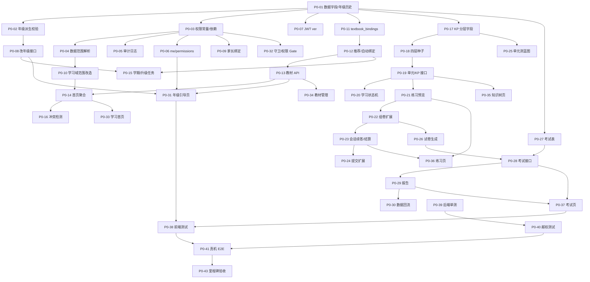
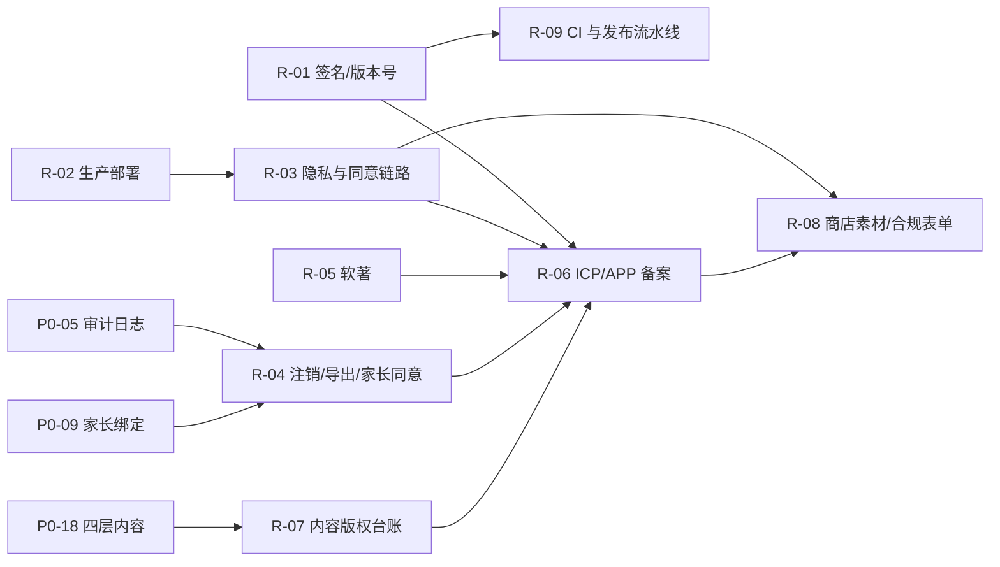

# 深爱学（AiLearning）项目实施任务计划与进度跟踪

> **文档性质**：项目主计划 / 进度跟踪 / 过程追溯（全程伴随开发周期）
> **版本**：v1.8
> **创建日期**：2026-11-06
> **最后更新**：2026-11-06 15:50（P0-07 JWT 版本校验完成）
> **参考设计文档**：见[§1.1 参考设计文档清单](#11-参考设计文档清单)（共 8 份，含 4 份设计方案、4 份支撑文档）
> **需求追踪**：见[§1.2 需求—设计—任务追踪矩阵](#12-需求设计任务追踪矩阵)
> **维护人**：项目负责人（PM）
> **更新频率**：每次开发会话结束必更；每日一次进度快照；里程碑专项评审

---

## 一、文档使用说明

### 1.1 参考设计文档清单

> 本计划的所有任务、验收标准均来源于下列文档。**需求变更必须先更新对应设计文档或登记 CR（§4.2），再调整本计划任务**，禁止"只改代码不改文档"。

| 编号 | 文档 | 版本 | 类型 | 覆盖范围 | 对应计划任务 | 维护人 | 状态 | 最后核对 |
|---|---|---|---|---|---|---|---|---|
| **D-01** | [k12-learning-app-design.md](./k12-learning-app-design.md) | v0.2 | 总体产品设计 | 产品定位、用户画像、信息架构、里程碑、技术栈 | 基线 B-01~B-05；P0 总体范围 | PM/AR | 已生效（M1/M2 基线） | 2026-11-06 |
| **D-02** | [subject-tutoring-and-m2-design.md](./subject-tutoring-and-m2-design.md) | v1.0 | 学科辅导专项设计 | 五大学法支柱、九学科分学段辅导方案、深圳教材适配、M2 数据模型与算法 | B-03/B-04；P0-17~P0-24；P1-07 | CT/AR | 已生效（M2 已交付） | 2026-11-06 |
| **D-03** | [user-role-permission-design.md](./user-role-permission-design.md) | v1.0 | 角色权限专项设计 | 多级角色体系、年级维度、权限矩阵、数据范围、权限校验、数据模型与 API | P0-01~P0-10；P1-01~P1-06；P2-01/P2-02 | AR/PM | 待实施（设计已评审） | 2026-11-06 |
| **D-04** | [learning-page-design.md](./learning-page-design.md) | v1.0 | 学习页专项设计 | 教材绑定、学习首页、知识点分层、智能练习、综合考试、数据流与 API | P0-11~P0-38；P1-07~P1-11；P2-03~P2-07 | FE/AR | 待实施（设计已评审） | 2026-11-06 |
| **D-05** | [privacy.md](./privacy.md) | v1.0（2026.11.06） | 合规支撑 | 隐私政策、未成年人数据、家长同意与数据留存 | P0-05/P0-09；P1-05；P2-08 | PM | 源稿（已更新为 K12 版，待公网发布） | 2026-11-06 |
| **D-06** | [skills.md](./skills.md) | 现行 | 工程支撑 | 开发规范、技能与接口使用说明 | 全部任务（开发约定） | AR | 已生效 | 2026-11-06 |
| **D-07** | [skill_github_repo_access.md](./skill_github_repo_access.md) | 现行 | 内部支撑 | 仓库访问与凭据说明（不进入版本库） | 发布/提交相关任务 | AR | 内部参考 | 2026-11-06 |
| **D-08** | [release-plan.md](./release-plan.md) | v1.0 | 发布支撑 | 上架缺口、渠道矩阵、备案/软著、合规红线、素材与时间线 | 发布任务 R-01~R-09；P0-05/P0-09、P1-05、P2-08 | PM/AR | 源稿（待执行） | 2026-11-06 |

**文档优先级**：需求冲突时，`D-01`（总体）> 专项设计（`D-02/D-03/D-04`）> 支撑文档（`D-05`~`D-08`）。专项之间冲突由 PM 裁决并登记 CR。发布相关的合规与上架要求以 `D-08` 为准。

**文档状态说明**：

| 状态 | 含义 |
|---|---|
| 草稿 | 编写中，不可作为开发依据 |
| 待实施（设计已评审） | 设计完成且通过评审，任务可启动 |
| 已生效 | 已落地并有代码/测试证据 |
| 待更新 | 实现与设计出现偏差，需同步修订或登记 CR |
| 废止 | 不再使用，需注明替代文档 |

### 1.2 需求—设计—任务追踪矩阵

> 用于回答三个问题：**这个需求出自哪份文档哪一章？由哪些任务实现？当前到哪一步？**

| 需求域 | 需求来源（文档 §） | 设计方案（文档 §） | 实现任务 | 验收编号 | 当前状态 |
|---|---|---|---|---|---|
| 多级角色体系与权限矩阵 | D-03 §3/§5 | D-03 §3/§5 | P0-03、P1-01、P1-04、P2-01、P2-02 | A8 | `DOING`（常量与鉴权依赖已落地） |
| 学生年级细分与必填 | D-03 §4/§7.1 | D-03 §4/§7.1、D-04 §4.5 | P0-01、P0-02、P0-08、P0-15、P0-31 | A1/A2/A9/L1 | `DOING`（P0-01/P0-02 已完成） |
| 数据访问范围控制 | D-03 §6 | D-03 §6 | P0-04、P0-10、P0-40 | A3/A4/A5/A6 | `DOING`（范围解析已落地，接口改造待 P0-10/P0-40） |
| 权限校验与审计 | D-03 §8 | D-03 §8 | P0-05、P0-07、P0-32、P0-39 | A7/A8/A10 | `DOING`（审计/`/me`/Token 失效已完成，待 P0-32/P0-39） |
| 家长绑定与未成年人合规 | D-03 §7.2、D-05 | D-03 §7.2/§10.2 | P0-09、P1-05 | A4 | `TODO` |
| 学校/教师组织能力 | D-03 §7.3/§7.4/§10.3 | D-03 §7.3/§7.4/§10.3 | P1-01~P1-06 | A5/A6 | `TODO` |
| 教材绑定与选择入口 | D-04 §4/§5 | D-04 §4/§5 | P0-11、P0-12、P0-13、P0-34、P0-16 | L1/L2/L3 | `TODO` |
| 学习首页与"下一步"入口 | D-04 §3/§6.6 | D-04 §3/§6.6 | P0-14、P0-33、P1-11 | L1/L14 | `TODO` |
| 知识点分层与学习路径 | D-02 学科方案、D-04 §6 | D-04 §6 | P0-17~P0-20、P0-35 | L4/L5 | `TODO` |
| 智能辅助练习 | D-02 学法、D-04 §7 | D-04 §7 | P0-21~P0-24、P0-36 | L6/L7/L8/L13 | `TODO` |
| 单元测试 | D-04 §8.1~§8.5 | D-04 §8 | P0-25~P0-30、P0-37 | L9/L10/L11/L12 | `TODO` |
| 期中/期末/模考 | D-04 §8.1~§8.5 | D-04 §8、D-03 §5.2 | P1-07~P1-10、P2-07 | L9~L12 | `TODO` |
| 主观题与报告增强 | D-04 §7.5/§8.5 | D-04 §7.5/§8.5 | P1-09、P1-10 | L11 | `TODO` |
| 推荐与学习闭环 | D-04 §2.2/§6.6 | D-04 §2.2/§6.6 | P1-11、P1-12 | 闭环验收 | `TODO` |
| 平台化与增强（RBAC/图谱/离线/AI） | D-03 §9.2、D-04 §14 | D-03 §9.2、D-04 §14 | P2-01~P2-10 | M4 | `TODO` |
| 上架合规与发布 | D-08 §3/§7 | D-08 §3/§6 | R-01~R-09、P0-05、P0-09、P1-05、P2-08 | 发布验收 | `TODO` |

**矩阵维护规则**：

1. 新增需求：先在对应设计文档补章节并升版本 → 在本矩阵新增一行 → 在 §3 台账新增任务（含依赖与验收映射）。
2. 需求变更：走 §4.2 CR 流程，更新"需求来源/设计方案"两列与任务状态。
3. 任务完成：同步更新"当前状态"列，并与 §5.1 快照、§6 里程碑保持一致。
4. 每次会话结束：核对本矩阵状态与台账是否一致；设计文档有改动时更新 §1.1 的"版本/最后核对"。

### 1.3 本文件的作用

1. **唯一任务台账**：所有开发任务在此登记，禁止口头/聊天记录替代。
2. **进度事实来源**：状态、实际工时、产出证据均以此为准。
3. **过程追溯依据**：需求变更、技术难点、阻塞与解决方案全部留痕。
4. **验收对照表**：每个任务对应设计文档的验收编号，便于逐项签署。
5. **需求—设计映射**：通过 §1.1 与 §1.2 可反查"需求出自哪、由谁实现、进展如何"。

### 1.4 角色与负责人代码

| 代码 | 角色 | 说明 |
|---|---|---|
| `PM` | 项目负责人 | 需求确认、优先级裁决、里程碑验收 |
| `AR` | 架构/后端 | 数据模型、API、算法、迁移 |
| `FE` | 前端 | Flutter 页面、交互、状态管理 |
| `QA` | 测试 | 接口/权限/真机/E2E/性能 |
| `CT` | 内容运营 | 教材、知识点、题库、试卷蓝图 |
| `ALL` | 协同 | 多人共同负责 |

> 当前执行模式：`AR`/`FE`/`QA` 由 Trae Agent 承担，`PM` 由用户承担（需求与验收），`CT` 由 Agent 生成 + `PM` 抽检。

### 1.5 状态定义与流转规则

| 状态 | 定义 | 进入条件 | 退出条件 |
|---|---|---|---|
| **待启动** `TODO` | 已登记，未开始 | 计划评审通过 | 开发人员领取并开始 |
| **进行中** `DOING` | 正在开发/测试 | 依赖任务全部 `DONE`；已建分支或已改代码 | 达成 DoD 并附证据 |
|  **已完成** `DONE` | 交付并通过验证 | DoD 全满足（代码 + 测试 + 证据） | 验收后一般不可回退；返工需走变更记录 |
| **阻塞中** `BLOCKED` | 无法继续推进 | 依赖未满足 / 环境故障 / 需求不明确 / 缺陷阻塞 | 阻塞解除后回到 `DOING` |

**流转约束**：

```
TODO ──领取──► DOING ──达成DoD──► DONE
                 │  ▲
              阻塞▼  │解除
                BLOCKED
DONE ──返工（需CR）──► DOING
```

- 禁止 `TODO → DONE` 跳步。
- 进入 `BLOCKED` 必须同时在[第四章问题记录](#四问题记录与解决方案)登记，注明影响与预计解除条件。
- 每日更新时必须同步：主台账、状态看板、变更记录、问题记录四处一致。

### 1.6 优先级定义

| 级别 | 含义 | 排期原则 |
|---|---|---|
| `P0` | 阻断主链路/合规风险 | 当前迭代必须完成 |
| `P1` | 核心体验与体系完整性 | P0 完成后进入 |
| `P2` | 增强与效率 | 按资源插入 |
| `P3` | 可选/长期 | 不占当前迭代 |

### 1.7 完成定义（DoD）

一个任务只有同时满足以下条件才可标记 `DONE`：

1. 代码已合入（或已写入工作区并通过检查）。
2. 相关单测/接口测试通过（后端 `pytest`，前端 `flutter test`）。
3. 静态检查通过（`ruff`/`dart analyze` 0 issue）。
4. 关键路径有可复现证据（接口响应、真机截图、日志片段）。
5. 对应设计文档验收项已勾选（见每任务 `验收映射`）。
6. 若涉及数据库：迁移脚本可在空库与存量库升级，且 `seed` 幂等。

---

## 二、基线：已完成能力（不计入本次新增工作）

| 编号 | 内容 | 状态 | 证据 |
|---|---|---|---|
| B-01 | M1 账号体系（注册/登录/JWT） | `DONE` | 现有 `/api/auth/*`，pytest 通过 |
| B-02 | 教材/章节/知识点/题目内容模型与种子（134 教材/112 章/170 KP/564 题） | `DONE` | `scripts/seed.py` 幂等运行 |
| B-03 | 掌握度 EMA、错题本 SM-2、自适应组卷、四题型判题 | `DONE` | `app/services/learning.py` + `tests/test_learn.py` |
| B-04 | 学习/错题本/我的 三 Tab 与答题闭环 | `DONE` | 真机冒烟记录（v0.3） |
| B-05 | Alembic 迁移与 SQLite 兼容 | `DONE` | `b3f1a2c77d8e` 迁移 |

> 基线已冻结。本次开发不重复实现上述能力，只在其上扩展。

---

## 三、任务台账

> **状态字段实时更新**；`实际(h)` 在任务完成时填写；`证据` 填 commit / 测试结果 / 截图路径。
> **总任务数**：77（开发 68：P0 43 + P1 15 + P2 10；发布 9：R-01~R-09）；**基线已完成**：5；**进行中**：0；**阻塞中**：0；**待启动**：77；**总预估工时**：676 h（开发 557 + 发布 119）。

### 3.1 阶段 P0：身份与学习主链路（当前迭代）

#### 3.1.1 数据与权限底座

| ID | 任务 | 负责人 | 预估(h) | 优先级 | 依赖 | 状态 | 实际(h) | 验收映射 | 证据 |
|---|---|---|---|---|---|---|---|---|---|
| P0-01 | 扩展 `users` 字段：`grade_group/semester/enrollment_year/region/token_version/grade_updated_at/graduated_at/teacher_subjects/grade_start/grade_end`；新增 `grade_histories` 表；迁移脚本（SQLite `batch_alter_table`） | AR | 6 | P0 | 无 | `DONE` | 3 | A2/A9 | `d7a9c3e5b210` 迁移；空库/存量库 upgrade→downgrade→upgrade 通过；存量回填 stage/grade_group；`tests/test_user_grade.py` 唯一约束+默认值用例通过 |
| P0-02 | 实现 `derive_stage/derive_grade_group` 与注册/资料更新校验（年级必填、学段一致性、选科限 10-12） | AR | 5 | P0 | P0-01 | `DONE` | 2 | A1/A2 | `app/core/grade.py`；注册返回 422 `GRADE_REQUIRED`/`STAGE_MISMATCH`/`ELECTIVE_ONLY_SENIOR`；pytest 29 passed |
| P0-03 | 权限常量表 `ROLE_PERMISSIONS`、`PERMISSION_SCOPE`；`require_permission`/`require_student_access` 依赖；`require_admin` 兼容改造 | AR | 8 | P0 | P0-01 | `DONE` | 5 | A8 | `app/core/permissions.py`（35 权限点+10 角色+范围映射）；`deps.py` 的 `require_permission`/`require_student_access`/`require_admin` 兼容；pytest 44 passed |
| P0-04 | 数据范围解析 `resolve_student_ids`（SELF/CHILD/CLASS/SCHOOL/ALL）与聚合脱敏工具 | AR | 6 | P0 | P0-03 | `DONE` | 4 | A3/A4/A5/A6 | `app/core/scope.py`（SELF/CHILD/SCHOOL/ALL 完整、CLASS 待 P1-01 返回空集安全默认）；`users.school_id` 迁移 `e1b2c3d4f5a6`；`mask_phone`；`tests/test_scope.py` 9 例；空库/存量库迁移通过 |
| P0-05 | 审计日志接入：登录失败、改角色、改年级、跨用户读取、导出（含 before/after） | AR | 4 | P0 | P0-03 | `DONE` | 2 | A10 | `app/services/audit.py`（detail JSON 含 before/after，1000 字截断）；登录失败/停用写 `auth.login_failed`/`auth.login_blocked`；`require_student_access` 跨用户读取写 `data.cross_user_read`；改角色/改年级/导出钩子随 P1-04/P0-08/P0-40 接入；`tests/test_audit.py` |
| P0-06 | `GET /api/auth/me` 扩展（`stage/grade_group/permissions`）与 `GET /api/auth/permissions` | AR | 3 | P0 | P0-03 | `DONE` | 2 | A8 | `MeOut`/`PermissionsOut`；`/auth/me` 返回 `stage/grade_group/permissions/scope`；`/auth/permissions` 独立查询；admin 兼容返回 `["*"]`/`ALL`；pytest 50 passed |
| P0-07 | JWT 增加 `ver`，角色/年级变更自增 `token_version`，旧 Token 失效 | AR | 3 | P0 | P0-01/P0-03 | `DONE` | 2 | A7 | `create_access_token` 写入 `ver`（旧 Token 无 `ver` 视为 0，兼容存量会话）；`get_current_user` 比对 `user.token_version`；`bump_token_version` 供角色/年级变更调用；`tests/test_token_version.py` 5 例 |
| P0-08 | 年级修改接口 `PUT /api/users/me/grade`（每学期限 1 次、二次确认令牌、影响提示） | AR | 5 | P0 | P0-02/P0-07 | `TODO` | — | A1/A9 | — |
| P0-09 | 家长绑定：`ParentChildBinding` 状态机（pending/active/revoked）、确认/解除、儿童账号同意校验 | AR | 8 | P0 | P0-03 | `TODO` | — | A4 | — |
| P0-10 | 学习域接口范围改造：`stats`/`wrong-questions` 支持 `student_id`，越权返回 `SCOPE_DENIED` | AR | 6 | P0 | P0-04 | `TODO` | — | A3/A4 | — |

#### 3.1.2 教材绑定与学习首页

| ID | 任务 | 负责人 | 预估(h) | 优先级 | 依赖 | 状态 | 实际(h) | 验收映射 | 证据 |
|---|---|---|---|---|---|---|---|---|---|
| P0-11 | 新增 `textbook_bindings` 表与迁移（唯一键、状态、学期归档） | AR | 4 | P0 | P0-01 | `TODO` | — | L2/L3 | — |
| P0-12 | 教材推荐与自动绑定服务（深圳版本优先级、开课科目、幂等 upsert） | AR | 6 | P0 | P0-11 | `TODO` | — | L2/L3 | — |
| P0-13 | 教材 API：`GET /me/textbooks`、`POST /me/textbooks/auto-bind`、`POST /me/textbooks/bind`、`DELETE /me/textbooks/{id}`、`GET /me/textbooks/recommend` | AR | 6 | P0 | P0-12 | `TODO` | — | L2/L3 | — |
| P0-14 | 学习首页聚合接口 `GET /api/learn/home`（当前教材、今日计划、继续学习、推荐、待办考试） | AR | 8 | P0 | P0-13/P0-10 | `TODO` | — | L1/L14 | — |
| P0-15 | 学期切换与年级升级定时任务（2 月/9 月、幂等 `grade_histories`、跨学段确认） | AR | 8 | P0 | P0-08/P0-12 | `TODO` | — | A9/L3 | — |
| P0-16 | 教材与年级冲突检测（`mismatch` 标记、接口告警、练习前拦截） | AR | 4 | P0 | P0-14 | `TODO` | — | L3/异常表 | — |

#### 3.1.3 四点：知识点分层与练习

| ID | 任务 | 负责人 | 预估(h) | 优先级 | 依赖 | 状态 | 实际(h) | 验收映射 | 证据 |
|---|---|---|---|---|---|---|---|---|---|
| P0-17 | `knowledge_points` 增加 `node_type/order_index/weight`，存量数据兼容（空 `parent_id` 视为 point 并补"默认节"） | AR | 4 | P0 | P0-01 | `TODO` | — | L4 | — |
| P0-18 | 内容种子改造：生成"单元→节→知识点"四层结构（小学 1-3 完整，4-12 样章），保持幂等 | CT/AR | 12 | P0 | P0-17 | `TODO` | — | L4 | — |
| P0-19 | 单元/节/知识点接口：`GET /learn/textbook/{id}/units`、`GET /learn/unit/{chapterId}`、`GET /learn/kp/{id}`（含前置、状态、历史） | AR | 8 | P0 | P0-17/P0-18 | `TODO` | — | L4/L5 | — |
| P0-20 | `kp_study_states` 表与状态机（未学习/学习中/待巩固/已掌握/复习中），讲解阅读与自测达标写入 | AR | 6 | P0 | P0-19 | `TODO` | — | L5 | — |
| P0-21 | 练习预览 `POST /learn/practice/preview`：题量、KP 覆盖、时长、seed，题量不足提示 | AR | 6 | P0 | P0-19 | `TODO` | — | L6/L8 | — |
| P0-22 | 组卷算法扩展：题型配比、KP 覆盖≥80%、去重、时长预算、到期错题≤25% | AR | 10 | P0 | P0-21 | `TODO` | — | L6/L7 | — |
| P0-23 | `practice_sessions` 表与续答/结算：`POST /learn/sessions/{id}/finish`、`GET /learn/sessions/{id}` | AR | 7 | P0 | P0-22 | `TODO` | — | L13 | — |
| P0-24 | 练习提交兼容扩展：`session_id/source` 写入、掌握度来源拆分 | AR | 4 | P0 | P0-23 | `TODO` | — | L12 | — |

#### 3.1.4 单元测试闭环

| ID | 任务 | 负责人 | 预估(h) | 优先级 | 依赖 | 状态 | 实际(h) | 验收映射 | 证据 |
|---|---|---|---|---|---|---|---|---|---|
| P0-25 | `exam_blueprints` 表与单元测蓝图种子（小学数学/语文/英语各 1 套） | CT/AR | 8 | P0 | P0-17 | `TODO` | — | L9 | — |
| P0-26 | 试卷生成服务（蓝图 + seed 稳定、题型/难度/覆盖约束、题量兜底） | AR | 10 | P0 | P0-25/P0-22 | `TODO` | — | L9 | — |
| P0-27 | `exams` 扩展 + `exam_attempts`/`exam_answers` 表与迁移 | AR | 6 | P0 | P0-01 | `TODO` | — | L10 | — |
| P0-28 | 考试接口：开始/续答、3 秒防抖保存、交卷幂等、客观自动判 | AR | 10 | P0 | P0-26/P0-27 | `TODO` | — | L10/L11 | — |
| P0-29 | 考试报告：总分、题型得分、KP 得分率、错题清单、下一步入口 | AR | 8 | P0 | P0-28 | `TODO` | — | L11/L12 | — |
| P0-30 | 考试数据回流：错题入库、掌握度按考试权重更新（单元测 0.8） | AR | 4 | P0 | P0-29 | `TODO` | — | L12 | — |

#### 3.1.5 前端 P0

| ID | 任务 | 负责人 | 预估(h) | 优先级 | 依赖 | 状态 | 实际(h) | 验收映射 | 证据 |
|---|---|---|---|---|---|---|---|---|---|
| P0-31 | 登录后年级引导页（3 步：学段→年级→教材确认），未完成强制拦截 | FE | 10 | P0 | P0-06/P0-08/P0-13 | `TODO` | — | L1 | — |
| P0-32 | 路由守卫 + `PermissionGate` + 403 错误统一处理（按业务码给引导） | FE | 6 | P0 | P0-03/P0-06 | `TODO` | — | A8 | — |
| P0-33 | 学习首页重构：当前教材卡、今日计划、继续学习、学科入口、考试入口 | FE | 12 | P0 | P0-14 | `TODO` | — | L1/L15 | — |
| P0-34 | 教材管理页：学科/学期切换、版本选择、推荐标识、冲突二次确认、解绑 | FE | 8 | P0 | P0-13 | `TODO` | — | L2/L3 | — |
| P0-35 | 单元/节/知识点树与详情页（掌握度环、状态、前置跳转、讲解/例题） | FE | 12 | P0 | P0-19/P0-20 | `TODO` | — | L4/L5 | — |
| P0-36 | 练习配置页 + 预览 + 答题页扩展（模式、续答、结算、下一步） | FE | 12 | P0 | P0-21/P0-23 | `TODO` | — | L8/L13 | — |
| P0-37 | 考试中心列表、考试详情/答题（计时、自动保存、交卷确认）、报告页 | FE | 16 | P0 | P0-28/P0-29 | `TODO` | — | L10/L11 | — |
| P0-38 | 前端单测/组件测试补充（模型解析、状态机、守卫） | FE/QA | 8 | P0 | P0-31~P0-37 | `TODO` | — | L15 | — |

#### 3.1.6 测试与验收 P0

| ID | 任务 | 负责人 | 预估(h) | 优先级 | 依赖 | 状态 | 实际(h) | 验收映射 | 证据 |
|---|---|---|---|---|---|---|---|---|---|
| P0-39 | 后端单测：年级派生、权限矩阵、范围解析、组卷约束、考试幂等 | QA/AR | 12 | P0 | P0-01~P0-30 | `TODO` | — | A1~A10/L6~L12 | — |
| P0-40 | 越权专项测试：跨学生、跨班级、跨学校、pending 绑定、旧 Token | QA | 6 | P0 | P0-39 | `TODO` | — | A3~A7 | — |
| P0-41 | 真机 E2E：年级引导→首页→四层下钻→练习→单元测→报告→错题复习 | QA | 8 | P0 | P0-31~P0-38 | `TODO` | — | L1~L15 | — |
| P0-42 | 迁移/种子回归：空库升级、存量库升级、seed 二次幂等 | QA/AR | 4 | P0 | P0-18/P0-25 | `TODO` | — | 基线约束 | — |
| P0-43 | P0 里程碑验收与文档同步（更新本计划、设计文档差异） | PM | 3 | P0 | P0-39~P0-42 | `TODO` | — | — | — |

> **P0 小计**：43 项，预估 **310 h**（AR 173、FE 84、CT 20、QA 30、PM 3；CT/AR 协同任务按主责计一次）。

### 3.2 阶段 P1：角色扩展与综合考试

| ID | 任务 | 负责人 | 预估(h) | 优先级 | 依赖 | 状态 | 实际(h) | 验收映射 | 证据 |
|---|---|---|---|---|---|---|---|---|---|
| P1-01 | 教师/班主任/校管角色与 `schools/classes/class_members/teacher_class_assignments` 表 | AR | 10 | P1 | P0-03 | `TODO` | — | A5/A6 | — |
| P1-02 | 班级与授课分配 API、教师年级/学科范围校验 | AR | 8 | P1 | P1-01 | `TODO` | — | A5 | — |
| P1-03 | 班级学情聚合接口（仅聚合值，不泄露逐题原文） | AR | 8 | P1 | P1-02/P0-04 | `TODO` | — | A5/6.5 | — |
| P1-04 | 管理端用户列表与角色授予/回收（禁止自授超管、本校范围） | AR | 8 | P1 | P1-01 | `TODO` | — | A6/A8 | — |
| P1-05 | 家长端页面：切换孩子、孩子学情、时长与青少年模式 | FE | 12 | P1 | P0-09 | `TODO` | — | A4 | — |
| P1-06 | 教师端页面：班级概览、班级报告（聚合） | FE | 12 | P1 | P1-03 | `TODO` | — | A5 | — |
| P1-07 | 期中/期末蓝图与组卷（范围=章节集合、6:3:1 难度、KP 覆盖） | CT/AR | 10 | P1 | P0-26 | `TODO` | — | L9 | — |
| P1-08 | 考试中心扩展：期中/期末/模考入口、考试窗口与过期处理 | AR/FE | 10 | P1 | P0-37/P1-07 | `TODO` | — | L10 | — |
| P1-09 | 主观题自评：参考答案、评分点、自评量表、成绩回写 | AR/FE | 10 | P1 | P0-29 | `TODO` | — | L11 | — |
| P1-10 | 报告增强：能力维度雷达、班级平均（有班级时）、趋势对比 | AR/FE | 8 | P1 | P1-09/P1-03 | `TODO` | — | L11 | — |
| P1-11 | 推荐服务：今日计划生成规则（复习→薄弱→单元测→进度→每日一练） | AR | 8 | P1 | P0-14/P0-20 | `TODO` | — | 6.6 | — |
| P1-12 | 错题与考试联动优化：考试错题错因默认分类、复习优先级 | AR | 4 | P1 | P0-30 | `TODO` | — | L12 | — |
| P1-13 | 性能优化：首页聚合缓存、学情统计缓存失效策略 | AR | 6 | P1 | P0-14 | `TODO` | — | L14 | — |
| P1-14 | P1 测试与真机回归 | QA | 12 | P1 | P1-01~P1-13 | `TODO` | — | — | — |
| P1-15 | P1 里程碑验收与计划同步 | PM | 3 | P1 | P1-14 | `TODO` | — | — | — |

> **P1 小计**：15 项，预估 **129 h**。

### 3.3 阶段 P2：平台化与增强

| ID | 任务 | 负责人 | 预估(h) | 优先级 | 依赖 | 状态 | 实际(h) | 验收映射 | 证据 |
|---|---|---|---|---|---|---|---|---|---|
| P2-01 | RBAC 表上线（`roles/permissions/role_permissions/user_roles`）与双写/对账 | AR | 12 | P2 | P1-04 | `TODO` | — | 9.2 | — |
| P2-02 | 权限配置后台（角色-权限可视化） | AR/FE | 12 | P2 | P2-01 | `TODO` | — | 9.1 | — |
| P2-03 | 教师布置作业/班级统一卷、批改主观题 | AR/FE | 16 | P2 | P1-09/P1-02 | `TODO` | — | 8.1/5.2 | — |
| P2-04 | 知识图谱视图（前置依赖可视化、薄弱高亮） | FE | 10 | P2 | P0-19 | `TODO` | — | 6.2 | — |
| P2-05 | 图片作答与离线整卷（本地队列、断网重放） | FE/AR | 16 | P2 | P0-23 | `TODO` | — | 13 章 | — |
| P2-06 | AI 讲解与错题归因辅助（LLM 接入、Prompt 安全） | AR | 16 | P2 | P0-19 | `TODO` | — | 6.4 | — |
| P2-07 | 模考与真题库、考试窗口与公平性（同班同卷） | CT/AR | 12 | P2 | P1-08 | `TODO` | — | 8.3 | — |
| P2-08 | 数据导出与合规审计增强（脱敏导出、用途登记） | AR | 6 | P2 | P0-05 | `TODO` | — | A10 | — |
| P2-09 | 内容审核双人复核流程 | AR/FE | 8 | P2 | P0-05 | `TODO` | — | 5.3 | — |
| P2-10 | P2 回归与验收 | QA/PM | 10 | P2 | P2-01~P2-09 | `TODO` | — | — | — |

> **P2 小计**：10 项，预估 **118 h**。

### 3.4 发布与合规任务（R，来源 D-08）

> 本组任务来自 [release-plan.md](./release-plan.md) §3 的 8 项上架缺口，按"可执行项"拆分。**发布任务不重复开发任务**：凡与 P0/P1/P2 重叠的，以开发任务为实施主体，R 任务负责补齐商店与法规硬性要求并做发布验收。

| ID | 任务（可执行项） | 负责人 | 预估(h) | 优先级 | 依赖 | 状态 | 实际(h) | 缺口/验收 | 证据 |
|---|---|---|---|---|---|---|---|---|---|
| R-01 | 正式签名与构建纪律：生成 release keystore（`make-release-keystore.ps1`）+ 备份；`build.gradle.kts` release 缺 keystore 时 fail-fast（禁止回退 debug）；统一 Android/HarmonyOS `versionCode` 规则（`1.0.0+1 → 10001`）；导出签名 MD5/SHA-256；AGC 正式签名证书与 Profile | AR | 5 | P0 | 无 | `TODO` | — | 缺口1 / R-A1 | — |
| R-02 | 后端生产化部署：云主机 + 域名 + HTTPS；切 PostgreSQL + `alembic upgrade head` + `seed.py`；密钥环境变量化；CORS 白名单、登录/注册限流、错误脱敏；每日备份与恢复演练；审计日志留存 ≥6 个月 | AR | 16 | P0 | 无 | `TODO` | — | 缺口3 / R-A2 | — |
| R-03 | 隐私政策公网发布 + App 内法务与同意链路：后端 `GET /legal/privacy`、`/legal/terms`（HTTPS、免登录）；「我的」页新增隐私政策/用户协议/联系我们；首启 ConsentGate（主动勾选、拒绝退出、无网络请求）；儿童注册监护人确认；政策版本升高重新同意并留痕 | AR/FE | 20 | P0 | R-02 | `TODO` | — | 缺口2 / R-A3 | — |
| R-04 | 商店硬性合规功能：账号注销（15 个工作日删除/匿名化）+ 数据导出（最小可用版）；家长绑定与 `consent_at` 生效；`daily_limit_minutes` 青少年模式生效；敏感操作审计（完整脱敏导出与用途登记仍由 P2-08 承接） | AR/FE | 20 | P0 | P0-05、P0-09 | `TODO` | — | 缺口8 / R-A4 | — |
| R-05 | 软著申请：整理源码 60 页（`app/lib` + `backend/app`）+ 操作说明书 + CPCC 线上提交（加急）+ 登记号归档（名称建议"深爱学学习辅助软件"） | PM/CT | 12 | P1 | 无（第 1 天启动） | `TODO` | — | 缺口5 / R-A5 | — |
| R-06 | 备案：域名 ICP 备案 → 导出签名 MD5 → 华为/小米商店侧 APP 备案（包名、签名、隐私 URL、SDK"无"）→ 备案号回填后端并在关于页展示 → 固化包名/签名不可变更 | PM/AR | 8 | P1 | R-01、R-03、R-05 | `TODO` | — | 缺口4 / R-A6 | — |
| R-07 | 内容版权与教育合规：建立《题源与授权台账》（来源/授权凭证/录入/审核）；商店与 App 内免责声明；删除"官方教材/名师/提分/押题"表述；举报入口与 24h 下架流程演练 | CT/AR/FE | 16 | P0 | P0-18 | `TODO` | — | 缺口6 / R-A7 | — |
| R-08 | 商店素材与合规表单：图标/特性图/截图（无教材封面与真实学生信息）、文案模板适配；Data Safety、目标受众与 Families、IARC 分级、华为隐私标签 | PM/QA | 12 | P1 | R-03 | `TODO` | — | 缺口7 / R-A8 | — |
| R-09 | 发布流水线与监控：`ci.ps1`（analyze/pytest/flutter test → build APK/AAB/HAP → `apksigner` 校验 → 产物归档 → git tag）；接入崩溃与错误监控；发布检查表自动化 | AR/QA | 10 | P2 | R-01 | `TODO` | — | 缺口8 / R-A9 | — |

> **R 小计**：9 项，预估 **119 h**（P0 5 项 77 h；P1 3 项 32 h；P2 1 项 10 h）。

#### 3.4.1 缺口 → 任务映射（发布验收口径）

| release-plan 缺口 | 对应 R 任务 | 关联开发任务 | 验收编号 |
|---|---|---|---|
| 缺口 1 正式签名与构建纪律 | R-01 | — | R-A1 |
| 缺口 2 隐私 URL + App 内同意链路 | R-03 | P0-05、P0-09（同意/审计底座） | R-A3 |
| 缺口 3 后端生产化部署 | R-02 | — | R-A2 |
| 缺口 4 APP 备案 | R-06 | — | R-A6 |
| 缺口 5 软件著作权 | R-05 | — | R-A5 |
| 缺口 6 内容版权与教育合规 | R-07 | P0-18（四层内容种子） | R-A7 |
| 缺口 7 商店素材与合规表单 | R-08 | — | R-A8 |
| 缺口 8 产品侧合规功能与发布工程 | R-04、R-09 | P0-05、P0-09、P1-05（完整增强另见 P2-08） | R-A4/R-A9 |

**发布验收编号（R-A1~R-A9）**

| 编号 | 判定标准 |
|---|---|
| R-A1 | 删除 `keystore.properties` 后 release 构建**失败**；有签名时 `apksigner` 证书 CN=AiLearning；Android 与 HarmonyOS `versionCode` 相同；MD5 已归档 |
| R-A2 | 公网 `https://<域名>/health` 返回 200；明文 HTTP 被客户端拒绝；备份可恢复演练通过；审计日志留存 ≥6 个月 |
| R-A3 | 隐私 URL 公网可直接打开且与 App 内一致；首启必须主动勾选才能进入；拒绝同意后无任何网络请求；政策版本升级触发重新同意且留痕 |
| R-A4 | 注销入口可用并在 15 个工作日内完成；数据导出可用；儿童账号无 `active` 绑定 + `consent_at` 时功能受限；时长上限生效；敏感操作全部审计留痕 |
| R-A5 | 取得软著受理号/证书，登记号归档 |
| R-A6 | APP 备案号下发并在 App 关于页展示；包名/签名与备案一致 |
| R-A7 | 题源台账覆盖首批内容；免责声明上线；举报入口可用；24h 下架流程演练通过 |
| R-A8 | 素材无版权/隐私瑕疵；Data Safety、Families、IARC、华为隐私标签均提交 |
| R-A9 | 一条命令完成 analyze/test/build/签名校验/tag；产物可追溯；崩溃监控有数据 |

### 3.5 依赖关系图（P0 与发布）





> **发布关键路径**：R-01 → R-02 → R-03 → R-06（备案）→ R-08 → 提审；R-05 软著为最长外部周期，须第 1 天启动。R-04 依赖 P0-05/P0-09 完成后方可验收。

---

## 四、问题记录与解决方案

> 记录开发过程中的**技术难点、需求变更、阻塞问题、缺陷**；每条必须填写处理时间与结论。
> 状态：`OPEN` 待处理 / `RESOLVED` 已解决 / `MITIGATED` 已规避 / `DEFERRED` 延后。

### 4.1 问题台账

| ID | 日期 | 类型 | 描述 | 影响任务 | 严重度 | 处理人 | 解决方案 | 处理用时 | 状态 |
|---|---|---|---|---|---|---|---|---|---|
| I-001 | 2026-11-06 | 风险（数据） | 存量学生账号大量 `grade` 为空，直接强制必填会阻断登录 | P0-02/P0-31 | 高 | AR/PM | 采用"登录后强制引导 + 未完成仅开放公开浏览"的灰度策略；不回填猜测年级 | 待验证 | `OPEN` |
| I-002 | 2026-11-06 | 风险（内容） | 部分知识点题量不足（<8 题），组卷 KP 覆盖 ≥80% 可能无法满足 | P0-22/P0-26 | 中 | CT/AR | 预览接口前置返回 `insufficient`；组卷按"同章→同学科→降难度"兜底；运营补齐题量 | 待验证 | `OPEN` |
| I-003 | 2026-11-06 | 技术 | SQLite 对已有表加外键/约束需 `batch_alter_table`，否则迁移失败 | P0-01/P0-27 | 中 | AR | 已有 v0.3 经验，统一使用 batch 模式；迁移在空库与存量库各跑一次 | 已预置 | `MITIGATED` |
| I-004 | 2026-11-06 | 技术 | 断言 `autoflush=False` 下新对象默认值不落库，导致掌握度/错题为空 | P0-24/P0-30 | 中 | AR | 写操作显式 `db.flush()`；新对象显式赋默认值；补单测 | 已修复（v0.3） | `MITIGATED` |

### 4.2 需求变更记录（CR）

| CR ID | 日期 | 变更内容 | 提出人 | 影响范围 | 决策 | 决策人 | 关联任务 |
|---|---|---|---|---|---|---|---|
| — | — | 暂无 | — | — | — | — | — |

> 变更流程：提出 → 影响评估（任务/工时/验收） → PM 裁决 → 更新本表与任务台账 → 通知相关方。

### 4.3 阻塞记录

| 阻塞 ID | 日期 | 任务 | 阻塞原因 | 解除条件 | 责任人 | 预计解除 | 状态 |
|---|---|---|---|---|---|---|---|
| — | — | — | 暂无 | — | — | — | — |

---

## 五、进度快照与同步机制

### 5.1 当前进度快照（2026-11-06 开发启动后）

| 指标 | 数值 |
|---|---|
| 任务总数（不含基线） | 77（开发 68：P0 43 + P1 15 + P2 10；发布 9：R-01~R-09） |
| `TODO` | 70 |
| `DOING` | 0 |
| `DONE` | 7（P0-01~P0-07；基线 5 项已冻结） |
| `BLOCKED` | 0 |
| 预估总工时 | 676 h（开发 557 = P0 310 + P1 129 + P2 118；发布 119） |
| 已投入工时 | 20 h（P0-01 3、P0-02 2、P0-03 5、P0-04 4、P0-05 2、P0-06 2、P0-07 2） |
| 当前迭代 | P0（身份与学习主链路）+ 发布准备（R-05 软著先行） |
| 迭代目标 | 年级必填与引导、教材绑定、学习首页、四层知识点、练习预览/续答、单元测客观题闭环；并行启动软著与签名/隐私/部署 |
| 里程碑 | M2.5（P0 完成）→ M5（发布就绪） |

### 5.2 同步节奏

| 频率 | 动作 | 责任人 | 产出 |
|---|---|---|---|
| 每次开发会话结束 | 更新任务状态、实际工时、证据；登记新问题 | 执行人（AR/FE/QA） | 本文件 §3/§4/§5.1 更新 |
| 每日 | 生成进度快照（完成数、阻塞数、偏差） | PM | §5.1 覆盖更新 + 会话汇报 |
| 每周 | 计划偏差评审：延期任务、优先级调整、风险复盘 | PM + 执行人 | §5.4 周报摘要 |
| 每个里程碑 | 验收签署、文档差异回写、基线冻结 | PM | 里程碑记录 + 设计文档更新 |

### 5.3 状态更新检查清单（每次会话结束自查）

- [ ] 所有 `DOING` 任务是否填写了实际工时与证据？
- [ ] 是否有任务满足 DoD 但未标记 `DONE`？
- [ ] `BLOCKED` 任务是否都在 §4.3 有记录且写了解除条件？
- [ ] 新发现的技术难点/需求变更是否进入 §4.1/§4.2？
- [ ] §5.1 快照数字是否与 §3 台账一致（总数、各状态数、工时）？
- [ ] 若完成里程碑，是否同步更新设计文档与验收记录？

### 5.4 周报摘要模板

```
周次：YYYY-Www
完成任务：P0-xx, P0-yy（附证据链接）
进行中：P0-zz（进度 xx%，剩余 xxh）
阻塞：I-xxx（原因 / 解除条件 / 责任人）
偏差：计划 xxh vs 实际 xxh（原因与纠偏）
风险：新增风险与应对
下周计划：任务清单
需 PM 决策：事项列表（若无写"无"）
```

### 5.5 更新记录（Changelog）

| 版本 | 日期 | 更新人 | 变更摘要 |
|---|---|---|---|
| v1.0 | 2026-11-06 | AR | 初始计划：拆分 P0/P1/P2 共 68 项任务；建立状态机制、问题台账、同步节奏；登记 4 条已知风险/经验 |
| v1.1 | 2026-11-06 | AR | 新增 §1.1 参考设计文档清单（D-01~D-07）与 §1.2 需求—设计—任务追踪矩阵，建立"需求→设计→任务→验收"双向追溯；补充文档优先级与状态规则；修正小节编号重复 |
| v1.2 | 2026-11-06 | AR | 文档清单新增 D-08 `release-plan.md`（发布方案，源稿）；同步更新文档数量（8 份）与优先级说明 |
| v1.3 | 2026-11-06 | AR | 新增 §3.4 发布与合规任务 R-01~R-09（119 h）与缺口→任务映射、发布验收 R-A1~R-A9、发布依赖图；新增 M5 发布就绪里程碑；总任务数 68→77，总工时 557→676 h |
| v1.4 | 2026-11-06 | AR | 开发启动：P0-01（users 年级维度 + grade_histories 迁移）、P0-02（年级派生与注册校验）标记 DONE 并补充证据；§5.1 快照同步（DONE 2 / 投入 5 h）；A1/A2 对应任务转 `DOING` |
| v1.5 | 2026-11-06 | AR | P0-03 权限底座落地（35 权限点 + 角色映射 + 范围映射 + `require_permission`/`require_admin`），标记 `DOING`（`require_student_access` 随 P0-04 完成）；§5.1 同步（DOING 1 / 投入 9 h） |
| v1.6 | 2026-11-06 | AR | P0-04 数据范围解析落地（SELF/CHILD/SCHOOL/ALL，CLASS 待 P1-01）、`users.school_id` 迁移 `e1b2c3d4f5a6`、`require_student_access` 完成，P0-03/P0-04 转 DONE；§5.1 同步（DONE 4 / 投入 14 h） |
| v1.7 | 2026-11-06 | AR | P0-05 审计服务落地（登录失败/停用/跨用户读取 + before/after）；P0-06 `/auth/me` 扩展与 `/auth/permissions` 上线；P0-05/P0-06 转 DONE；§5.1 同步（DONE 6 / 投入 18 h / pytest 50） |
| v1.8 | 2026-11-06 | AR | P0-07 JWT `ver` 与 `token_version` 校验落地（兼容旧 Token），`bump_token_version` 供角色/年级变更调用；A7 验收通过；§5.1 同步（DONE 7 / 投入 20 h / pytest 55） |
| — | — | — | — |

---

## 六、里程碑与验收台账

| 里程碑 | 包含任务 | 验收标准 | 计划状态 | 完成日期 | 验收人 |
|---|---|---|---|---|---|
| **M2.5（P0）** | P0-01 ~ P0-43 | 年级必填与引导可用；教材绑定生效；学习首页聚合；四层知识点可下钻；练习预览=实际、可续答；单元测可组卷/交卷/报告；错题与掌握度回流；权限越权测试全通过；真机 E2E 通过 | `TODO` | — | PM |
| **M3（P1）** | P1-01 ~ P1-15 | 教师/班主任/校管可用；家长端可用；期中/期末/模考闭环；主观题自评与报告增强；推荐服务上线 | `TODO` | — | PM |
| **M4（P2）** | P2-01 ~ P2-10 | RBAC 表与配置后台；教师作业；图谱；离线；AI 讲解；合规导出 | `TODO` | — | PM |
| **M5（发布就绪）** | R-01 ~ R-09 | 正式签名可验证；生产后端 HTTPS 可用；隐私 URL 与首启同意链路可用；注销/导出/家长同意/时长生效；软著受理；APP 备案下发；内容授权台账与免责声明上线；商店素材与表单齐备；发布流水线可追溯 | `TODO` | — | PM |

### 6.1 P0 验收对照（摘自设计文档）

| 编号 | 验收项 | 对应任务 | 状态 |
|---|---|---|---|
| A1/A2 | 年级必填 + 学段一致性 | P0-02/P0-08/P0-31 | `DOING`（后端校验已完成，待 P0-08/P0-31） |
| A3~A6 | 越权拦截（学生/家长/教师/校管） | P0-04/P0-10/P0-40 | `TODO` |
| A7 | 角色变更旧 Token 失效 | P0-07 | `DONE`（`ver` 校验 + `bump_token_version`） |
| A8 | 权限点覆盖所有路由 | P0-03/P0-32/P0-39 | `TODO` |
| A9 | 升级幂等 | P0-01/P0-15/P0-42 | `TODO` |
| A10 | 敏感操作审计 | P0-05 | `TODO` |
| L1 | 3 步内完成年级+教材确认 | P0-31 | `TODO` |
| L2/L3 | 教材绑定幂等、上下册不混排 | P0-11~P0-13/P0-34 | `TODO` |
| L4/L5 | 四层下钻、状态与掌握度 | P0-17~P0-20/P0-35 | `TODO` |
| L6/L7 | 覆盖率≥80%、错题占比≤25% | P0-22/P0-39 | `TODO` |
| L8 | 预览=实际（同 seed） | P0-21/P0-36 | `TODO` |
| L9~L12 | 组卷/交卷幂等/报告/数据回流 | P0-25~P0-30/P0-39 | `TODO` |
| L13 | 断点续答 | P0-23/P0-36 | `TODO` |
| L14 | 首页聚合 P95<300ms | P0-14/P1-13 | `TODO` |
| L15 | 权限范围与验收 | P0-10/P0-40/P0-41 | `TODO` |

---

## 七、开发执行约定

1. **分支与提交**：每个任务独立小步提交，提交信息含任务 ID（如 `P0-03: RBAC 权限依赖`）。
2. **迁移顺序**：先迁移后种子；迁移必须同时验证"空库升级"与"存量库升级"。
3. **接口兼容**：现有 `/api/learn/*` 与 `/api/practice/*` 保持兼容，新增参数可空、默认行为不变。
4. **权限先行**：涉及他人数据的接口必须先接入 `require_permission` + 范围解析，再实现业务查询。
5. **测试前置**：每个后端任务至少 1 个单测；每个前端页面至少 1 个模型/状态测试。
6. **文档同步**：实现与设计不一致时，先更新设计文档或登记 CR，再改代码。
7. **真机验证**：涉及页面的 P0 任务完成后，在 EBG 真机（`2NSDU20423005421`）走一遍主链路。
8. **计划更新**：每次会话结束按 §5.3 清单更新本文件，保持"台账-看板-快照"一致。

---

> **当前下一步**：P0-08（`PUT /api/users/me/grade`：每学期限 1 次、二次确认、审计与 Token 失效）。所有任务按依赖图推进，每日更新 §5.1 快照与 §4 问题台账。
